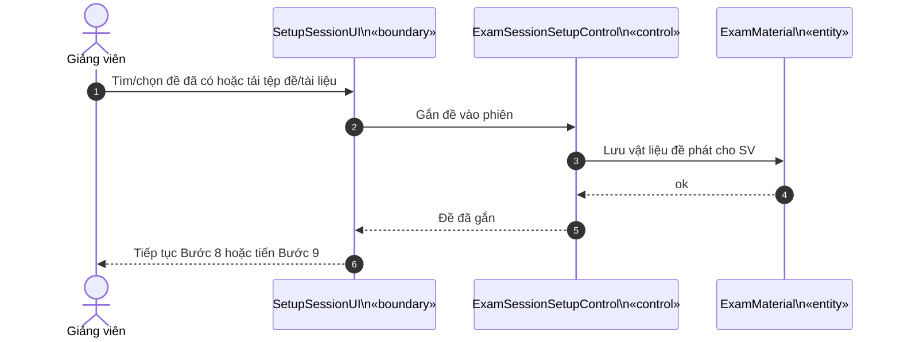
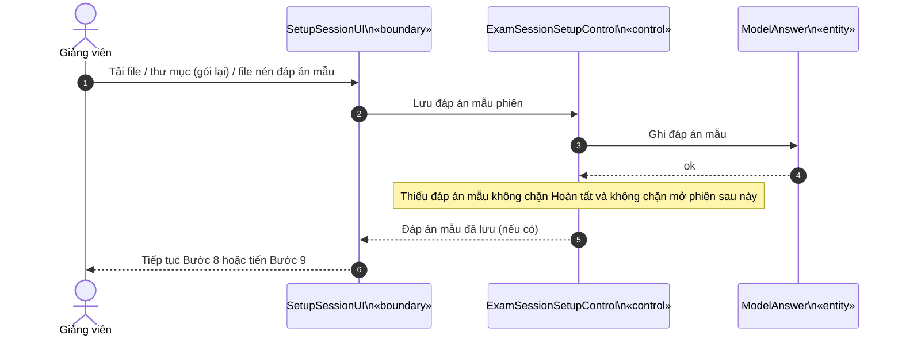
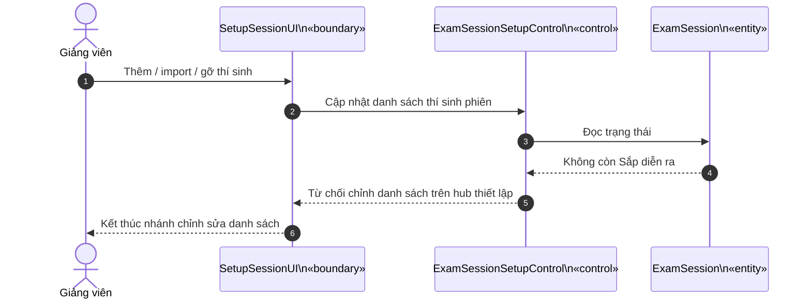
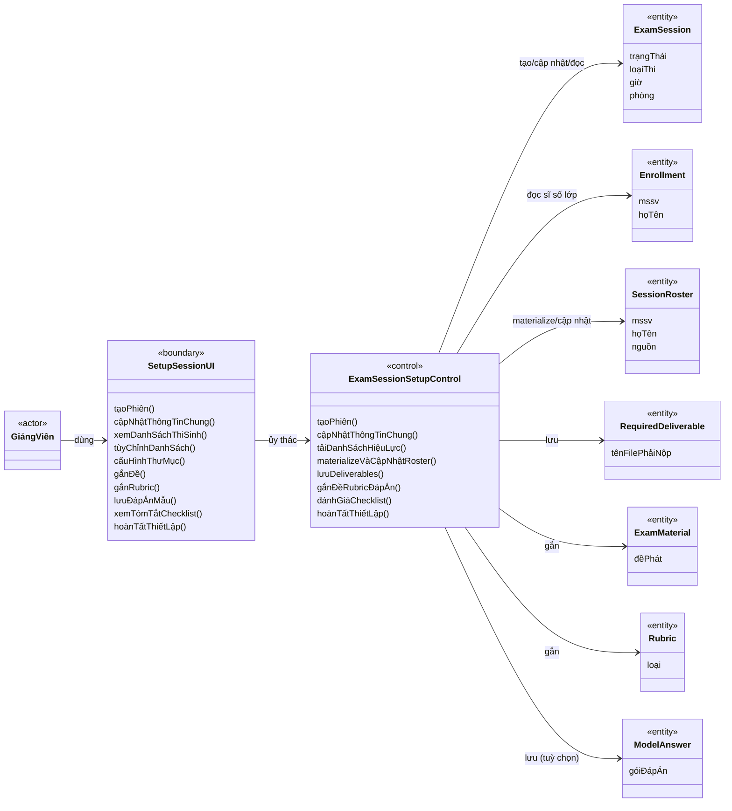

# Sequence diagram UC-EXM-02 — Thiết lập phiên thi (BCE, mức nghiệp vụ)

**Use case:** UC-EXM-02 — [Đặc tả rút gọn](./usecase-spec-thiet-lap-phien-thi-rut-gon.md)  
**Phương pháp:** Jacobson BCE — Boundary · Control · Entity  
**Mức độ:** Nghiệp vụ (thông điệp theo hành vi use case; không mô tả HTTP status, DTO, guard hay lớp kỹ thuật chi tiết)

```text
[Actor] <---> [Boundary] <---> [Control] <---> [Entity]
                                    |
                                    +---> [Control khác]
```

**Tiền điều kiện:** Giảng viên đã đăng nhập; có lớp học phần được phân công.

**Ngoài phạm vi sơ đồ:** Mở phiên thi, điểm danh, thu bài, chấm điểm, huỷ phiên, đổi giảng viên phụ trách.

---

## 1. Ánh xạ BCE (nghiệp vụ)

| BCE | Đối tượng | Vai trò nghiệp vụ |
| --- | --- | --- |
| Actor | Giảng viên | Tạo và hoàn thiện thiết lập ca thi trước khi mở cửa |
| Boundary | `SetupSessionUI` | Form tạo phiên + hub Thiết lập (các bước Thông tin chung, Danh sách thí sinh, Thư mục bài làm, Đề thi & Rubric, Xác nhận) |
| Control | `ExamSessionSetupControl` | Điều phối tạo phiên, cập nhật thiết lập, đọc danh sách hiệu lực, checklist sẵn sàng, hoàn tất thiết lập |
| Entity | `ExamSession` | Phiên thi (trạng thái **Sắp diễn ra**, loại thi, giờ, phòng, tên, lớp, môn, học kỳ) |
| Entity | `Enrollment` | Sĩ số lớp học phần - nguồn danh sách mặc định khi chưa tùy chỉnh phiên |
| Entity | `SessionRoster` | Danh sách thí sinh theo phiên (sau materialize / thêm / import / gỡ) |
| Entity | `RequiredDeliverable` | File sinh viên phải nộp trong thư mục bài làm |
| Entity | `ExamMaterial` | Đề / tài liệu phát cho sinh viên |
| Entity | `Rubric` | Rubric gắn vào phiên để chấm |
| Entity | `ModelAnswer` | Đáp án mẫu (tuỳ chọn) phục vụ chấm |

**Quy tắc BCE trên sơ đồ:**

| Quy tắc | Áp dụng |
| --- | --- |
| Actor chỉ nói chuyện với Boundary | Không Actor → Control / Entity |
| Boundary không đụng Entity | Mọi nghiệp vụ qua Control |
| Entity không gọi Control / Boundary | Chỉ trả / nhận dữ liệu |
| Hoàn tất ≠ Mở phiên | Control ghi thiết lập + đánh giá checklist; **không** chuyển phiên sang Đang thi |

**Không vẽ:** cookie/token, ValidationPipe, kho object storage chi tiết, sessionStorage nháp kỹ thuật (chỉ thể hiện ý “giữ tạm trên máy giảng viên” khi cần ở luồng thay thế).

---

## 2. Luồng chính — Tạo phiên đến Hoàn tất thiết lập

### 2.1 Mermaid

```mermaid
sequenceDiagram
  autonumber
  actor GV as Giảng viên
  participant UI as SetupSessionUI\n«boundary»
  participant Ctrl as ExamSessionSetupControl\n«control»
  participant Session as ExamSession\n«entity»
  participant Enroll as Enrollment\n«entity»
  participant Deliverable as RequiredDeliverable\n«entity»
  participant Material as ExamMaterial\n«entity»
  participant Rubric as Rubric\n«entity»
  participant Answer as ModelAnswer\n«entity»

  Note over GV,Answer: Bước 1–3 — Tạo phiên (Sắp diễn ra)
  GV ->> UI: Mở tạo phiên; chọn lớp, phòng, loại thi, tên, giờ bắt đầu/kết thúc; xác nhận tạo
  UI ->> Ctrl: Tạo phiên thi (lớp, phòng, loại thi, tên, giờ)
  Ctrl ->> Ctrl: Kiểm tra dữ liệu tạo (bắt buộc, end > start, lớp/phòng thuộc phạm vi GV)
  Ctrl ->> Session: Lưu phiên trạng thái Sắp diễn ra
  Session -->> Ctrl: Phiên đã tạo
  Ctrl -->> UI: Mở hub Thiết lập phiên thi
  UI -->> GV: Hub ở bước Thông tin chung

  Note over GV,Answer: Bước 4 — Thông tin chung
  GV ->> UI: Xem mã/môn/lớp/học kỳ (chỉ đọc); chỉnh loại thi, thời gian, phòng nếu cần
  UI ->> Ctrl: Cập nhật thông tin chung (loại thi, giờ, phòng) khi có thay đổi
  Ctrl ->> Session: Ghi loại thi / giờ / phòng (khi còn Sắp diễn ra)
  Session -->> Ctrl: Đã cập nhật
  Ctrl -->> UI: Thông tin chung hiện hành

  Note over GV,Answer: Bước 5–6 — Danh sách thí sinh (mặc định theo lớp)
  UI ->> Ctrl: Tải danh sách thí sinh hiệu lực
  Ctrl ->> Enroll: Đọc sĩ số lớp học phần (chưa tùy chỉnh phiên)
  Enroll -->> Ctrl: Danh sách mặc định
  Ctrl -->> UI: Hiển thị danh sách mặc định từ sĩ số lớp
  UI -->> GV: Bước Danh sách thí sinh — xem; giữ nguyên (mặc định) hoặc tùy chỉnh (xem 6a)
  GV ->> UI: Giữ nguyên danh sách theo lớp; chuyển bước tiếp theo

  Note over GV,Answer: Bước 7 — Thư mục bài làm
  GV ->> UI: Khai báo file phải nộp (≥ 1 khi muốn đủ điều kiện mở sau); xem preview nếu có
  UI ->> Ctrl: Lưu cấu hình thư mục bài làm
  Ctrl ->> Deliverable: Thay thế danh sách file phải nộp
  Deliverable -->> Ctrl: Đã lưu
  Ctrl -->> UI: Cấu hình thư mục + preview
  UI -->> GV: Chuyển bước tiếp theo

  Note over GV,Answer: Bước 8 — Đề thi & Rubric (có thể dùng 8a/8b/8c)
  GV ->> UI: Gắn/tải đề; gắn rubric; có thể thêm đáp án mẫu
  UI ->> Ctrl: Gắn đề phát / gắn rubric / lưu đáp án mẫu (tuỳ chọn)
  Ctrl ->> Material: Gắn vật liệu đề vào phiên
  Ctrl ->> Rubric: Gắn rubric vào phiên
  opt Có đáp án mẫu
    Ctrl ->> Answer: Lưu đáp án mẫu cho phiên
  end
  Material -->> Ctrl: ok
  Rubric -->> Ctrl: ok
  Ctrl -->> UI: Đề / rubric / đáp án mẫu hiện hành
  UI -->> GV: Chuyển bước tiếp theo

  Note over GV,Answer: Bước 9–12 — Xác nhận và Hoàn tất
  UI ->> Ctrl: Tổng hợp thiết lập + đánh giá checklist sẵn sàng
  Ctrl ->> Session: Đọc snapshot phiên
  Ctrl ->> Enroll: (hoặc SessionRoster) Đọc danh sách hiệu lực
  Ctrl ->> Deliverable: Đếm file phải nộp
  Ctrl ->> Material: Kiểm tra đã có đề chưa
  Ctrl ->> Rubric: Kiểm tra đã gắn rubric chưa
  Ctrl -->> UI: Bảng tóm tắt + checklist mức độ sẵn sàng
  UI -->> GV: Bước Xác nhận — xem tóm tắt và checklist
  GV ->> UI: Chọn Hoàn tất
  UI ->> Ctrl: Hoàn tất thiết lập
  Ctrl ->> Ctrl: Ghi các thay đổi còn lại + chạy checklist
  Ctrl ->> Session: Xác nhận vẫn Sắp diễn ra (không mở phiên)
  Session -->> Ctrl: ok
  Ctrl -->> UI: Đã lưu thiết lập; giữ bước Xác nhận
  UI -->> GV: Thông báo đã lưu thiết lập; phiên vẫn Sắp diễn ra
```

### 2.2 Bảng thông điệp

| # | Từ | Tới | Thông điệp nghiệp vụ |
| --- | --- | --- | --- |
| 1 | Actor | UI | Nhập form tạo phiên và xác nhận tạo |
| 2 | UI | Control | Tạo phiên thi |
| 3 | Control | Control | Kiểm tra dữ liệu tạo |
| 4 | Control | ExamSession | Lưu **Sắp diễn ra** |
| 5 | Control | UI | Đưa vào hub Thiết lập |
| 6 | Actor | UI | Xem / chỉnh Thông tin chung |
| 7 | UI | Control | Cập nhật loại thi, giờ, phòng (nếu đổi) |
| 8 | Control | ExamSession | Ghi thông tin chung |
| 9 | UI | Control | Tải danh sách thí sinh hiệu lực |
| 10 | Control | Enrollment | Đọc sĩ số lớp (mặc định) |
| 11 | Control | UI | Hiển thị danh sách mặc định |
| 12 | Actor | UI | Giữ nguyên danh sách; sang bước sau |
| 13 | Actor | UI | Khai báo thư mục bài làm |
| 14 | UI | Control | Lưu file phải nộp |
| 15 | Control | RequiredDeliverable | Ghi danh sách nộp |
| 16 | Actor | UI | Gắn đề / rubric / đáp án mẫu (tuỳ chọn) |
| 17 | UI | Control | Gắn đề, rubric, đáp án mẫu |
| 18 | Control | ExamMaterial / Rubric / ModelAnswer | Ghi gắn kết phiên |
| 19 | UI | Control | Tổng hợp + checklist |
| 20 | Control | các Entity liên quan | Đọc dữ liệu sẵn sàng |
| 21 | Control | UI | Tóm tắt + checklist |
| 22 | Actor | UI | Chọn Hoàn tất |
| 23 | UI | Control | Hoàn tất thiết lập |
| 24 | Control | ExamSession | Giữ **Sắp diễn ra**; không mở phiên |
| 25 | Control | UI | Đã lưu thiết lập |
| 26 | UI | Actor | Thông báo thành công trên bước Xác nhận |

---

## 3. Luồng thay thế

### 3a — Tạo xong rồi rời hub, quay lại sau

*Liên kết:* Rẽ tại bước 3 → Quay lại bước 4 (hoặc bước đang cần).

```mermaid
sequenceDiagram
  autonumber
  actor GV as Giảng viên
  participant UI as SetupSessionUI\n«boundary»
  participant Ctrl as ExamSessionSetupControl\n«control»
  participant Session as ExamSession\n«entity»

  Note over GV,Session: Sau khi phiên đã Sắp diễn ra
  GV ->> UI: Đóng trang; sau đó mở lại hub từ danh sách phiên
  UI ->> Ctrl: Mở thiết lập phiên (còn Sắp diễn ra)
  Ctrl ->> Session: Tải phiên
  Session -->> Ctrl: ExamSession
  Ctrl -->> UI: Hub Thiết lập (bước đang cần; nháp máy GV có thể còn)
  UI -->> GV: Tiếp tục tại Bước 4 hoặc bước đang cần
```

### 4–11a — Chuyển bước không theo thứ tự

*Liên kết:* Rẽ tại bước 4–11 → Tiếp tục tại bước được chọn.

```mermaid
sequenceDiagram
  autonumber
  actor GV as Giảng viên
  participant UI as SetupSessionUI\n«boundary»

  GV ->> UI: Chọn bước bất kỳ trên thanh bước (hoặc Quay lại / Tiếp tục)
  Note over UI: Không bắt buộc hoàn thành bước hiện tại; giữ tạm dữ liệu form trên máy GV
  UI -->> GV: Hiển thị bước được chọn trên hub
```

### 6a — Tùy chỉnh danh sách thí sinh theo phiên

*Liên kết:* Rẽ tại bước 6 → Quay lại bước 7.

```mermaid
sequenceDiagram
  autonumber
  actor GV as Giảng viên
  participant UI as SetupSessionUI\n«boundary»
  participant Ctrl as ExamSessionSetupControl\n«control»
  participant Enroll as Enrollment\n«entity»
  participant Roster as SessionRoster\n«entity»

  GV ->> UI: Thêm tay / tải file danh sách / gỡ thí sinh
  UI ->> Ctrl: Cập nhật danh sách thí sinh phiên
  alt Lần ghi đầu (chưa có roster phiên)
    Ctrl ->> Enroll: Đọc sĩ số lớp
    Enroll -->> Ctrl: Enrollment
    Ctrl ->> Roster: Materialize (tách danh sách phiên khỏi sĩ số lớp)
  end
  Ctrl ->> Roster: Áp dụng thêm / import / gỡ
  Note over Roster: Chỉ áp dụng cho phiên; sĩ số lớp không đổi
  Roster -->> Ctrl: Danh sách phiên đã tùy chỉnh
  Ctrl -->> UI: Hiển thị danh sách phiên
  UI -->> GV: Tiếp tục tại Bước 7
```

### 8a — Gắn đề từ kho / soạn đề hoặc tải tệp

*Liên kết:* Rẽ tại bước 8 → Ở lại bước 8 hoặc tiến bước 9.



### 8b — Gắn hoặc đổi rubric

*Liên kết:* Rẽ tại bước 8 → Ở lại bước 8 hoặc tiến bước 9.

```mermaid
sequenceDiagram
  autonumber
  actor GV as Giảng viên
  participant UI as SetupSessionUI\n«boundary»
  participant Ctrl as ExamSessionSetupControl\n«control»
  participant Session as ExamSession\n«entity»
  participant Rubric as Rubric\n«entity»

  GV ->> UI: Tìm rubric (QA/QS, học kỳ…) và xác nhận gắn
  UI ->> Ctrl: Gắn/đổi rubric phiên
  Ctrl ->> Rubric: Đọc rubric được chọn
  Rubric -->> Ctrl: Rubric
  Ctrl ->> Session: Ghi gắn rubric (khi phiên còn cho phép gắn)
  Session -->> Ctrl: ok
  Note over Ctrl: Thiếu rubric không chặn Hoàn tất; checklist chỉ cảnh báo
  Ctrl -->> UI: Rubric đã gắn
  UI -->> GV: Tiếp tục Bước 8 hoặc tiến Bước 9
```

### 8c — Đáp án mẫu (tuỳ chọn)

*Liên kết:* Rẽ tại bước 8 → Ở lại bước 8 hoặc tiến bước 9.



### 11a — Hoàn tất khi checklist chỉ có cảnh báo

*Liên kết:* Rẽ tại bước 11 → Kết thúc use case hoặc quay lại bổ sung.

```mermaid
sequenceDiagram
  autonumber
  actor GV as Giảng viên
  participant UI as SetupSessionUI\n«boundary»
  participant Ctrl as ExamSessionSetupControl\n«control»
  participant Session as ExamSession\n«entity»

  GV ->> UI: Chọn Hoàn tất
  UI ->> Ctrl: Hoàn tất thiết lập
  Ctrl ->> Ctrl: Checklist chỉ cảnh báo (roster rỗng / chưa đề / chưa rubric); không có lý do chặn
  Ctrl ->> Session: Ghi thiết lập; giữ Sắp diễn ra
  Session -->> Ctrl: ok
  Ctrl -->> UI: Đã lưu thiết lập (+ cảnh báo nếu còn)
  UI -->> GV: Quay lại bước để bổ sung hoặc kết thúc use case
```

---

## 4. Luồng ngoại lệ

### E1 — Dữ liệu tạo không hợp lệ

*Liên kết:* Rẽ tại bước 2 → Quay lại bước 1.

```mermaid
sequenceDiagram
  autonumber
  actor GV as Giảng viên
  participant UI as SetupSessionUI\n«boundary»
  participant Ctrl as ExamSessionSetupControl\n«control»

  GV ->> UI: Xác nhận tạo phiên
  UI ->> Ctrl: Tạo phiên thi
  Ctrl ->> Ctrl: Phát hiện thiếu trường / end ≤ start / lớp-phòng không hợp lệ
  Ctrl -->> UI: Từ chối tạo; yêu cầu sửa form
  UI -->> GV: Quay lại Bước 1
```

### E2 — Xung đột phòng hoặc khung giờ

*Liên kết:* Rẽ tại bước 2 hoặc khi lưu bước 4 → Quay lại bước đang nhập/lưu.

```mermaid
sequenceDiagram
  autonumber
  actor GV as Giảng viên
  participant UI as SetupSessionUI\n«boundary»
  participant Ctrl as ExamSessionSetupControl\n«control»
  participant Session as ExamSession\n«entity»

  GV ->> UI: Tạo phiên hoặc lưu Thông tin chung
  UI ->> Ctrl: Ghi phòng + khung giờ
  Ctrl ->> Session: Kiểm tra xung đột lịch với phiên khác
  Session -->> Ctrl: Có xung đột
  Ctrl -->> UI: Từ chối ghi; báo xung đột
  UI -->> GV: Quay lại bước đang nhập / lưu
```

### E3 — Chỉnh danh sách khi phiên không còn Sắp diễn ra

*Liên kết:* Rẽ tại bước 6 → Kết thúc nhánh chỉnh sửa danh sách.



### E6 — Hoàn tất bị chặn vì trạng thái hoặc khung giờ

*Liên kết:* Rẽ tại bước 11 → Quay lại bước 4; không mở phiên.

```mermaid
sequenceDiagram
  autonumber
  actor GV as Giảng viên
  participant UI as SetupSessionUI\n«boundary»
  participant Ctrl as ExamSessionSetupControl\n«control»
  participant Session as ExamSession\n«entity»

  GV ->> UI: Chọn Hoàn tất
  UI ->> Ctrl: Hoàn tất thiết lập
  Ctrl ->> Session: Kiểm tra còn Sắp diễn ra và khung giờ hợp lệ
  Session -->> Ctrl: Không còn Sắp diễn ra hoặc giờ không hợp lệ / đã qua
  Ctrl -->> UI: Chặn hoàn tất; nêu lý do (thường gắn Thông tin chung); không mở phiên
  UI -->> GV: Chuyển về Bước 4
```

### E7 — Hoàn tất bị chặn vì chưa có file phải nộp

*Liên kết:* Rẽ tại bước 11 → Quay lại bước 7.

```mermaid
sequenceDiagram
  autonumber
  actor GV as Giảng viên
  participant UI as SetupSessionUI\n«boundary»
  participant Ctrl as ExamSessionSetupControl\n«control»
  participant Deliverable as RequiredDeliverable\n«entity»

  GV ->> UI: Chọn Hoàn tất
  UI ->> Ctrl: Hoàn tất thiết lập
  Ctrl ->> Deliverable: Đếm file phải nộp
  Deliverable -->> Ctrl: 0 file
  Ctrl -->> UI: Chặn hoàn tất; cần ≥ 1 file nộp; không mở phiên
  UI -->> GV: Chuyển tới Bước 7 (Thư mục bài làm)
```

### E9 — Phiên không còn Sắp diễn ra (chỉ xem)

*Liên kết:* Thay bước 4 trở đi → Kết thúc use case (chỉ xem).

```mermaid
sequenceDiagram
  autonumber
  actor GV as Giảng viên
  participant UI as SetupSessionUI\n«boundary»
  participant Ctrl as ExamSessionSetupControl\n«control»
  participant Session as ExamSession\n«entity»

  GV ->> UI: Mở hub khi phiên đã mở / đang thu bài / đã kết thúc / đã huỷ
  UI ->> Ctrl: Mở thiết lập phiên
  Ctrl ->> Session: Đọc trạng thái
  Session -->> Ctrl: Không còn Sắp diễn ra
  Ctrl -->> UI: Các bước chỉ đọc; không Hoàn tất thiết lập mới
  UI -->> GV: Xem lại thiết lập đã khoá — Kết thúc Use Case (chỉ xem)
```

---

## 5. Class diagram BCE (nghiệp vụ)



---

## 6. Checklist vẽ UML

| Hạng mục | Đạt |
| --- | --- |
| Actor chỉ nối Boundary | Có |
| Boundary không gọi Entity trực tiếp | Có |
| Entity không gọi Control/Boundary | Có |
| Luồng chính phủ tạo → hub → hoàn tất; không mở phiên | Có |
| Thay thế/ngoại lệ khớp mã trong đặc tả rút gọn | Có (3a, 4–11a, 6a, 8a–8c, 11a, E1–E3, E6, E7, E9) |
| Thông điệp mức nghiệp vụ (không HTTP/DTO) | Có |
