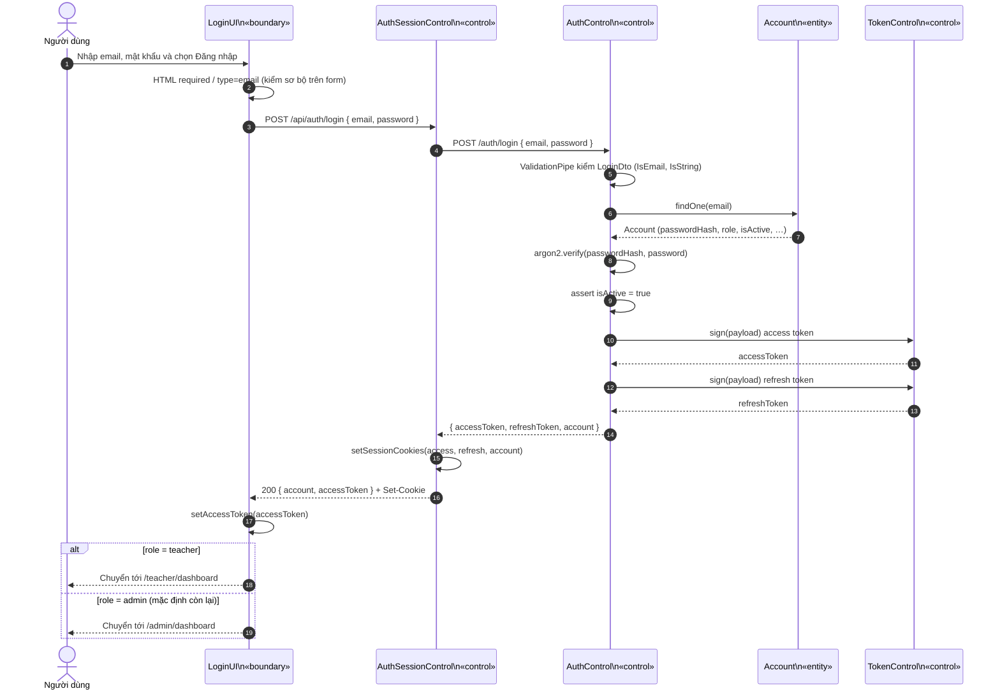
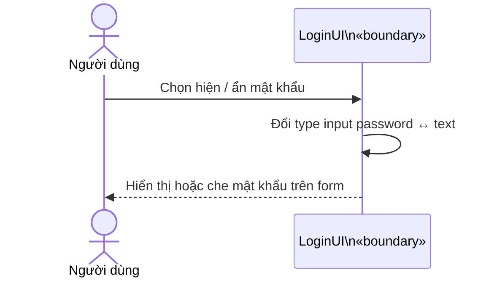
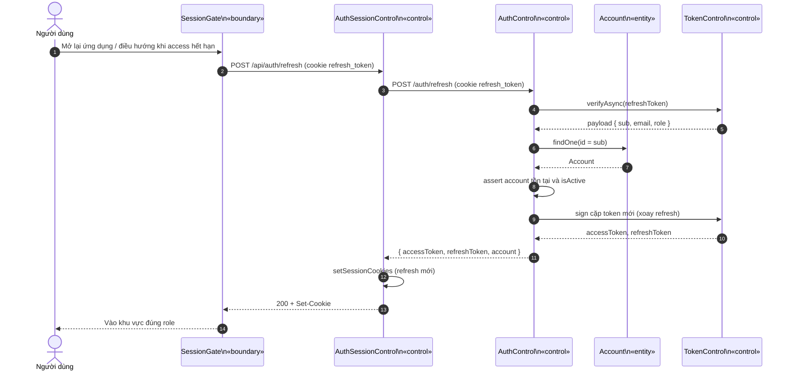
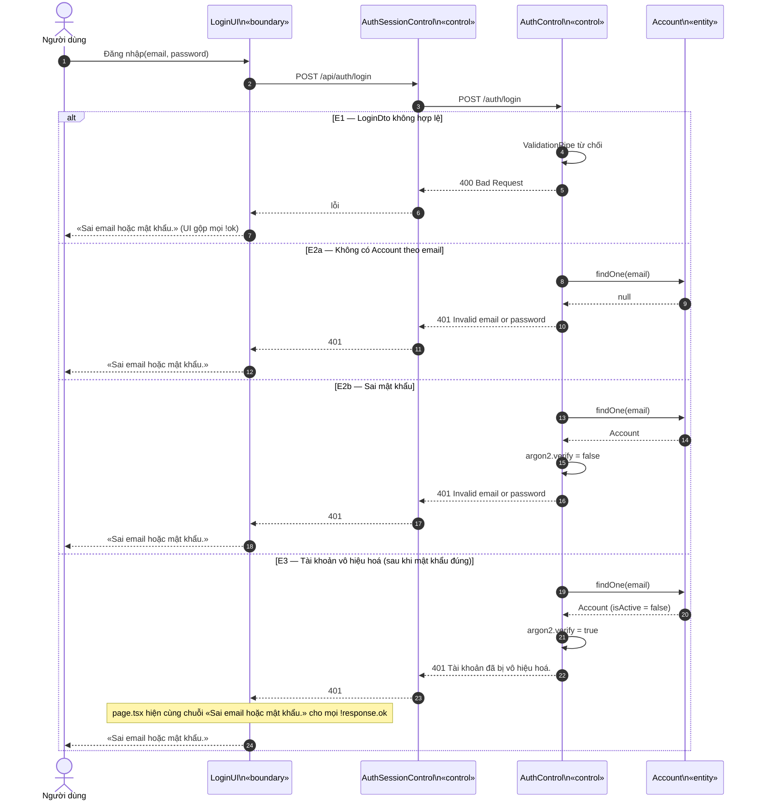
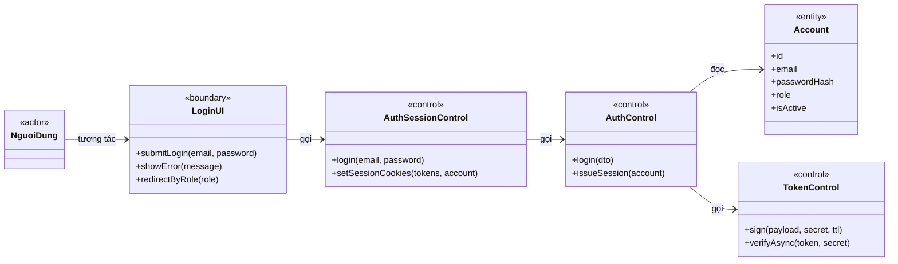

# Sequence diagram UC01 — Đăng nhập hệ thống (BCE)

**Use case:** UC01 / UC-AUTH-01 — [Đặc tả use case](./usecase-spec-uc01-uc15.md)  
**Mục lục UC01–UC15 (mỗi UC một file chi tiết):** [sequence-uc01-uc15-bce.md](./sequence-uc01-uc15-bce.md)  
**Phương pháp:** Jacobson BCE (Boundary · Control · Entity)  
**Nguồn đối chiếu code:** `apps/web` (form + BFF) · `apps/api` (Nest Auth)

Chuỗi quan hệ chuẩn:

```text
[Actor] <---> [Boundary] <---> [Controller] <---> [Entity]
                                    |
                                    +---> [Controller khác]
```

---

## 1. Ánh xạ BCE ↔ code

| Vai trò BCE | Đối tượng trên sơ đồ | File / lớp trong code | Ghi chú |
| --- | --- | --- | --- |
| **Actor** | Người dùng (Quản trị viên / Giảng viên) | — | Cùng form; phân luồng theo `account.role` sau khi đăng nhập thành công |
| **Boundary** | `LoginUI` | `apps/web/src/app/(auth)/login/page.tsx` | Form email / mật khẩu; báo lỗi; giữ access token trong bộ nhớ tab; điều hướng dashboard |
| **Control** | `AuthSessionControl` | `apps/web/src/app/api/auth/login/route.ts` + `lib/auth-cookies.ts` | BFF Next.js: gọi Nest, gắn cookie phiên (`access_token`, `refresh_token` httpOnly; `account` không httpOnly) |
| **Control** | `AuthControl` | `apps/api/src/auth/auth.controller.ts` · `auth.service.ts` · `dto/login.dto.ts` | Nhận `POST /auth/login`; `ValidationPipe` kiểm `LoginDto`; đối soát mật khẩu (argon2); kiểm `isActive`; gọi cấp token |
| **Control** (khác) | `TokenControl` | Nest `JwtService` (được `AuthService.issueSession` gọi) | Ký access token (TTL mặc định 15 phút) và refresh token (TTL mặc định 7 ngày) |
| **Entity** | `Account` | `apps/api/src/identity/entities/account.entity.ts` | Bảng `account`: `email`, `passwordHash`, `role`, `isActive`, … |

**Quy tắc BCE đã áp dụng**

- Actor chỉ trao đổi với Boundary (`LoginUI`).
- Boundary không đọc Entity trực tiếp; mọi nghiệp vụ đi qua Control.
- `AuthControl` đọc Entity `Account` và uỷ quyền ký token cho `TokenControl` (Control khác), đúng nhánh `| +---> [Controller khác]`.
- Entity không gọi Control / Boundary.

**Không vẽ riêng trên sơ đồ (gộp vào bước Control)**

- `ValidationPipe` toàn cục (`apps/api/src/main.ts`) — bước kiểm định dạng ngay khi vào `AuthControl`.
- `Repository<AccountEntity>` — cơ chế truy cập; thông điệp trên sơ đồ ghi như thao tác lên Entity `Account`.
- `setAccessToken` / `router.push` — phản hồi của Boundary sau khi nhận kết quả từ Control.

---

## 2. Luồng chính (Happy path)

### 2.1 Mermaid



### 2.2 Bảng thông điệp (chuẩn hoá)

| # | Từ | Tới | Thông điệp / thao tác | Ghi chú code |
| --- | --- | --- | --- | --- |
| 1 | Actor | `LoginUI` | Nhập email, mật khẩu; chọn Đăng nhập | `handleSubmit` |
| 2 | `LoginUI` | `LoginUI` | Kiểm sơ bộ trên form | `required`, `type="email"` |
| 3 | `LoginUI` | `AuthSessionControl` | `đăng nhập(email, password)` | `fetch('/api/auth/login')` |
| 4 | `AuthSessionControl` | `AuthControl` | `đăng nhập(email, password)` | `fetch(API_URL + '/auth/login')` |
| 5 | `AuthControl` | `AuthControl` | `kiểmTraĐịnhDạng(LoginDto)` | `ValidationPipe` + `@IsEmail` / `@IsString` |
| 6 | `AuthControl` | `Account` | `tìmTheoEmail(email)` | `accounts.findOne({ where: { email } })` |
| 7 | `Account` | `AuthControl` | Trả bản ghi tài khoản | Gồm `passwordHash`, `role`, `isActive` |
| 8 | `AuthControl` | `AuthControl` | `đốiSoátMậtKhẩu(passwordHash, password)` | `argon2.verify` |
| 9 | `AuthControl` | `AuthControl` | `kiểmTraĐangHoạtĐộng(isActive)` | Sau verify mật khẩu (tránh oracle liệt kê email) |
| 10 | `AuthControl` | `TokenControl` | `kýAccessToken(payload)` | `jwt.sign` + `ACCESS_TOKEN_SECRET` |
| 11 | `TokenControl` | `AuthControl` | `accessToken` | TTL mặc định `15m` |
| 12 | `AuthControl` | `TokenControl` | `kýRefreshToken(payload)` | `jwt.sign` + `REFRESH_TOKEN_SECRET` |
| 13 | `TokenControl` | `AuthControl` | `refreshToken` | TTL mặc định `7d` |
| 14 | `AuthControl` | `AuthSessionControl` | `{ accessToken, refreshToken, account }` | `PublicAccount`: id, email, name, role |
| 15 | `AuthSessionControl` | `AuthSessionControl` | `gắnCookiePhiên(...)` | `setSessionCookies` |
| 16 | `AuthSessionControl` | `LoginUI` | `{ account, accessToken }` + cookie | Refresh token **không** trả trong JSON body |
| 17 | `LoginUI` | `LoginUI` | `giữAccessTokenTrongBộNhớ` | `setAccessToken` |
| 18 | `LoginUI` | Actor | Điều hướng dashboard theo `role` | `teacher` → `/teacher/dashboard`; còn lại → `/admin/dashboard` |

**Payload JWT (`AccessTokenPayload`):** `sub` = `account.id`, `email`, `role`.

---

## 3. Luồng thay thế

### 3.1 A2 — Hiện / ẩn mật khẩu (chỉ Boundary)

Không gọi Control hay Entity.



Sau đó Actor tiếp tục luồng chính từ bước nhập / Đăng nhập.

### 3.2 A1 — Làm mới phiên bằng refresh token (không gõ lại mật khẩu)

A1 không đi qua `LoginUI` submit form. Boundary phía trình duyệt là middleware / route làm mới; Control Nest vẫn là `AuthControl.refresh`, vẫn đọc `Account` và gọi `TokenControl`.

| Vai trò BCE | Đối tượng | Code |
| --- | --- | --- |
| Boundary | `SessionGate` (middleware hoặc gọi `/api/auth/refresh`) | `apps/web/src/middleware.ts`, `app/api/auth/refresh/route.ts` |
| Control | `AuthSessionControl` (nhánh refresh) | route refresh + `setSessionCookies` |
| Control | `AuthControl` | `AuthController.refresh` → `AuthService.refresh` |
| Control khác | `TokenControl` | `jwt.verifyAsync` refresh cũ + `jwt.sign` cặp mới |
| Entity | `Account` | `findOne({ id: payload.sub })` + kiểm `isActive` |



---

## 4. Luồng ngoại lệ

Cùng các participant với luồng chính. Nhánh `alt` bám thông điệp lỗi trong code.



| Ngoại lệ UC | Điểm cắt BCE | Phản ứng hệ thống |
| --- | --- | --- |
| E1 | `AuthControl` (ValidationPipe) hoặc `LoginUI` (HTML required) | Không cấp phiên |
| E2 | `AuthControl` ↔ `Account` | Cùng thông điệp 401 phía API; Boundary hiện một câu chung |
| E3 | `AuthControl` sau khi đọc `Account.isActive` | API phân biệt message; Boundary hiện tại **không** tách message E3 trên UI |
| E4 | Sau đăng nhập, middleware / route theo role | Không thuộc vòng `POST /auth/login` thành công với `admin`/`teacher` hợp lệ; token chỉ mang hai role này |

**Lệch UI / API (cần biết khi viết test case):** `AuthService` trả `Tài khoản đã bị vô hiệu hoá.` cho E3, nhưng `LoginUI` gán mọi `!response.ok` thành «Sai email hoặc mật khẩu.» — đặc tả sequence phản ánh đúng code hiện tại.

---

## 5. Sơ đồ lớp BCE của UC01 (phụ trợ)

Dùng khi vẽ kèm class diagram stereotyped; không thay sequence.



---

## 6. Checklist khi vẽ lại trên StarUML / Visual Paradigm / PlantUML

1. Stereotype rõ: `«boundary»`, `«control»`, `«entity»` (và actor).
2. Không có mũi tên Actor → Control / Actor → Entity.
3. Không có mũi tên Entity → Control hay Entity → Boundary.
4. `TokenControl` chỉ được `AuthControl` gọi (Control → Control khác).
5. Cookie phiên gắn ở `AuthSessionControl`, không gắn ở Entity.
6. Tên thông điệp dùng động từ nghiệp vụ trên sơ đồ tiếng Việt; có thể chú thích signature code trong note.
7. Happy path và từng `alt` ngoại lệ tách frame hoặc tách sơ đồ phụ cho dễ đọc trong báo cáo.
