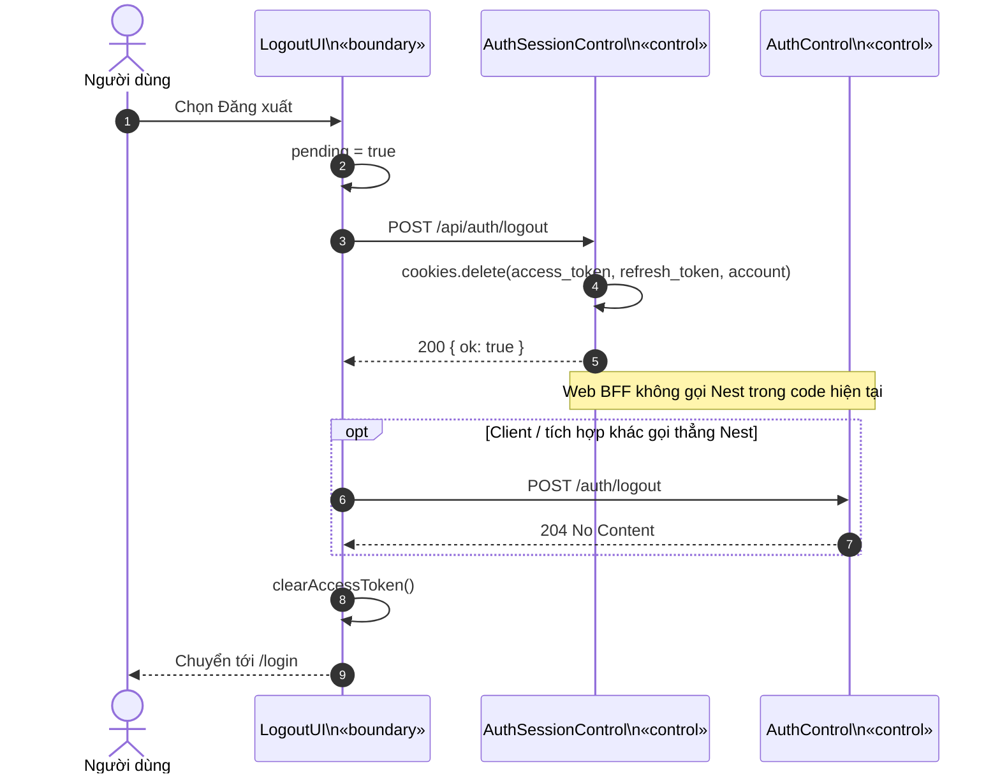
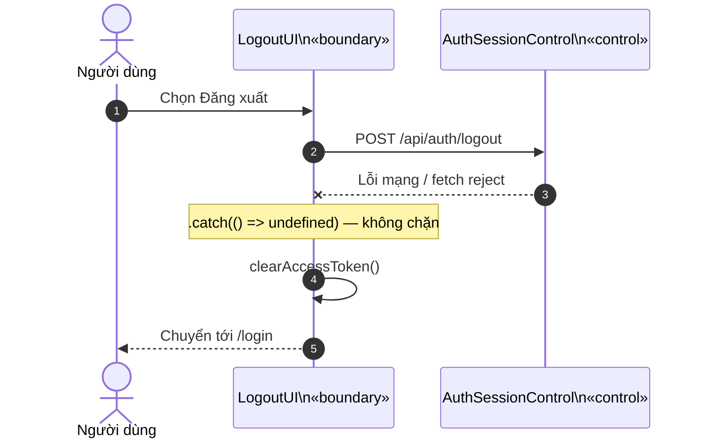
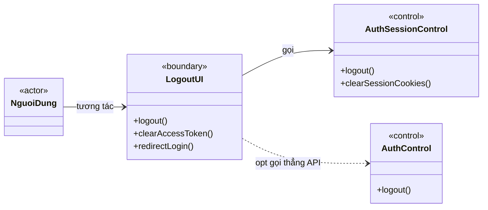

# Sequence diagram UC02 — Đăng xuất hệ thống (BCE)

**Use case:** UC02 / UC-AUTH-02 — [Đặc tả use case](./usecase-spec-uc01-uc15.md)  
**Bộ mục lục:** [sequence-uc01-uc15-bce.md](./sequence-uc01-uc15-bce.md)  
**Phương pháp:** Jacobson BCE (Boundary · Control · Entity)  
**Nguồn đối chiếu code:** `apps/web` (LogoutButton + BFF) · `apps/api` (Auth logout no-op)

Chuỗi quan hệ chuẩn:

```text
[Actor] <---> [Boundary] <---> [Controller] <---> [Entity]
                                    |
                                    +---> [Controller khác]
```

---

## 1. Ánh xạ BCE ↔ code

| Vai trò BCE | Đối tượng trên sơ đồ | File / lớp trong code | Ghi chú |
| --- | --- | --- | --- |
| **Actor** | Người dùng (Quản trị viên / Giảng viên) đang có phiên | — | Nút Đăng xuất nằm trong AppShell |
| **Boundary** | `LogoutUI` | `apps/web/src/components/layout/logout-button.tsx` | Gọi BFF, xoá access token bộ nhớ, điều hướng `/login` |
| **Control** | `AuthSessionControl` | `apps/web/src/app/api/auth/logout/route.ts` | Xoá cookie `access_token`, `refresh_token`, `account` |
| **Control** | `AuthControl` | `apps/api/src/auth/auth.controller.ts` → `logout()` | `POST /auth/logout` trả 204; JWT stateless — **không** invalidate phía server |
| **Entity** | — | — | Đăng xuất **không** đọc/ghi `Account` |

**Quy tắc BCE đã áp dụng**

- Actor chỉ trao đổi với Boundary (`LogoutUI`).
- Boundary không tự xoá được cookie httpOnly — phải nhờ `AuthSessionControl`.
- Không có Entity trong happy path web hiện tại.
- Nest `AuthControl` là Control tùy chọn: BFF web **không** proxy sang Nest; vẫn ghi trên sơ đồ để khớp API công khai và hợp đồng «stateless logout».

**Không vẽ riêng trên sơ đồ**

- `clearAccessToken` / `router.push` — phản hồi nội bộ Boundary sau khi BFF trả lời (hoặc lỗi mạng).
- `JwtAuthGuard` — logout Nest không bắt JWT bắt buộc trên handler hiện tại.

**Lệch code quan trọng:** `LogoutUI` chỉ `fetch('/api/auth/logout')`. Route Next **không** gọi Nest. Bước Actor→…→`AuthControl` trên sơ đồ chính đánh dấu `opt` theo đúng triển khai.

---

## 2. Luồng chính (Happy path)

### 2.1 Mermaid



### 2.2 Bảng thông điệp (chuẩn hoá)

| # | Từ | Tới | Thông điệp / thao tác | Ghi chú code |
| --- | --- | --- | --- | --- |
| 1 | Actor | `LogoutUI` | Chọn Đăng xuất | `handleLogout` |
| 2 | `LogoutUI` | `LogoutUI` | Đặt trạng thái đang xử lý | `setPending(true)` |
| 3 | `LogoutUI` | `AuthSessionControl` | `đăngXuất()` | `fetch('/api/auth/logout', { method: 'POST' })` |
| 4 | `AuthSessionControl` | `AuthSessionControl` | `xoáCookiePhiên()` | `cookies.delete` × 3 |
| 5 | `AuthSessionControl` | `LogoutUI` | `{ ok: true }` | `NextResponse.json` |
| 6 | `LogoutUI` | `LogoutUI` | `xoáAccessTokenBộNhớ()` | `clearAccessToken()` trong `lib/auth-token.ts` |
| 7 | `LogoutUI` | Actor | Điều hướng trang Đăng nhập | `router.push('/login')` |

**Hậu điều kiện:** Cookie phiên hết trên trình duyệt; bản access token trong tab bị xoá; Actor phải UC01 lại để vào chức năng web.

---

## 3. Luồng thay thế

Không có nhánh nghiệp vụ khác để «đăng xuất thành công» ngoài đường trên.

### 3.1 A1 — Yêu cầu BFF lỗi mạng / không tới được

Vẫn đạt mục tiêu đăng xuất **cục bộ** trên tab hiện tại.



| # | Từ | Tới | Thông điệp | Code |
| --- | --- | --- | --- | --- |
| 1–2 | như luồng chính | | | |
| 3 | `AuthSessionControl` | `LogoutUI` | Lỗi / không phản hồi | `fetch(...).catch(...)` |
| 4 | `LogoutUI` | `LogoutUI` | Vẫn xoá token bộ nhớ | `clearAccessToken` |
| 5 | `LogoutUI` | Actor | `/login` | `router.push` |

---

## 4. Luồng ngoại lệ

Không có nhánh làm **hỏng** mục tiêu đăng xuất trên trình duyệt hiện tại.

| Ngoại lệ UC | Điểm cắt BCE | Phản ứng |
| --- | --- | --- |
| — | — | Access token đã phát hành là stateless: bản sao ngoài trình duyệt này chỉ sống hết TTL ngắn; refresh cookie trên trình duyệt này đã bị xoá nên không cấp phiên mới |

Ghi chú bảo mật (không vẽ Entity): vô hiệu hoá tài khoản (UC03) chặn **login/refresh** mới; không thu hồi ngay mọi access token đã cấp (TTL ~15 phút) — thiết kế có chủ ý trong `AccountEntity` / `AuthService`.

---

## 5. Sơ đồ lớp BCE của UC02 (phụ trợ)



---

## 6. Checklist khi vẽ lại

1. Stereotype `«boundary»` / `«control»`; không bịa Entity cho logout web.
2. Actor chỉ nối `LogoutUI`.
3. Cookie xoá ở `AuthSessionControl`, không ở Boundary thuần client.
4. Note rõ: BFF không proxy Nest; Nest logout là no-op.
5. A1 vẫn kết thúc ở `/login` + `clearAccessToken`.
6. Happy path và A1 tách sơ đồ hoặc `alt`/`opt` cho báo cáo.
