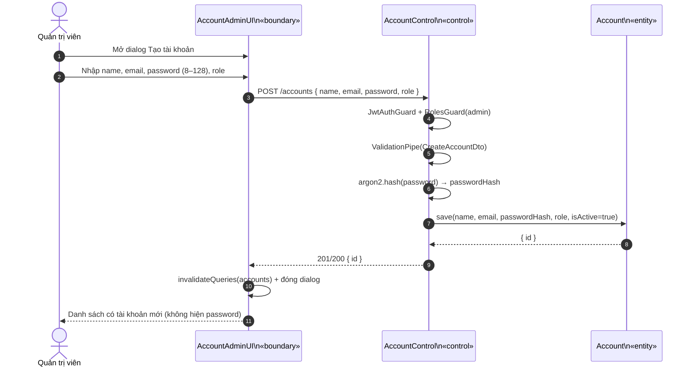
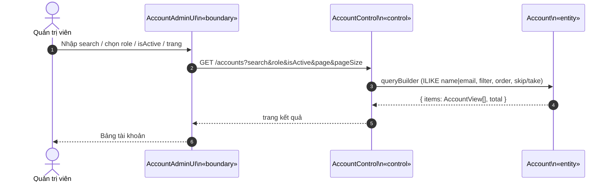
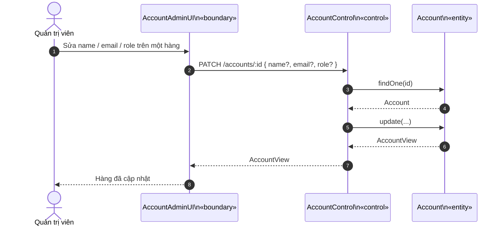
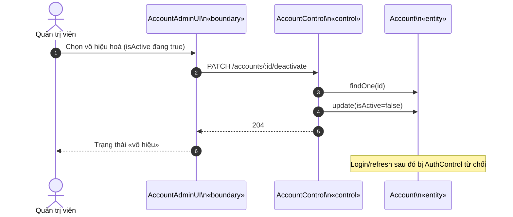
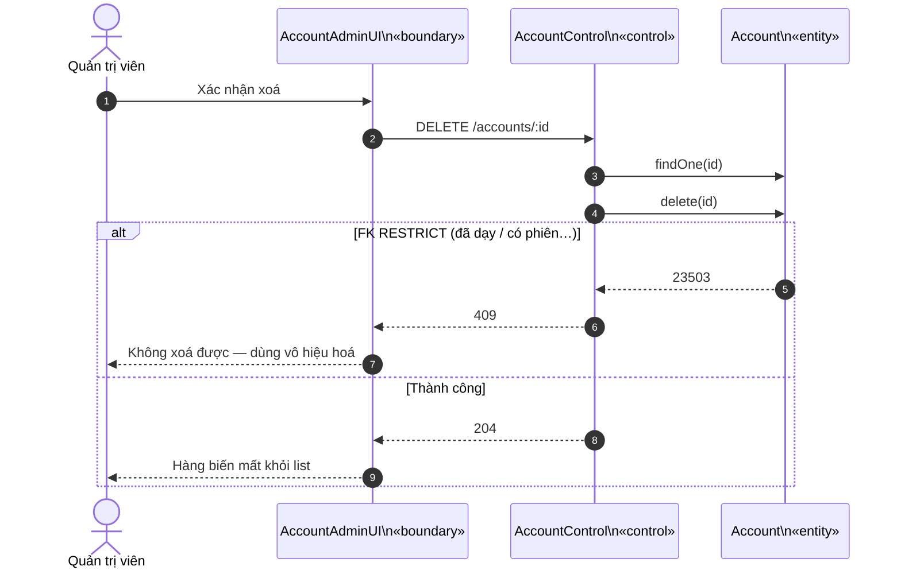
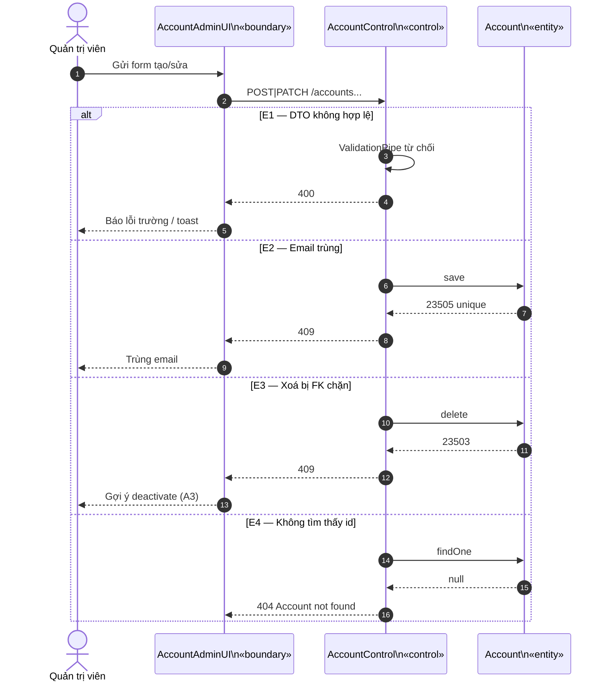
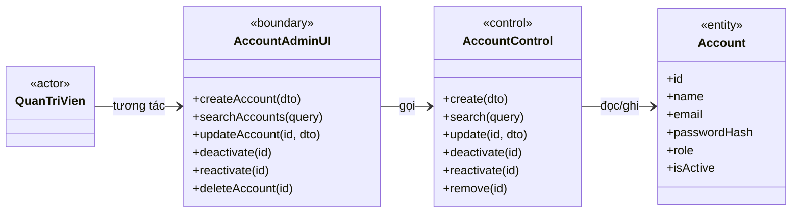

# Sequence diagram UC03 — Quản lý tài khoản người dùng (BCE)

**Use case:** UC03 / UC-ACC-01 — [Đặc tả use case](./usecase-spec-uc01-uc15.md)  
**Bộ mục lục:** [sequence-uc01-uc15-bce.md](./sequence-uc01-uc15-bce.md)  
**Phương pháp:** Jacobson BCE (Boundary · Control · Entity)  
**Nguồn đối chiếu code:** `apps/web/admin/accounts` · `apps/api/accounts`

Chuỗi quan hệ chuẩn:

```text
[Actor] <---> [Boundary] <---> [Controller] <---> [Entity]
                                    |
                                    +---> [Controller khác]
```

---

## 1. Ánh xạ BCE ↔ code

| Vai trò BCE | Đối tượng trên sơ đồ | File / lớp trong code | Ghi chú |
| --- | --- | --- | --- |
| **Actor** | Quản trị viên | — | `@Roles('admin')` trên mọi route accounts |
| **Boundary** | `AccountAdminUI` | `apps/web/src/app/admin/accounts/page.tsx` + `hooks/useAccounts.ts` + `lib/api/accounts.ts` | Dialog tạo/sửa; bảng list; nút vô hiệu/xoá |
| **Control** | `AccountControl` | `accounts.controller.ts` · `accounts.service.ts` · DTO create/update/search | CRUD + deactivate/reactivate |
| **Control** (nội bộ) | Hash mật khẩu | `argon2.hash` trong `AccountsService.create` | Không tách participant; ghi self-call trên Control |
| **Entity** | `Account` | `identity/entities/account.entity.ts` | `name`, `email`, `passwordHash`, `role`, `isActive` |

**Quy tắc BCE đã áp dụng**

- Actor ↔ `AccountAdminUI` only.
- Boundary gọi Nest qua `apiClient` (Bearer access token) — gộp vào mũi tên Boundary → Control.
- `JwtAuthGuard` + `RolesGuard` gộp vào bước vào `AccountControl`.
- Không có Control khác bắt buộc; argon2 là thao tác trong `AccountControl`.

**Không vẽ riêng**

- TanStack Query invalidate — phản hồi Boundary sau success.
- `PostgresExceptionFilter` map 23505 → 409 — ghi trong ngoại lệ.

---

## 2. Luồng chính (Happy path) — Tạo tài khoản

### 2.1 Mermaid



### 2.2 Bảng thông điệp

| # | Từ | Tới | Thông điệp / thao tác | Ghi chú code |
| --- | --- | --- | --- | --- |
| 1 | Actor | `AccountAdminUI` | Mở form tạo + nhập liệu | Dialog + `AccountForm` |
| 2 | `AccountAdminUI` | `AccountControl` | `tạoTàiKhoản(dto)` | `createAccount` → `POST /accounts` |
| 3 | `AccountControl` | `AccountControl` | Xác thực JWT + role admin | Guards |
| 4 | `AccountControl` | `AccountControl` | `kiểmTraĐịnhDạng(CreateAccountDto)` | `@IsEmail`, `@Length(8,128)`, `@IsIn(admin\|teacher)` |
| 5 | `AccountControl` | `AccountControl` | `bămMậtKhẩu(password)` | `argon2.hash(..., argon2id)` |
| 6 | `AccountControl` | `Account` | `lưu(account)` | `accounts.save(create(...))` |
| 7 | `Account` | `AccountControl` | `{ id }` | |
| 8 | `AccountControl` | `AccountAdminUI` | `{ id }` | |
| 9 | `AccountAdminUI` | Actor | Làm mới list / toast | `useCreateAccount.onSuccess` |

---

## 3. Luồng thay thế

### 3.1 A1 — Tìm và lọc danh sách



| # | Từ | Tới | Thông điệp | Code |
| --- | --- | --- | --- | --- |
| 1 | Actor | UI | Đổi bộ lọc | URL/search params |
| 2 | UI | Acc | `tìmKiếm(query)` | `searchAccounts` |
| 3 | Acc | Account | Query có điều kiện | `AccountsService.search` |
| 4 | Acc | UI | `AccountView[]` (không có passwordHash) | `toView` |

### 3.2 A2 — Sửa thông tin



Không đổi mật khẩu ở nhánh này (`UpdateAccountDto` không có password).

### 3.3 A3 — Vô hiệu hoá



### 3.4 A4 — Kích hoạt lại

Đối xứng A3: `PATCH /accounts/:id/reactivate` → `isActive=true`.

### 3.5 A5 — Xoá cứng



---

## 4. Luồng ngoại lệ



| Ngoại lệ | Điểm cắt BCE | Phản ứng |
| --- | --- | --- |
| E1 | `AccountControl` ValidationPipe | Không ghi Entity |
| E2 | `Account` unique email | 409 |
| E3 | `Account` DELETE + FK | 409; dùng A3 |
| E4 | `findOrThrow` | 404 |
| (auth) | Guards | 401/403 nếu không phải admin |

---

## 5. Sơ đồ lớp BCE



---

## 6. Checklist khi vẽ lại

1. Happy path = **tạo** tài khoản; A1–A5 là sơ đồ/frame riêng.
2. Không hiện `passwordHash` trên Boundary response (`AccountView`).
3. A3/A4 không audit (đúng comment service) — không vẽ `AuditLog` cho UC03.
4. A5 luôn có nhánh 409 FK.
5. Actor chỉ nối Boundary; Entity không gọi ngược.
