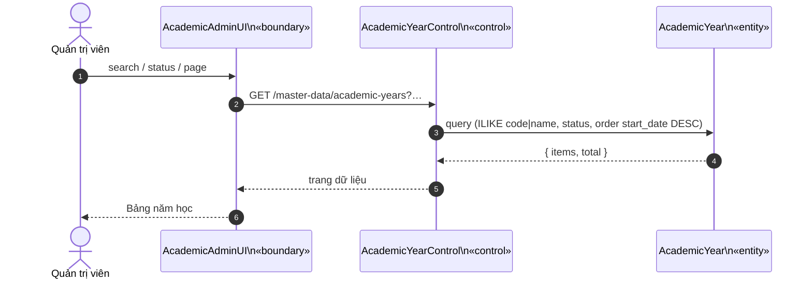
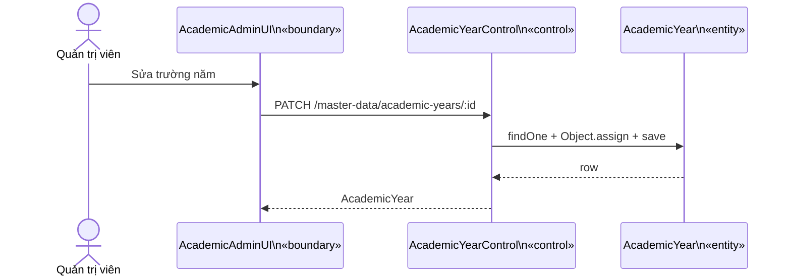
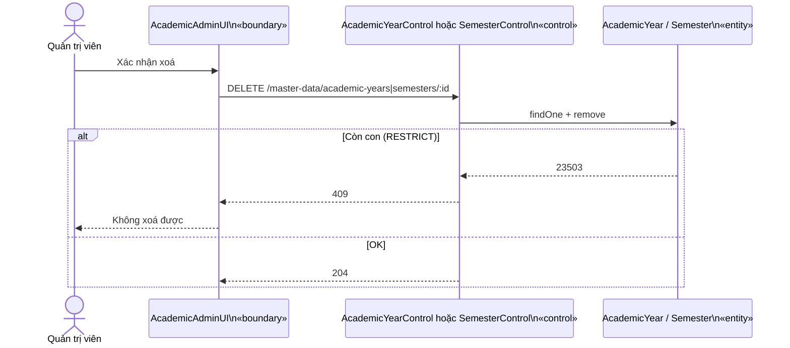
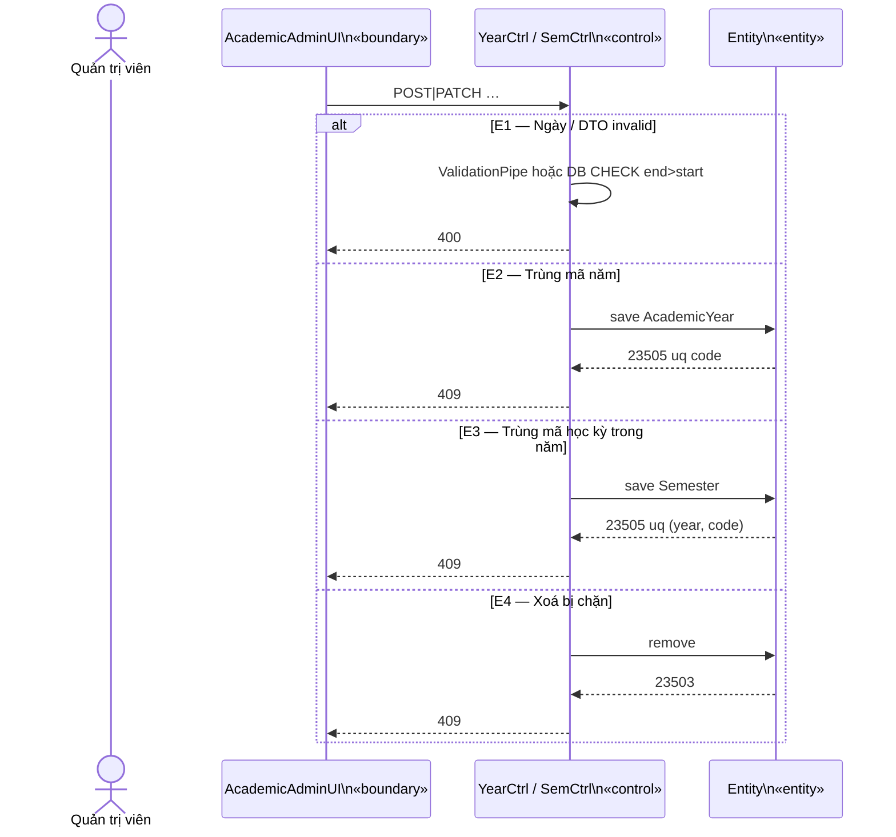
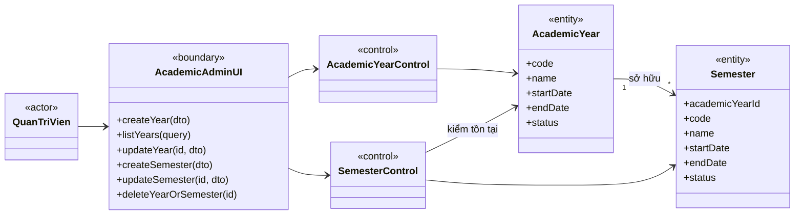

# Sequence diagram UC04 — Quản lý năm học (BCE)

**Use case:** UC04 / UC-CAT-01 — [Đặc tả use case](./usecase-spec-uc01-uc15.md)  
**Bộ mục lục:** [sequence-uc01-uc15-bce.md](./sequence-uc01-uc15-bce.md)  
**Phương pháp:** Jacobson BCE (Boundary · Control · Entity)  
**Nguồn đối chiếu code:** `admin/master-data/academic/**` · `AcademicYearsController` / `SemestersController` · `MasterDataService`

Chuỗi quan hệ chuẩn:

```text
[Actor] <---> [Boundary] <---> [Controller] <---> [Entity]
                                    |
                                    +---> [Controller khác]
```

Học kỳ không có mã UC riêng: luôn thuộc năm học → trên sequence, thao tác học kỳ đi qua **Control khác** `SemesterControl`.

---

## 1. Ánh xạ BCE ↔ code

| Vai trò BCE | Đối tượng trên sơ đồ | File / lớp trong code | Ghi chú |
| --- | --- | --- | --- |
| **Actor** | Quản trị viên | — | C/U/D năm & kỳ: admin. List GET có thể teacher (chọn kỳ) — ngoài phạm vi CRUD admin |
| **Boundary** | `AcademicAdminUI` | `admin/master-data/academic/page.tsx`, `academic/[id]/page.tsx` + hooks master-data | List năm; chi tiết năm chứa học kỳ |
| **Control** | `AcademicYearControl` | `AcademicYearsController` + `MasterDataService` (academic year methods) | `/master-data/academic-years` |
| **Control** (khác) | `SemesterControl` | `SemestersController` + `MasterDataService` (semester methods) | `/master-data/semesters`; trước save gọi kiểm năm tồn tại |
| **Entity** | `AcademicYear` | `academic-year.entity.ts` | `code` unique; `ck_academic_year_dates`: end > start; status planned/active/closed |
| **Entity** | `Semester` | `semester.entity.ts` | unique `(academicYearId, code)`; `ck_semester_dates`; FK năm RESTRICT |

**Quy tắc BCE**

- Actor ↔ Boundary only.
- `SemesterControl` được Boundary gọi trực tiếp (REST riêng); khi tạo kỳ, Control này đọc Entity `AcademicYear` (qua service `getAcademicYear`) — trên sơ đồ vẽ `SemesterControl` → `AcademicYear` hoặc `SemesterControl` → `AcademicYearControl` rồi Entity. **Chuẩn hoá:** `SemesterControl` → Entity `AcademicYear` (cùng service layer, không vòng HTTP nội bộ).

**Không vẽ riêng:** ValidationPipe, Repository, `apiClient`, phân trang UI.

---

## 2. Luồng chính — Tạo năm học

### 2.1 Mermaid

```mermaid
sequenceDiagram
  autonumber
  actor Admin as Quản trị viên
  participant UI as AcademicAdminUI\n«boundary»
  participant YearCtrl as AcademicYearControl\n«control»
  participant Year as AcademicYear\n«entity»

  Admin ->> UI: Mở form thêm năm học
  Admin ->> UI: Nhập code, name, startDate, endDate, status
  UI ->> YearCtrl: POST /master-data/academic-years
  YearCtrl ->> YearCtrl: Jwt + Roles(admin) + ValidationPipe(CreateAcademicYearDto)
  YearCtrl ->> Year: save(dto)
  Note over Year: DB CHECK end_date > start_date; unique code
  Year -->> YearCtrl: { id }
  YearCtrl -->> UI: { id }
  UI ->> UI: invalidate list + đóng dialog
  UI -->> Admin: Năm học xuất hiện trên danh sách
```

### 2.2 Bảng thông điệp

| # | Từ | Tới | Thông điệp | Code |
| --- | --- | --- | --- | --- |
| 1 | Actor | UI | Nhập liệu năm học | Dialog create |
| 2 | UI | YearCtrl | `tạoNămHọc(dto)` | `createAcademicYear` |
| 3 | YearCtrl | YearCtrl | Guard + validate | `@Length` code/name, `@IsDateString`, `@IsIn(status)` |
| 4 | YearCtrl | Year | `lưu(năm)` | `createAcademicYear` → `save` |
| 5 | Year | YearCtrl | `{ id }` | |
| 6 | YearCtrl | UI | `{ id }` | |
| 7 | UI | Actor | List cập nhật | React Query |

---

## 3. Luồng thay thế

### 3.1 A1 — Tìm / lọc / phân trang năm



### 3.2 A2 — Sửa năm học

`PATCH /master-data/academic-years/:id` — `UpdateAcademicYearDto` (name, dates, status; **không** đổi `code` trong DTO update hiện tại).



### 3.3 A3 — Thêm học kỳ (Control khác)

```mermaid
sequenceDiagram
  autonumber
  actor Admin as Quản trị viên
  participant UI as AcademicAdminUI\n«boundary»
  participant SemCtrl as SemesterControl\n«control»
  participant Year as AcademicYear\n«entity»
  participant Sem as Semester\n«entity»

  Admin ->> UI: Trong năm đã chọn — thêm học kỳ
  Admin ->> UI: Nhập code, name, startDate, endDate, status, academicYearId
  UI ->> SemCtrl: POST /master-data/semesters
  SemCtrl ->> SemCtrl: validate CreateSemesterDto
  SemCtrl ->> Year: findOne(academicYearId)
  alt Năm không tồn tại
    Year -->> SemCtrl: null
    SemCtrl -->> UI: 404 Academic year not found
  else OK
    Year -->> SemCtrl: AcademicYear
    SemCtrl ->> Sem: save(semester)
    Note over Sem: unique (academicYearId, code); end > start
    Sem -->> SemCtrl: { id }
    SemCtrl -->> UI: { id }
    UI -->> Admin: Học kỳ hiện dưới năm
  end
```

| # | Từ | Tới | Thông điệp | Code |
| --- | --- | --- | --- | --- |
| 1 | Actor | UI | Form học kỳ trên trang năm | `academic/[id]` |
| 2 | UI | SemCtrl | `tạoHọcKỳ(dto)` | `createSemester` |
| 3 | SemCtrl | Year | `tìmNăm(id)` | `getAcademicYear` |
| 4 | SemCtrl | Sem | `lưu(kỳ)` | `createSemester` |
| 5 | SemCtrl | UI | `{ id }` | |

### 3.4 A4 — Sửa học kỳ

`PATCH /master-data/semesters/:id` — có thể đổi `academicYearId` (service gọi lại `getAcademicYear`).

### 3.5 A5 — Xoá năm hoặc học kỳ



- Xoá năm khi còn học kỳ → RESTRICT.  
- Xoá học kỳ khi còn lớp học phần (`class.semester_id`) → RESTRICT.

---

## 4. Luồng ngoại lệ



| Ngoại lệ | Điểm cắt | Phản ứng |
| --- | --- | --- |
| E1 | Control validate / Entity CHECK | Không lưu hoặc 400/500 map filter |
| E2 | `AcademicYear.code` unique | 409 |
| E3 | `Semester` unique theo năm | 409 |
| E4 | RESTRICT | 409; giữ dữ liệu |

---

## 5. Sơ đồ lớp BCE



---

## 6. Checklist khi vẽ lại

1. Happy path = tạo **năm học**; A3 là sơ đồ riêng với `SemesterControl`.
2. Control → Control khác: Boundary gọi SemCtrl; SemCtrl đọc Year entity (không bắt buộc HTTP nội bộ YearCtrl).
3. Ghi chú CHECK ngày và unique trên Entity.
4. Include nghiệp vụ «năm chứa kỳ» thể hiện bằng A3, không nhét hết vào một happy path dày.
