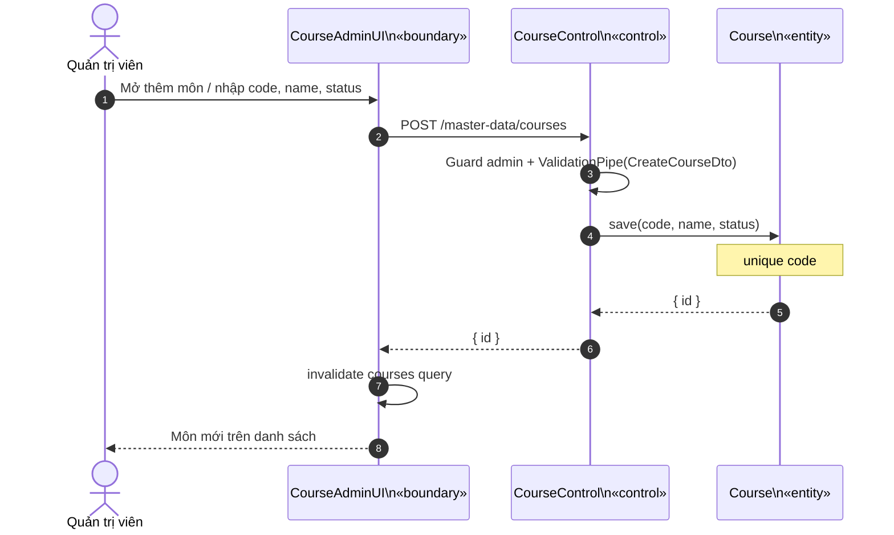
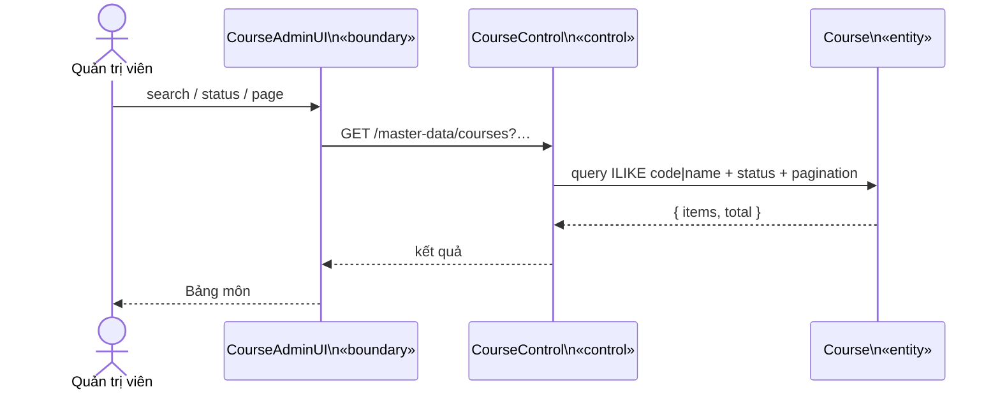
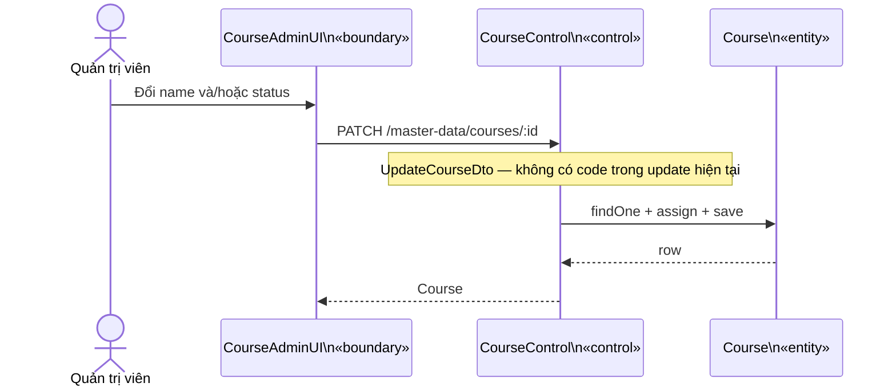
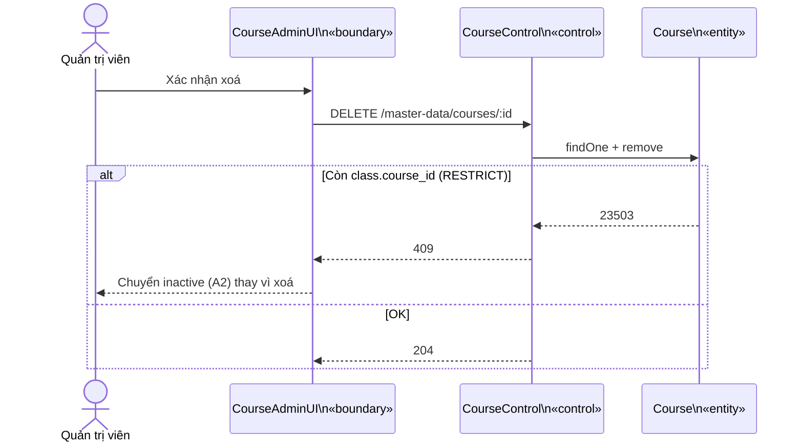
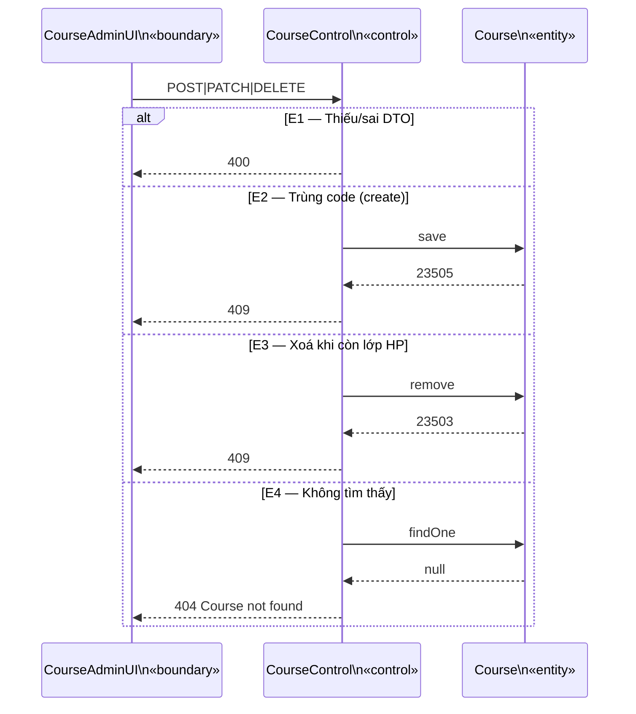
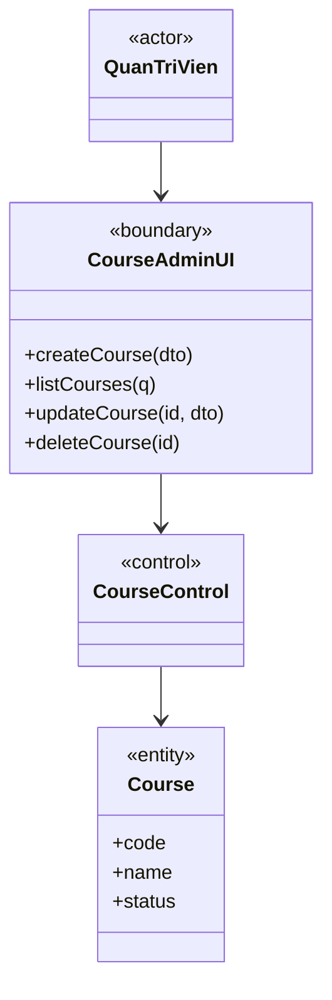

# Sequence diagram UC05 — Quản lý môn học (BCE)

**Use case:** UC05 / UC-CAT-02 — [Đặc tả use case](./usecase-spec-uc01-uc15.md)  
**Bộ mục lục:** [sequence-uc01-uc15-bce.md](./sequence-uc01-uc15-bce.md)  
**Phương pháp:** Jacobson BCE · **Code:** `admin/master-data/courses/page.tsx` · `CoursesController` · `MasterDataService` · `course.entity.ts`

```text
[Actor] <---> [Boundary] <---> [Controller] <---> [Entity]
                                    |
                                    +---> [Controller khác]
```

UC05 **không** bắt buộc Control khác trên happy path tạo môn. (Lớp HP / IDE policy gọi `Course` ở UC khác.)

---

## 1. Ánh xạ BCE ↔ code

| BCE | Đối tượng | Code | Ghi chú |
| --- | --- | --- | --- |
| Actor | Quản trị viên | — | `@Roles('admin')` C/U/D |
| Boundary | `CourseAdminUI` | `courses/page.tsx` + `useMasterData` / `lib/api/master-data.ts` | Catalog list + dialog |
| Control | `CourseControl` | `CoursesController` + `createCourse` / `updateCourse` / `removeCourse` / `listCourses` | `/master-data/courses` |
| Entity | `Course` | `course.entity.ts` | `code` unique; `name`; status `active` \| `inactive` |

**Không vẽ:** ValidationPipe, Repository, apiClient, Jwt guards (gộp bước vào Control).

---

## 2. Luồng chính — Tạo môn học

### 2.1 Mermaid



### 2.2 Bảng thông điệp

| # | Từ | Tới | Thông điệp | Code |
| --- | --- | --- | --- | --- |
| 1 | Actor | UI | Nhập mã, tên, trạng thái | Dialog |
| 2 | UI | Ctrl | `tạoMôn(dto)` | `createCourse` |
| 3 | Ctrl | Ctrl | Validate `@Length` code≤50, name≤200, status | `CreateCourseDto` |
| 4 | Ctrl | Course | `lưu(môn)` | `createCourse` → `save` |
| 5 | Course | Ctrl | `{ id }` | |
| 6 | Ctrl | UI | `{ id }` | |
| 7 | UI | Actor | List cập nhật | |

---

## 3. Luồng thay thế

### 3.1 A1 — Tìm / lọc / phân trang



### 3.2 A2 — Sửa môn



### 3.3 A3 — Xoá môn chưa dùng



---

## 4. Luồng ngoại lệ



| Ngoại lệ | Điểm cắt | Phản ứng |
| --- | --- | --- |
| E1 | ValidationPipe | Không lưu |
| E2 | Unique `code` | 409 |
| E3 | FK từ `class` | 409; dùng `inactive` |
| E4 | getCourse | 404 |

---

## 5. Sơ đồ lớp BCE



---

## 6. Checklist

1. Happy path = tạo môn; A1–A3 tách frame.
2. Không vẽ credits / FK năm (không có trong entity).
3. A3 luôn kèm nhánh RESTRICT → gợi ý `inactive`.
4. Actor chỉ nối Boundary.
