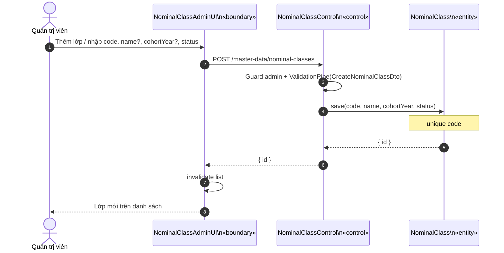
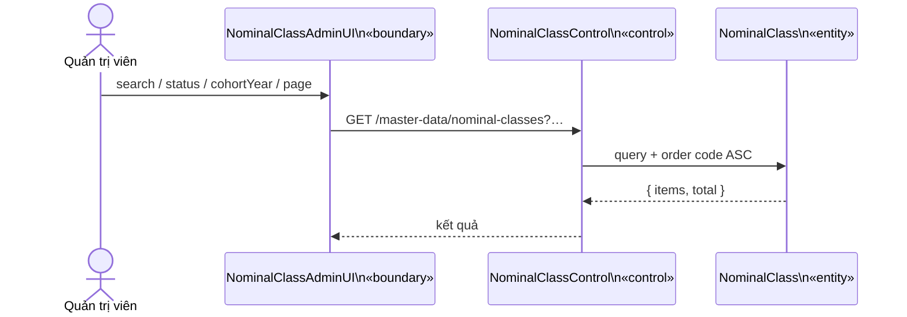
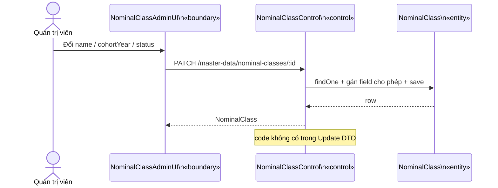
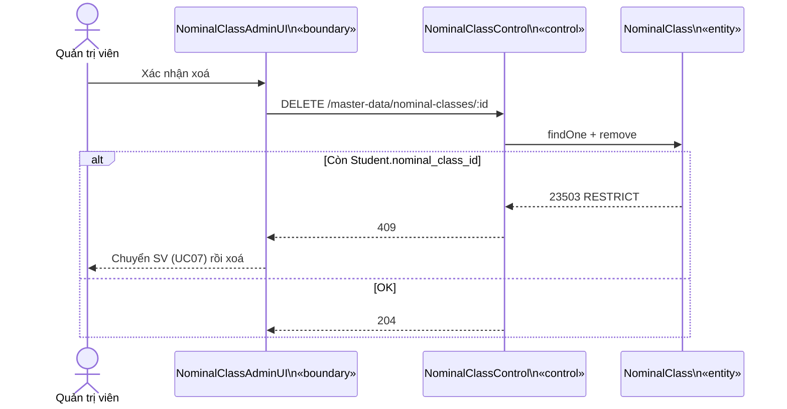
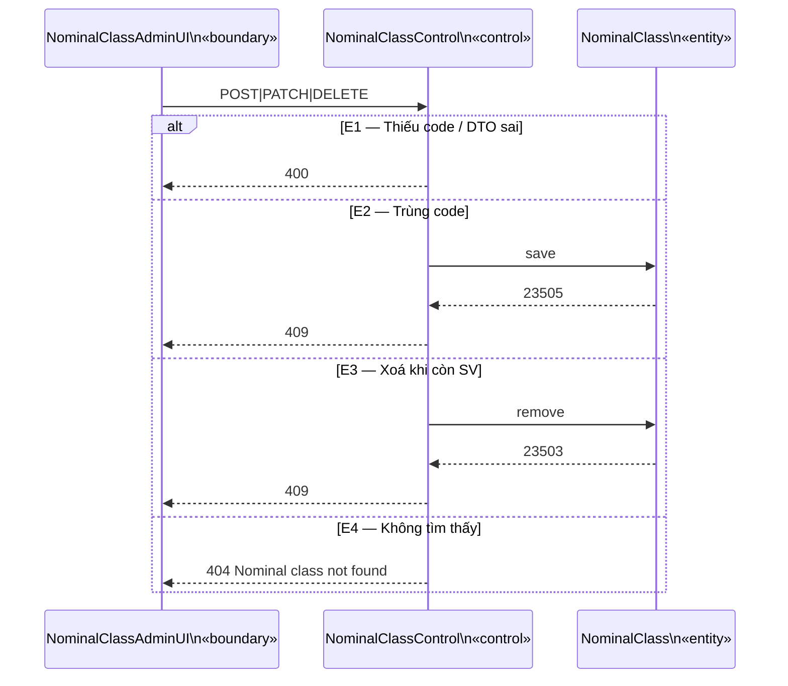
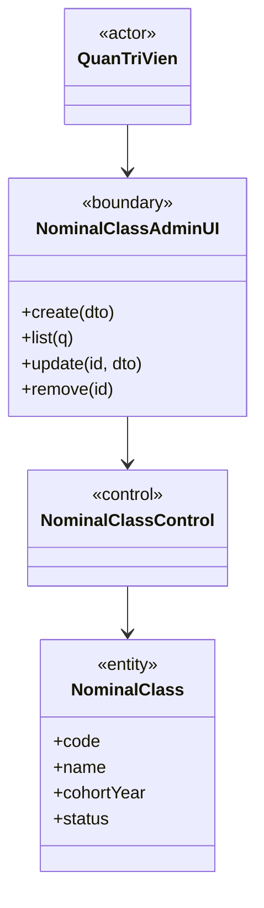

# Sequence diagram UC06 — Quản lý lớp danh nghĩa (BCE)

**Use case:** UC06 / UC-CAT-03 — [Đặc tả use case](./usecase-spec-uc01-uc15.md)  
**Bộ mục lục:** [sequence-uc01-uc15-bce.md](./sequence-uc01-uc15-bce.md)  
**Code:** `admin/master-data/nominal-classes/page.tsx` · `NominalClassesController` · `MasterDataService` · `nominal-class.entity.ts`

```text
[Actor] <---> [Boundary] <---> [Controller] <---> [Entity]
                                    |
                                    +---> [Controller khác]
```

Happy path không cần Control khác. UC07 sẽ gọi đọc `NominalClass` khi tạo sinh viên.

---

## 1. Ánh xạ BCE ↔ code

| BCE | Đối tượng | Code | Ghi chú |
| --- | --- | --- | --- |
| Actor | Quản trị viên | — | admin CRUD |
| Boundary | `NominalClassAdminUI` | `nominal-classes/page.tsx` + master-data API/hooks | Lớp hành chính, khác lớp HP |
| Control | `NominalClassControl` | `NominalClassesController` + service methods | `/master-data/nominal-classes` |
| Entity | `NominalClass` | `nominal-class.entity.ts` | `code` unique; `name?`; `cohortYear?`; status active/inactive |

**Update DTO:** cho phép sửa `name`, `cohortYear`, `status` — **không** đổi `code` sau tạo (`UpdateNominalClassDto`).

**Không vẽ:** ValidationPipe, Repository, apiClient, guards (gộp).

---

## 2. Luồng chính — Tạo lớp danh nghĩa

### 2.1 Mermaid



### 2.2 Bảng thông điệp

| # | Từ | Tới | Thông điệp | Code |
| --- | --- | --- | --- | --- |
| 1 | Actor | UI | Nhập mã lớp (vd. D21CQCN01) | Dialog |
| 2 | UI | Ctrl | `tạoLớpDanhNghĩa(dto)` | `createNominalClass` |
| 3 | Ctrl | Ctrl | Validate | DTO |
| 4 | Ctrl | NC | `lưu(lớp)` | `save(create({...}))` |
| 5 | NC | Ctrl | `{ id }` | |
| 6 | Ctrl | UI | `{ id }` | |
| 7 | UI | Actor | List cập nhật | |

---

## 3. Luồng thay thế

### 3.1 A1 — Tìm / lọc / phân trang



### 3.2 A2 — Sửa lớp



### 3.3 A3 — Xoá lớp chưa có sinh viên



---

## 4. Luồng ngoại lệ



| Ngoại lệ | Điểm cắt | Phản ứng |
| --- | --- | --- |
| E1 | ValidationPipe | Không lưu |
| E2 | Unique code | 409 |
| E3 | FK Student | 409 |
| E4 | getNominalClass | 404 |

---

## 5. Sơ đồ lớp BCE



---

## 6. Checklist

1. Nhấn mạnh khác `Class` (lớp HP) — note trên Boundary/Entity.
2. A2 không đổi `code`.
3. A3 kèm RESTRICT → UC07 trước.
4. Actor chỉ nối Boundary.
