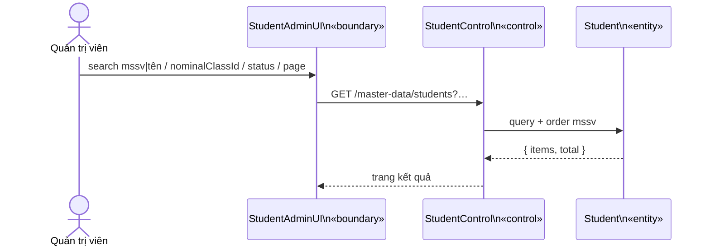
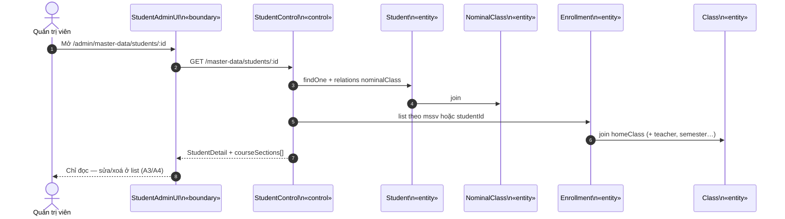
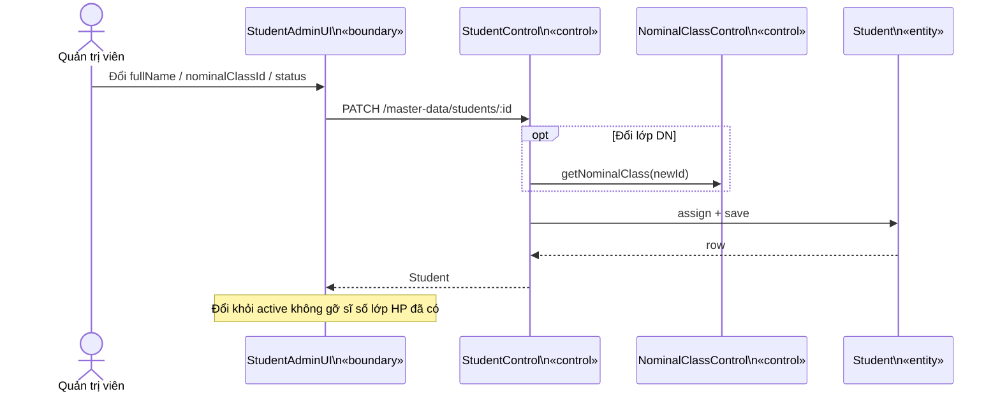
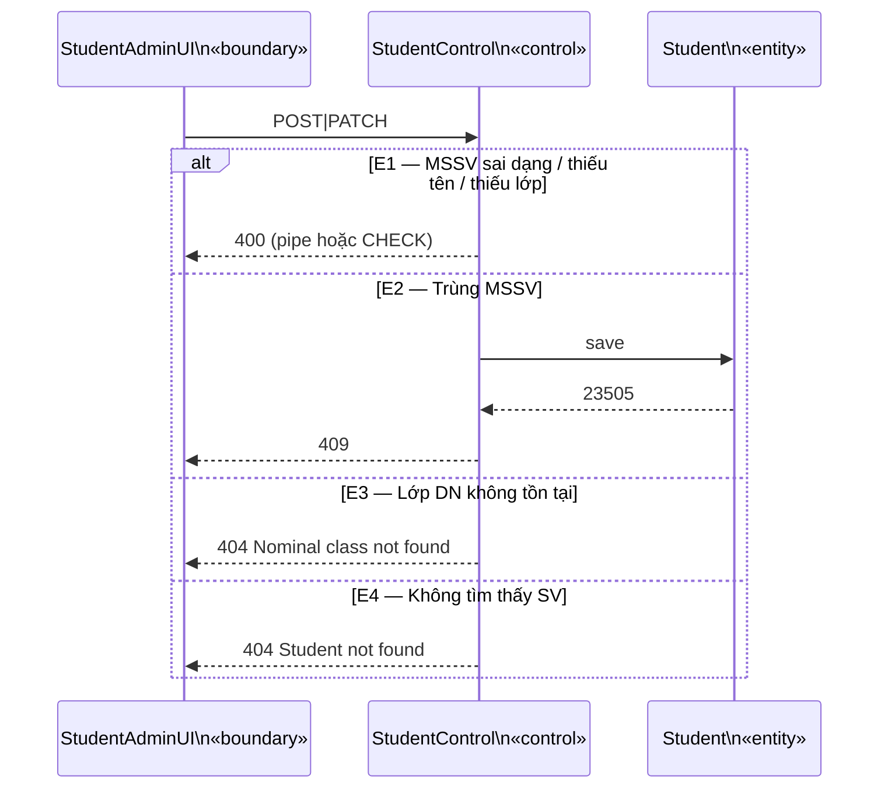
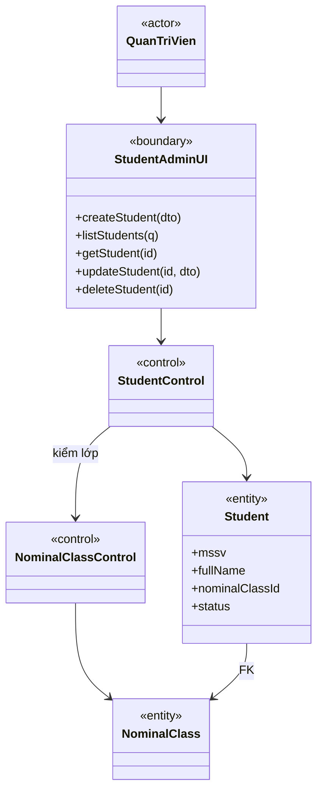

# Sequence diagram UC07 — Quản lý hồ sơ sinh viên (BCE)

**Use case:** UC07 / UC-CAT-04 — [Đặc tả use case](./usecase-spec-uc01-uc15.md)  
**Bộ mục lục:** [sequence-uc01-uc15-bce.md](./sequence-uc01-uc15-bce.md)  
**Code:** `admin/master-data/students/**` · `StudentsController` · `MasterDataService` · `student.entity.ts`

```text
[Actor] <---> [Boundary] <---> [Controller] <---> [Entity]
                                    |
                                    +---> [Controller khác]
```

---

## 1. Ánh xạ BCE ↔ code

| BCE | Đối tượng | Code | Ghi chú |
| --- | --- | --- | --- |
| Actor | Quản trị viên | — | Catalog SV — không có account web |
| Boundary | `StudentAdminUI` | `students/page.tsx`, `students/[id]/page.tsx` | List CRUD; trang `[id]` **chỉ đọc** + drill lớp HP |
| Control | `StudentControl` | `StudentsController` + student methods trong `MasterDataService` | `/master-data/students` |
| Control khác | `NominalClassControl` (logic) | `getNominalClass` trước create/update khi có `nominalClassId` | Kiểm lớp DN tồn tại |
| Entity | `Student` | `student.entity.ts` | mssv citext unique; ck `^[A-Za-z0-9]{4,20}$`; status active/inactive/graduated/withdrawn |
| Entity (đọc kèm) | `NominalClass`, `Enrollment`/`Class` | Chi tiết SV join lớp DN + liệt kê lớp HP | Chỉ A2 |

**Không vẽ:** ValidationPipe, Repository, apiClient, guards (gộp).

---

## 2. Luồng chính — Tạo hồ sơ sinh viên

### 2.1 Mermaid

```mermaid
sequenceDiagram
  autonumber
  actor Admin as Quản trị viên
  participant UI as StudentAdminUI\n«boundary»
  participant Stu as StudentControl\n«control»
  participant NCCtrl as NominalClassControl\n«control»
  participant NC as NominalClass\n«entity»
  participant Student as Student\n«entity»

  Admin ->> UI: Nhập mssv, fullName, chọn nominalClassId, status
  UI ->> Stu: POST /master-data/students
  Stu ->> Stu: Guard admin + ValidationPipe(CreateStudentDto)
  Stu ->> NCCtrl: getNominalClass(nominalClassId)
  NCCtrl ->> NC: findOne
  alt Lớp DN không có
    NC -->> NCCtrl: null
    NCCtrl -->> Stu: 404
    Stu -->> UI: 404
  else OK
    NC -->> Stu: NominalClass
    Stu ->> Student: save(mssv, fullName, nominalClassId, status)
    Note over Student: unique mssv; CHECK độ dài/ký tự
    Student -->> Stu: { id }
    Stu -->> UI: { id }
    UI -->> Admin: Hồ sơ trên danh sách
  end
```

### 2.2 Bảng thông điệp

| # | Từ | Tới | Thông điệp | Code |
| --- | --- | --- | --- | --- |
| 1 | Actor | UI | Nhập MSSV, họ tên, lớp DN, status | Form create |
| 2 | UI | Stu | `tạoHồSơ(dto)` | `createStudent` |
| 3 | Stu | Stu | Validate DTO | |
| 4 | Stu | NCCtrl | `kiểmLớpDanhNghĩa(id)` | `getNominalClass` (cùng MasterDataService) |
| 5 | NCCtrl | NC | `findOne` | |
| 6 | NC | Stu | NominalClass | |
| 7 | Stu | Student | `lưu(sv)` | `createStudent` → `save` |
| 8 | Student | Stu | `{ id }` | |
| 9 | Stu | UI | `{ id }` | |
| 10 | UI | Actor | List cập nhật | |

Trên sơ đồ StarUML có thể gộp NCCtrl vào self-call `StudentControl` nếu muốn ít participant — tài liệu này giữ Control khác đúng mẫu UC01 (`| +--->`).

---

## 3. Luồng thay thế

### 3.1 A1 — Tìm / lọc / phân trang



### 3.2 A2 — Xem chi tiết (read-only)



### 3.3 A3 — Sửa hồ sơ từ danh sách



### 3.4 A4 — Xoá hồ sơ catalog

```mermaid
sequenceDiagram
  actor Admin as Quản trị viên
  participant UI as StudentAdminUI\n«boundary»
  participant Stu as StudentControl\n«control»
  participant Student as Student\n«entity»

  Admin ->> UI: Xác nhận xoá
  UI ->> Stu: DELETE /master-data/students/:id
  Stu ->> Student: remove
  Stu -->> UI: 204
  Note over Student: Enrollment snapshot mssv/name giữ nguyên; student_id SET NULL nếu có FK
```

---

## 4. Luồng ngoại lệ



| Ngoại lệ | Điểm cắt | Phản ứng |
| --- | --- | --- |
| E1 | DTO / `ck_student_mssv` | Không lưu |
| E2 | Unique mssv | 409 |
| E3 | NominalClassControl | 404 |
| E4 | requireStudent | 404 |

**Hệ quả nghiệp vụ (E ngoài sequence tạo):** SV `status ≠ active` → UC12 từ chối thêm từ catalog.

---

## 5. Sơ đồ lớp BCE



---

## 6. Checklist

1. Happy path có mũi tên Control → Control khác (NominalClass).
2. A2 chi tiết: Boundary read-only; không vẽ nút Sửa trên `[id]`.
3. Không tạo `Account` cho sinh viên.
4. Actor chỉ nối Boundary.
