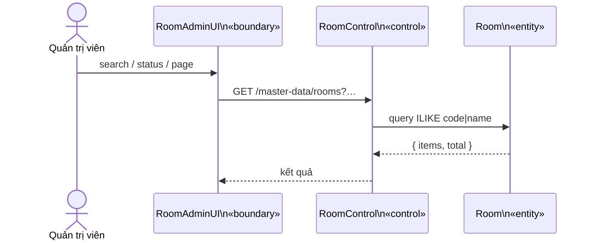
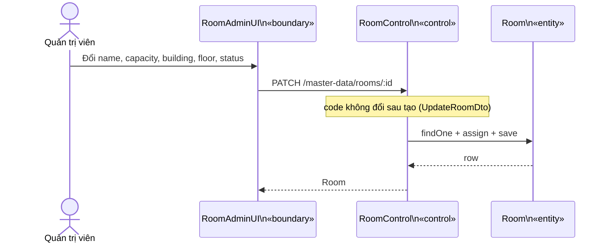
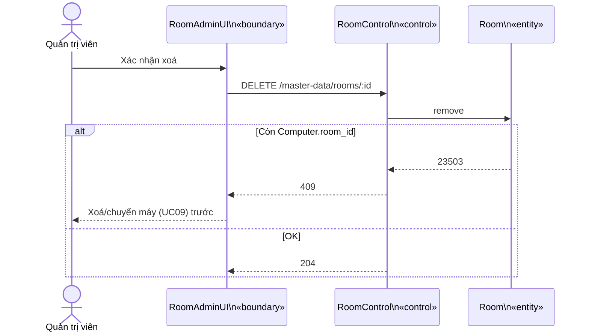
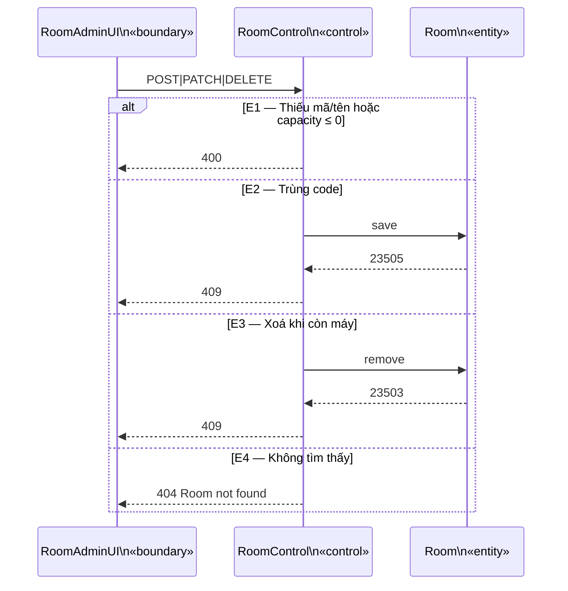
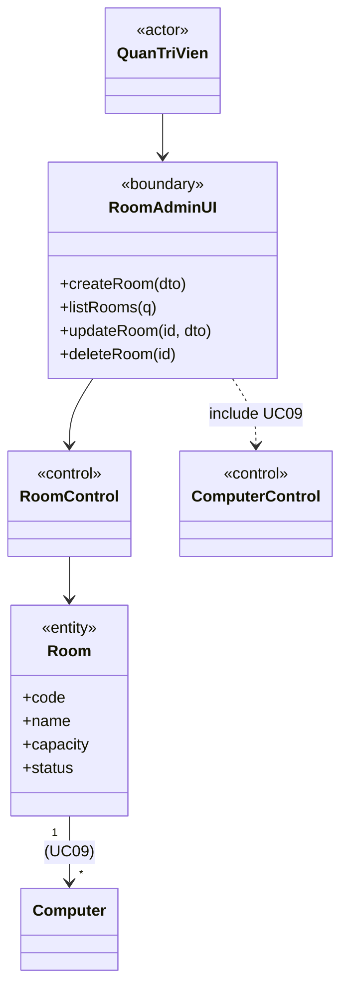

# Sequence diagram UC08 — Quản lý phòng máy (BCE)

**Use case:** UC08 / UC-LAB-01 — [Đặc tả use case](./usecase-spec-uc01-uc15.md)  
**Bộ mục lục:** [sequence-uc01-uc15-bce.md](./sequence-uc01-uc15-bce.md)  
**Code:** `admin/master-data/rooms/page.tsx` · `RoomsController` · `MasterDataService` · `room.entity.ts`  
**Include:** UC09 Quản lý máy tính

```text
[Actor] <---> [Boundary] <---> [Controller] <---> [Entity]
                                    |
                                    +---> [Controller khác]
```

---

## 1. Ánh xạ BCE ↔ code

| BCE | Đối tượng | Code | Ghi chú |
| --- | --- | --- | --- |
| Actor | Quản trị viên | — | C/U/D admin; teacher được GET list (chọn phòng phiên) — ngoài CRUD |
| Boundary | `RoomAdminUI` | `rooms/page.tsx` + master-data API | Catalog phòng |
| Control | `RoomControl` | `RoomsController` + room methods | `/master-data/rooms` |
| Control khác | `ComputerControl` | UC09 — gọi sau khi có `Room.id` | Include trên sơ đồ quan hệ UC |
| Entity | `Room` | `room.entity.ts` | code unique; capacity > 0; status available/maintenance/retired |

**Không vẽ:** ValidationPipe, Repository, apiClient, guards (gộp).

---

## 2. Luồng chính — Tạo phòng (+ include máy)

### 2.1 Mermaid

```mermaid
sequenceDiagram
  autonumber
  actor Admin as Quản trị viên
  participant UI as RoomAdminUI\n«boundary»
  participant RoomCtrl as RoomControl\n«control»
  participant Room as Room\n«entity»
  participant CompCtrl as ComputerControl\n«control»

  Admin ->> UI: Nhập code, name, capacity, building?, floor?, status
  UI ->> RoomCtrl: POST /master-data/rooms
  RoomCtrl ->> RoomCtrl: Guard admin + ValidationPipe(CreateRoomDto)
  RoomCtrl ->> Room: save(...)
  Note over Room: unique code; capacity > 0
  Room -->> RoomCtrl: { id }
  RoomCtrl -->> UI: { id }
  opt Include UC09 — khai báo máy thuộc phòng
    UI ->> CompCtrl: ref UC09 tạo máy với roomId
    Note over CompCtrl: Xem sequence-uc09-computer-bce.md
  end
  UI -->> Admin: Phòng (và máy nếu có) đã lưu
```

### 2.2 Bảng thông điệp

| # | Từ | Tới | Thông điệp | Code |
| --- | --- | --- | --- | --- |
| 1 | Actor | UI | Nhập thông tin phòng | Dialog |
| 2 | UI | RoomCtrl | `tạoPhòng(dto)` | `createRoom` |
| 3 | RoomCtrl | RoomCtrl | Validate | DTO |
| 4 | RoomCtrl | Room | `lưu(phòng)` | `save` |
| 5 | Room | RoomCtrl | `{ id }` | |
| 6 | RoomCtrl | UI | `{ id }` | |
| 7 | UI | CompCtrl | (opt) `tạoMáy` UC09 | include |
| 8 | UI | Actor | Xác nhận trên list | |

---

## 3. Luồng thay thế

### 3.1 A1 — Tìm / lọc / phân trang



### 3.2 A2 — Sửa phòng



### 3.3 A3 — Xoá phòng chưa có máy



---

## 4. Luồng ngoại lệ



| Ngoại lệ | Điểm cắt | Phản ứng |
| --- | --- | --- |
| E1 | Validation / business | Không lưu |
| E2 | Unique code | 409 |
| E3 | FK Computer | 409 |
| E4 | getRoom | 404 |

---

## 5. Sơ đồ lớp BCE



---

## 6. Checklist

1. Happy path kết thúc bằng `opt` ref UC09 — đừng nhét toàn bộ tạo máy vào một sequence dày.
2. A2: không đổi `code`.
3. A3 luôn có nhánh còn máy.
4. Actor chỉ nối Boundary.
