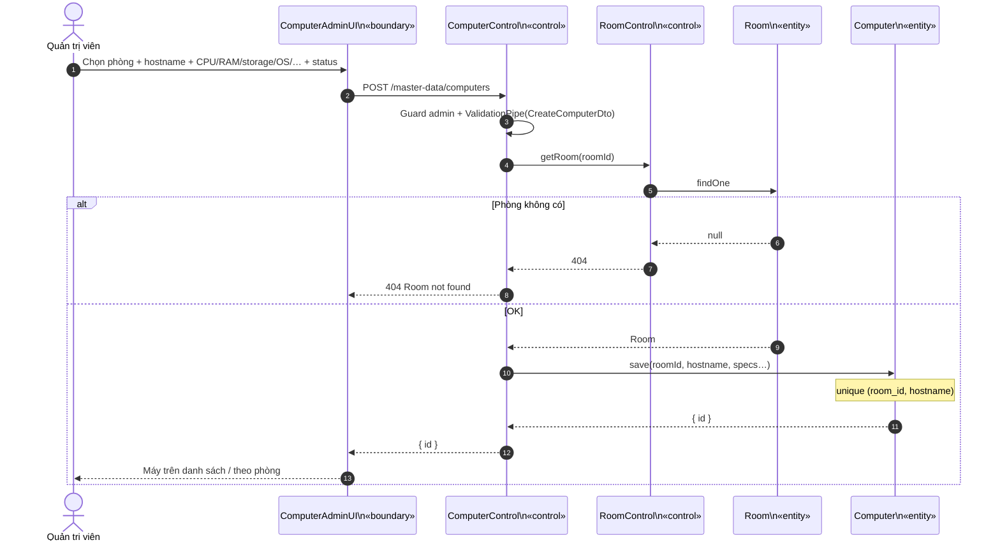
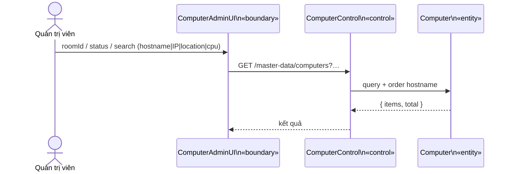
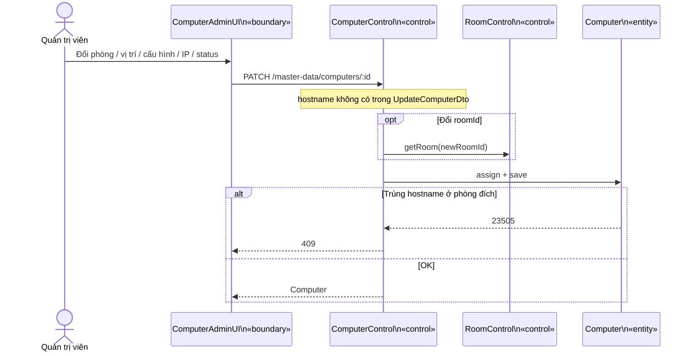
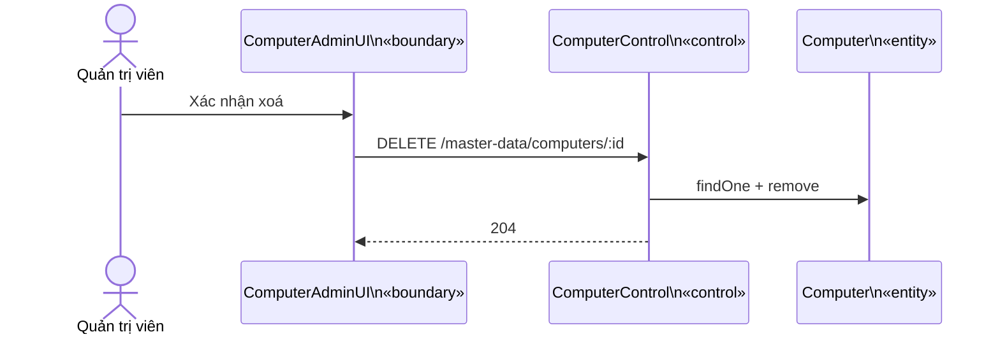
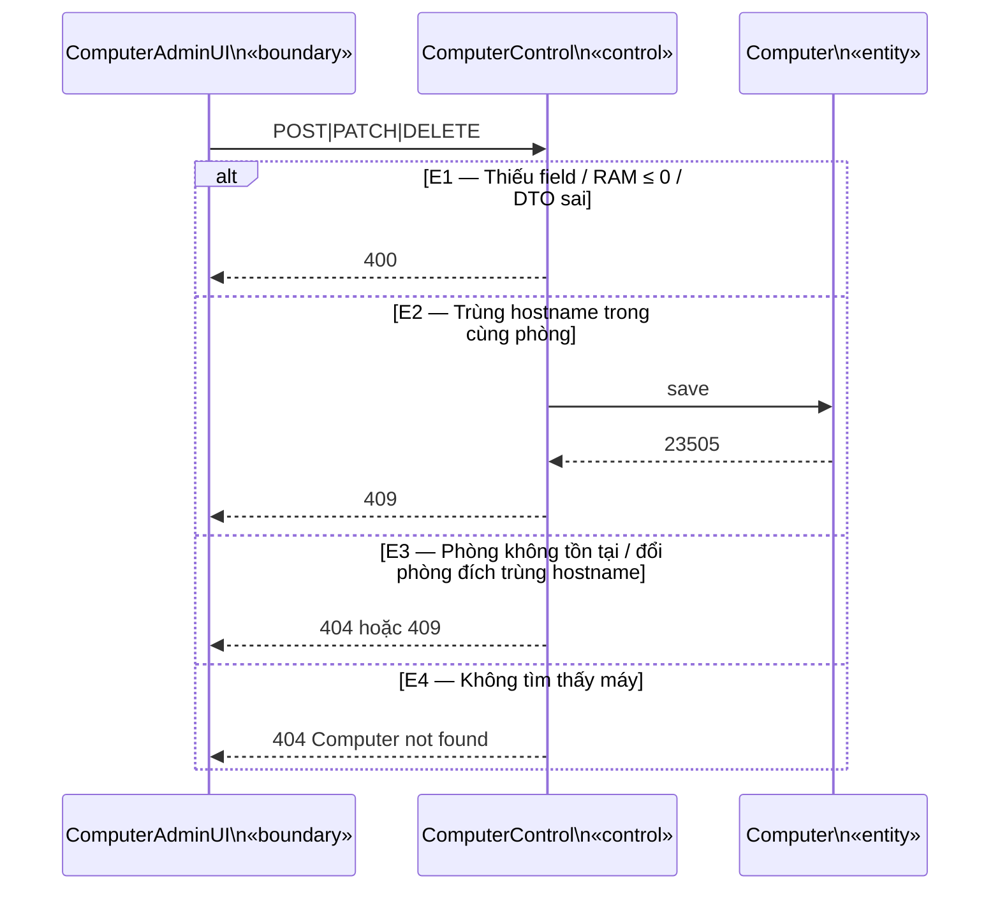
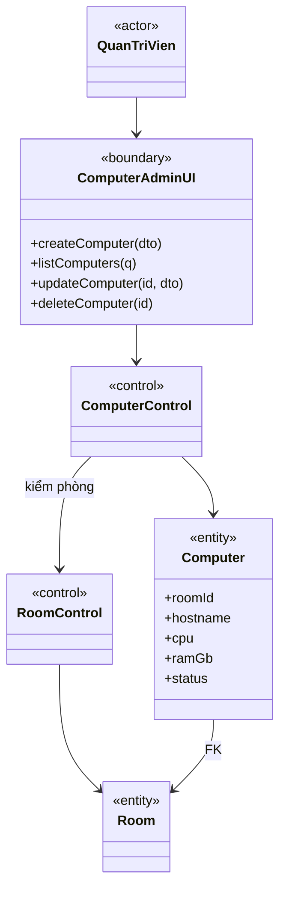

# Sequence diagram UC09 — Quản lý máy tính phòng máy (BCE)

**Use case:** UC09 / UC-LAB-02 — [Đặc tả use case](./usecase-spec-uc01-uc15.md)  
**Bộ mục lục:** [sequence-uc01-uc15-bce.md](./sequence-uc01-uc15-bce.md)  
**Code:** `admin/master-data/computers/page.tsx` · `ComputersController` · `MasterDataService` · `computer.entity.ts`  
**Được include từ:** UC08

```text
[Actor] <---> [Boundary] <---> [Controller] <---> [Entity]
                                    |
                                    +---> [Controller khác]
```

---

## 1. Ánh xạ BCE ↔ code

| BCE | Đối tượng | Code | Ghi chú |
| --- | --- | --- | --- |
| Actor | Quản trị viên | — | admin CRUD |
| Boundary | `ComputerAdminUI` | `computers/page.tsx` (+ điều hướng từ phòng) | Form gắn `roomId` |
| Control | `ComputerControl` | `ComputersController` + computer methods | `/master-data/computers` |
| Control khác | `RoomControl` | `getRoom(roomId)` trước create / khi đổi phòng | Bảo đảm phòng tồn tại |
| Entity | `Computer` | `computer.entity.ts` | unique `(roomId, hostname)`; hostname **không** đổi qua PATCH |
| Entity | `Room` | Đọc khi kiểm / đổi phòng | FK RESTRICT |

**Không vẽ:** ValidationPipe, Repository, apiClient, guards (gộp).

---

## 2. Luồng chính — Tạo máy trong phòng

### 2.1 Mermaid



### 2.2 Bảng thông điệp

| # | Từ | Tới | Thông điệp | Code |
| --- | --- | --- | --- | --- |
| 1 | Actor | UI | Nhập máy + chọn phòng | Dialog create |
| 2 | UI | Comp | `tạoMáy(dto)` | `createComputer` |
| 3 | Comp | Comp | Validate | DTO (ramGb > 0, …) |
| 4 | Comp | RoomCtrl | `kiểmPhòng(roomId)` | `getRoom` |
| 5 | RoomCtrl | Room | `findOne` | |
| 6 | Room | Comp | Room | |
| 7 | Comp | Computer | `lưu(máy)` | `save` |
| 8 | Computer | Comp | `{ id }` | |
| 9 | Comp | UI | `{ id }` | |
| 10 | UI | Actor | List cập nhật | |

---

## 3. Luồng thay thế

### 3.1 A1 — Tìm theo phòng / từ khoá



### 3.2 A2 — Sửa máy



### 3.3 A3 — Xoá máy



---

## 4. Luồng ngoại lệ



| Ngoại lệ | Điểm cắt | Phản ứng |
| --- | --- | --- |
| E1 | ValidationPipe | Không lưu |
| E2 | Unique (room, hostname) | 409 |
| E3 | RoomControl / unique phòng đích | 404/409 |
| E4 | getComputer | 404 |

---

## 5. Sơ đồ lớp BCE



---

## 6. Checklist

1. Luôn có Control → RoomControl trên create (và khi đổi phòng).
2. Note: hostname bất biến sau tạo.
3. Cùng hostname ở **phòng khác** vẫn hợp lệ — chỉ unique theo phòng.
4. Actor chỉ nối Boundary.
