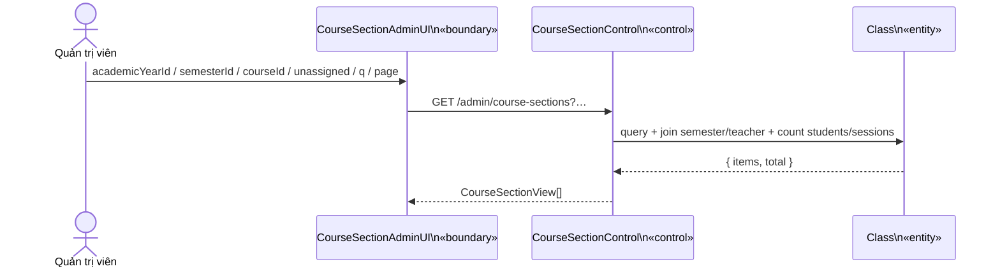
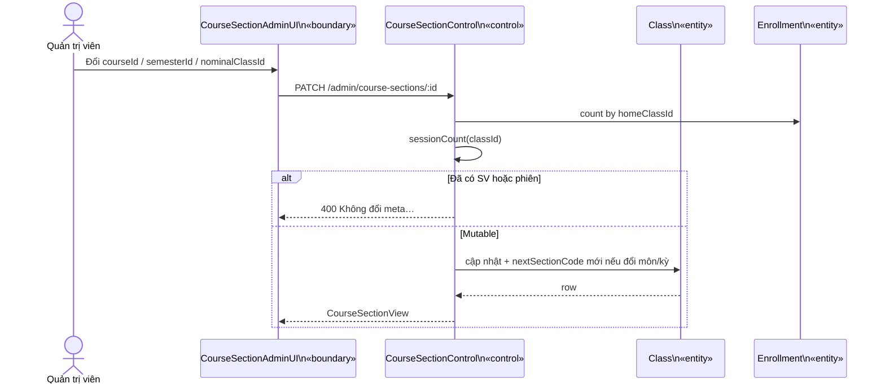
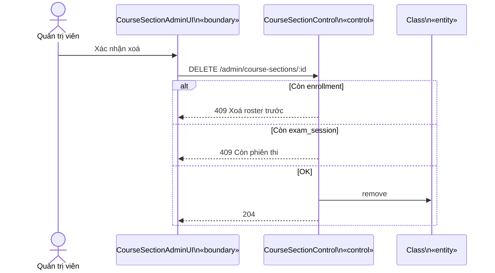
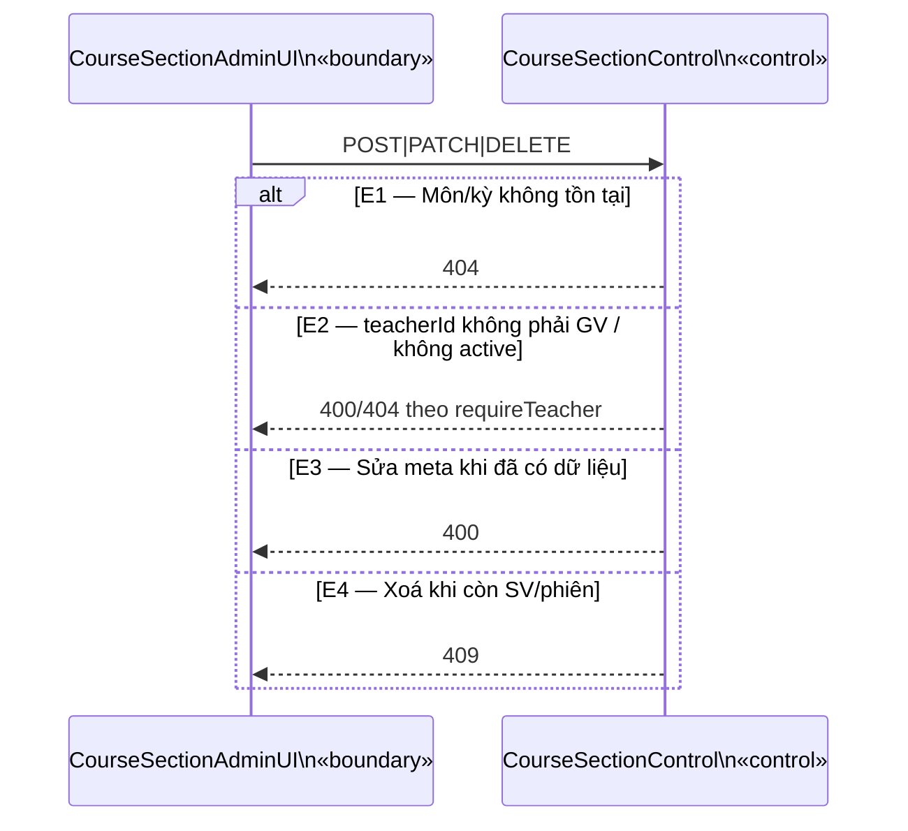
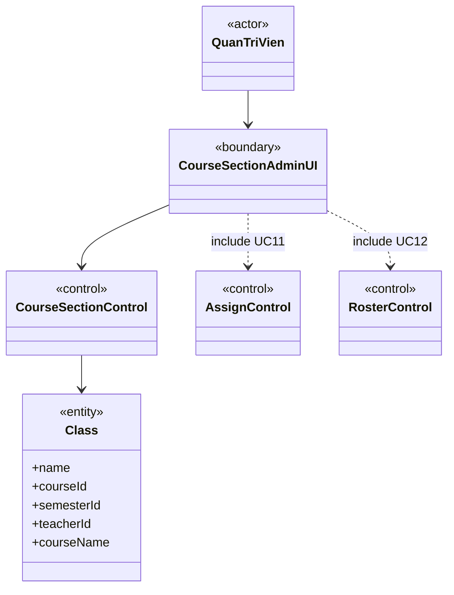

# Sequence diagram UC10 — Quản lý lớp học phần (BCE)

**Use case:** UC10 / UC-SEC-01 — [Đặc tả use case](./usecase-spec-uc01-uc15.md)  
**Bộ mục lục:** [sequence-uc01-uc15-bce.md](./sequence-uc01-uc15-bce.md)  
**Code:** `admin/course-sections/**` · `AdminCourseSectionController` · `AdminCourseSectionService` · `class.entity.ts`  
**Include:** UC11 Phân công GV · UC12 Sĩ số

```text
[Actor] <---> [Boundary] <---> [Controller] <---> [Entity]
                                    |
                                    +---> [Controller khác]
```

---

## 1. Ánh xạ BCE ↔ code

| BCE | Đối tượng | Code | Ghi chú |
| --- | --- | --- | --- |
| Actor | Quản trị viên | — | Giảng viên **không** tạo lớp |
| Boundary | `CourseSectionAdminUI` | `course-sections/page.tsx`, `[id]/page.tsx` | Tạo / list / chi tiết |
| Control | `CourseSectionControl` | `AdminCourseSectionService` (+ controller) | `/admin/course-sections` |
| Control khác | Catalog require* | Cùng service: Course, Semester, NominalClass, Account(teacher) | Không HTTP nội bộ — vẽ như đọc Entity / Control catalog |
| Control khác (include) | `AssignControl`, `RosterControl` | UC11, UC12 | Sau tạo lớp |
| Entity | `Class` | `course/entities/class.entity.ts` | Bảng `class`; mã `name` = `{course.code}{001…}` |

**Không vẽ:** ValidationPipe, DataSource transaction chi tiết (gộp note), apiClient, guards (gộp).

---

## 2. Luồng chính — Tạo lớp học phần

### 2.1 Mermaid

```mermaid
sequenceDiagram
  autonumber
  actor Admin as Quản trị viên
  participant UI as CourseSectionAdminUI\n«boundary»
  participant Sec as CourseSectionControl\n«control»
  participant Course as Course\n«entity»
  participant Sem as Semester\n«entity»
  participant NC as NominalClass\n«entity»
  participant Account as Account\n«entity»
  participant Class as Class\n«entity»
  participant Assign as AssignControl\n«control»
  participant Roster as RosterControl\n«control»

  Admin ->> UI: Chọn môn, học kỳ; optional lớp DN / GV; tạo lớp
  UI ->> Sec: POST /admin/course-sections
  Sec ->> Sec: Guard admin + validate CreateCourseSectionDto
  Sec ->> Course: requireCourse(courseId)
  Course -->> Sec: Course
  Sec ->> Sem: requireSemester(semesterId)
  Sem -->> Sec: Semester
  opt nominalClassId
    Sec ->> NC: requireNominalClass
    NC -->> Sec: NominalClass
  end
  opt teacherId (A2 gộp)
    Sec ->> Account: requireTeacher
    Account -->> Sec: Account role=teacher
  end
  Sec ->> Class: nextSectionCode + save(name, courseId, semesterId, courseName snapshot, teacherId?, nominalClassId?)
  Class -->> Sec: Class
  Sec -->> UI: CourseSectionView
  UI ->> Assign: ref UC11 phân công (nếu chưa có teacher)
  UI ->> Roster: ref UC12 lập sĩ số
  UI -->> Admin: Lớp sẵn sàng (mã tự cấp)
```

### 2.2 Bảng thông điệp

| # | Từ | Tới | Thông điệp | Code |
| --- | --- | --- | --- | --- |
| 1 | Actor | UI | Chọn môn/kỳ (+ optional) | Dialog tạo |
| 2 | UI | Sec | `tạoLớpHP(dto)` | `createCourseSection` |
| 3 | Sec | Course | `requireCourse` | findOne hoặc 404 |
| 4 | Sec | Sem | `requireSemester` | |
| 5 | Sec | NC | (opt) `requireNominalClass` | |
| 6 | Sec | Account | (opt) `requireTeacher` | |
| 7 | Sec | Class | `nextSectionCode` + `save` | transaction |
| 8 | Class | Sec | entity | |
| 9 | Sec | UI | `CourseSectionView` | embed count, names |
| 10 | UI | Assign / Roster | include UC11 / UC12 | có thể trì hoãn |
| 11 | UI | Actor | Điều hướng chi tiết / list | |

**Mã lớp:** `{course.code}` + 3 chữ số theo số lớp đã có của cặp (môn, học kỳ).

---

## 3. Luồng thay thế

### 3.1 A1 — Lọc danh sách



### 3.2 A2 — Gán GV ngay khi tạo

Nằm trong bước opt `teacherId` của luồng chính: cùng transaction tạo lớp đã có `teacherId`; sĩ số sau này nhận `homeTeacherId` qua UC11/assign hoặc trống cho đến khi có enrollment.

### 3.3 A3 — Sửa meta khi lớp còn trống



### 3.4 A4 — Xoá lớp trống



---

## 4. Luồng ngoại lệ



| Ngoại lệ | Điểm cắt | Phản ứng |
| --- | --- | --- |
| E1 | require Course/Semester | 404 |
| E2 | requireTeacher | lỗi; không gán |
| E3 | `assertMetaMutable` | 400 |
| E4 | `remove` | 409 |

---

## 5. Sơ đồ lớp BCE



---

## 6. Checklist

1. Happy path có `ref` UC11/UC12 — có thể trì hoãn nhưng phải có trên sơ đồ include.
2. Mã lớp do Control cấp, Actor không nhập mã.
3. Snapshot `courseName` lúc tạo/đổi môn.
4. Actor chỉ nối Boundary.
