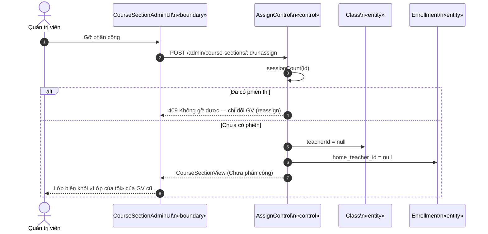
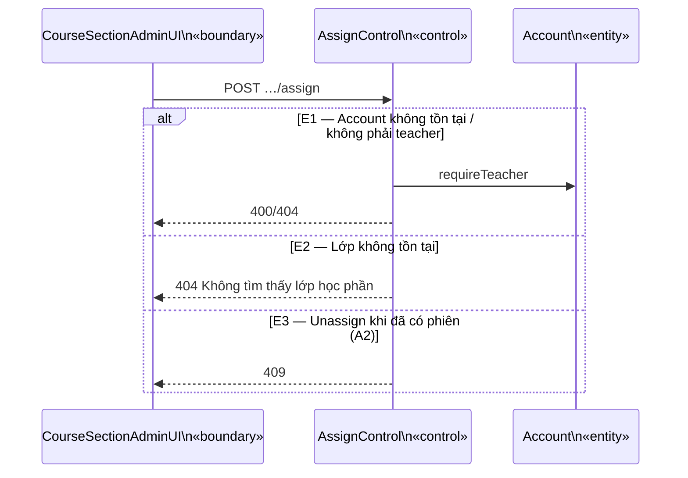
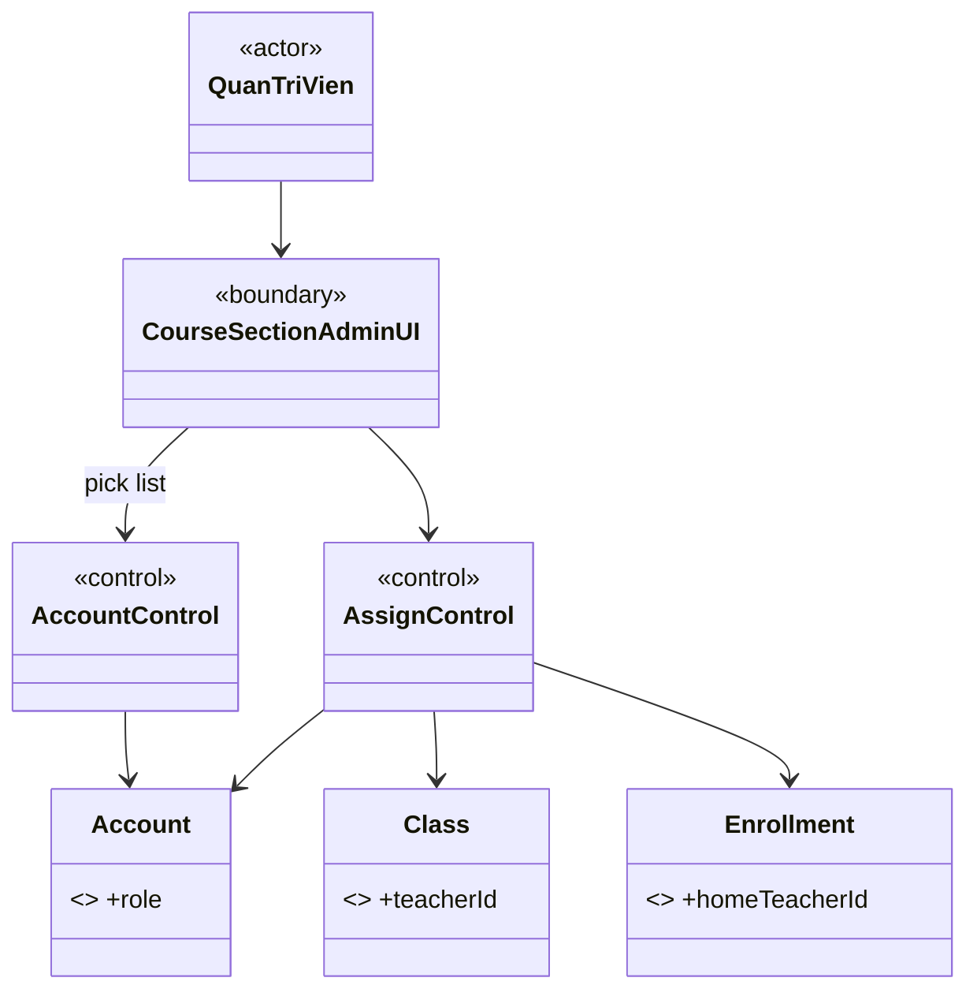

# Sequence diagram UC11 — Phân công giảng viên cho lớp học phần (BCE)

**Use case:** UC11 / UC-SEC-02 — [Đặc tả use case](./usecase-spec-uc01-uc15.md)  
**Bộ mục lục:** [sequence-uc01-uc15-bce.md](./sequence-uc01-uc15-bce.md)  
**Code:** `course-sections/[id]/page.tsx` · `POST …/assign` · `POST …/unassign` · `GET /accounts/teachers`  
**Include từ:** UC10 · **Không** chuyển chủ phiên thi (UC15)

```text
[Actor] <---> [Boundary] <---> [Controller] <---> [Entity]
                                    |
                                    +---> [Controller khác]
```

---

## 1. Ánh xạ BCE ↔ code

| BCE | Đối tượng | Code | Ghi chú |
| --- | --- | --- | --- |
| Actor | Quản trị viên | — | |
| Boundary | `CourseSectionAdminUI` | Dialog «Phân công / Đổi giảng viên» trên chi tiết lớp | |
| Control | `AssignControl` | `AdminCourseSectionService.assign` / `unassign` | Routes trên `AdminCourseSectionController` |
| Control khác | `AccountControl` | `GET /accounts/teachers` → `listTeacherOptions` | Pick-list id+name |
| Entity | `Class` | `teacherId` | |
| Entity | `Enrollment` | `homeTeacherId` backfill cùng transaction | |
| Entity | `Account` | Kiểm role=teacher khi assign | |

**Không vẽ:** ValidationPipe, apiClient, guards (gộp).  
**Note nghiệp vụ:** Đổi GV lớp **không** đổi `exam_session.teacher_id` / rubric — UI có cảnh báo; chuyển phiên = UC15.

---

## 2. Luồng chính — Phân công / đổi GV

### 2.1 Mermaid

```mermaid
sequenceDiagram
  autonumber
  actor Admin as Quản trị viên
  participant UI as CourseSectionAdminUI\n«boundary»
  participant Acc as AccountControl\n«control»
  participant Assign as AssignControl\n«control»
  participant Account as Account\n«entity»
  participant Class as Class\n«entity»
  participant Enroll as Enrollment\n«entity»

  Admin ->> UI: Mở Phân công / Đổi giảng viên
  UI ->> Acc: GET /accounts/teachers
  Acc ->> Account: find role=teacher order name
  Account -->> Acc: [{ id, name }]
  Acc -->> UI: TeacherOption[]
  Admin ->> UI: Chọn teacherId / Xác nhận
  UI ->> Assign: POST /admin/course-sections/:id/assign { teacherId }
  Assign ->> Assign: Guard admin + validate
  Assign ->> Account: requireTeacher(teacherId)
  Account -->> Assign: Account (role teacher)
  Assign ->> Class: findOne(id) + set teacherId + save
  Assign ->> Enroll: UPDATE home_teacher_id WHERE home_class_id = id
  Assign -->> UI: CourseSectionView (teacherName)
  UI -->> Admin: Lớp hiện tên GV; GV thấy «Lớp của tôi»
  Note over Class: Phiên thi cũ vẫn thuộc GV trước — UC15 nếu cần
```

### 2.2 Bảng thông điệp

| # | Từ | Tới | Thông điệp | Code |
| --- | --- | --- | --- | --- |
| 1 | Actor | UI | Mở dialog | Nút Phân công / Đổi GV |
| 2 | UI | Acc | `liệtKêGiảngViên()` | `listTeacherOptions` |
| 3 | Acc | Account | query teachers | `listTeacherOptions` |
| 4 | Acc | UI | options | chỉ id, name |
| 5 | Actor | UI | Chọn GV | |
| 6 | UI | Assign | `phânCông(id, teacherId)` | `assignCourseSection` |
| 7 | Assign | Account | `requireTeacher` | |
| 8 | Assign | Class | set `teacherId` | transaction |
| 9 | Assign | Enroll | backfill `homeTeacherId` | cùng TX |
| 10 | Assign | UI | view | |
| 11 | UI | Actor | Hiển thị GV | |

---

## 3. Luồng thay thế

### 3.1 A1 — Gán lúc tạo lớp (UC10-A2)

```mermaid
sequenceDiagram
  actor Admin as Quản trị viên
  participant UI as CourseSectionAdminUI\n«boundary»
  participant Sec as CourseSectionControl\n«control»
  participant Class as Class\n«entity»

  Admin ->> UI: Tạo lớp kèm teacherId
  UI ->> Sec: POST /admin/course-sections { …, teacherId }
  Sec ->> Class: save với teacherId
  Sec -->> UI: CourseSectionView
  Note over UI: Cùng hậu điều kiện bước 8–11 luồng chính; roster sau nhận homeTeacherId khi thêm SV
```

### 3.2 A2 — Gỡ phân công



---

## 4. Luồng ngoại lệ



| Ngoại lệ | Điểm cắt | Phản ứng |
| --- | --- | --- |
| E1 | requireTeacher | Không gán (tránh admin/orphaned UI) |
| E2 | getEntity | 404 |
| E3 | unassign + sessionCount | 409; dùng luồng chính đổi GV hoặc UC15 cho phiên |

---

## 5. Sơ đồ lớp BCE



---

## 6. Checklist

1. Luôn vẽ backfill `Enrollment` trong cùng bước assign.
2. Note tách biệt UC15 trên sơ đồ chính.
3. A2 unassign có nhánh 409 bắt buộc.
4. AccountControl chỉ trả id+name — không lộ email trên pick-list.
