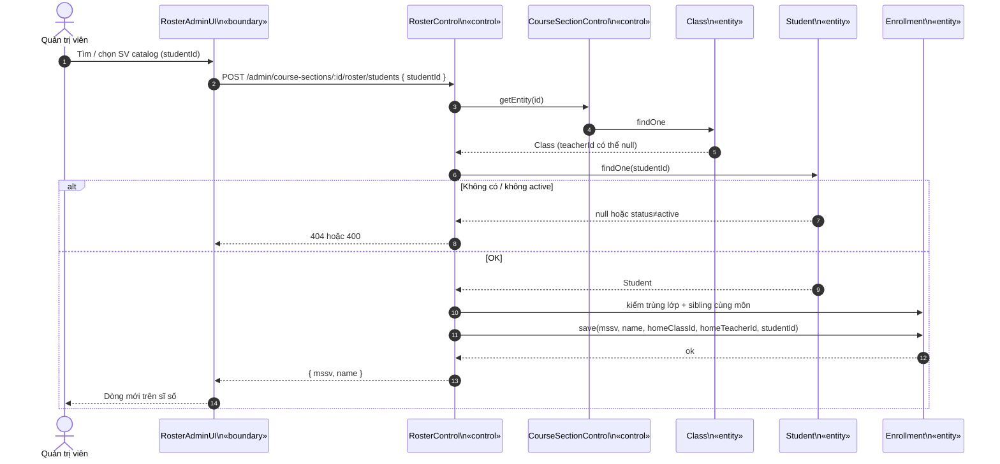
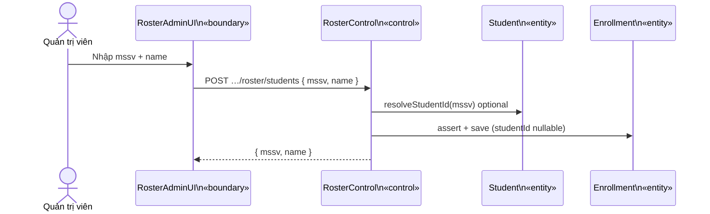
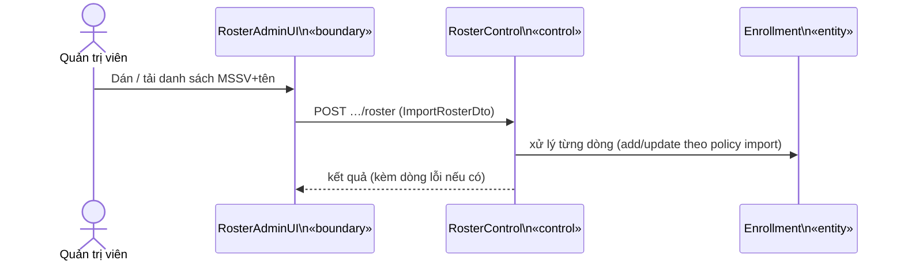
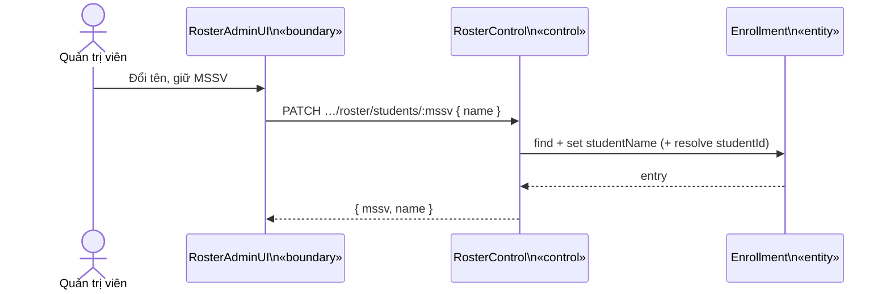
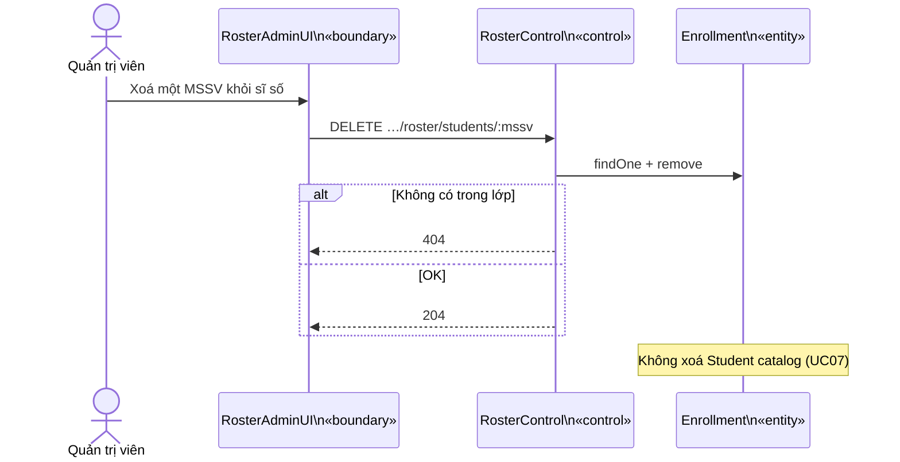
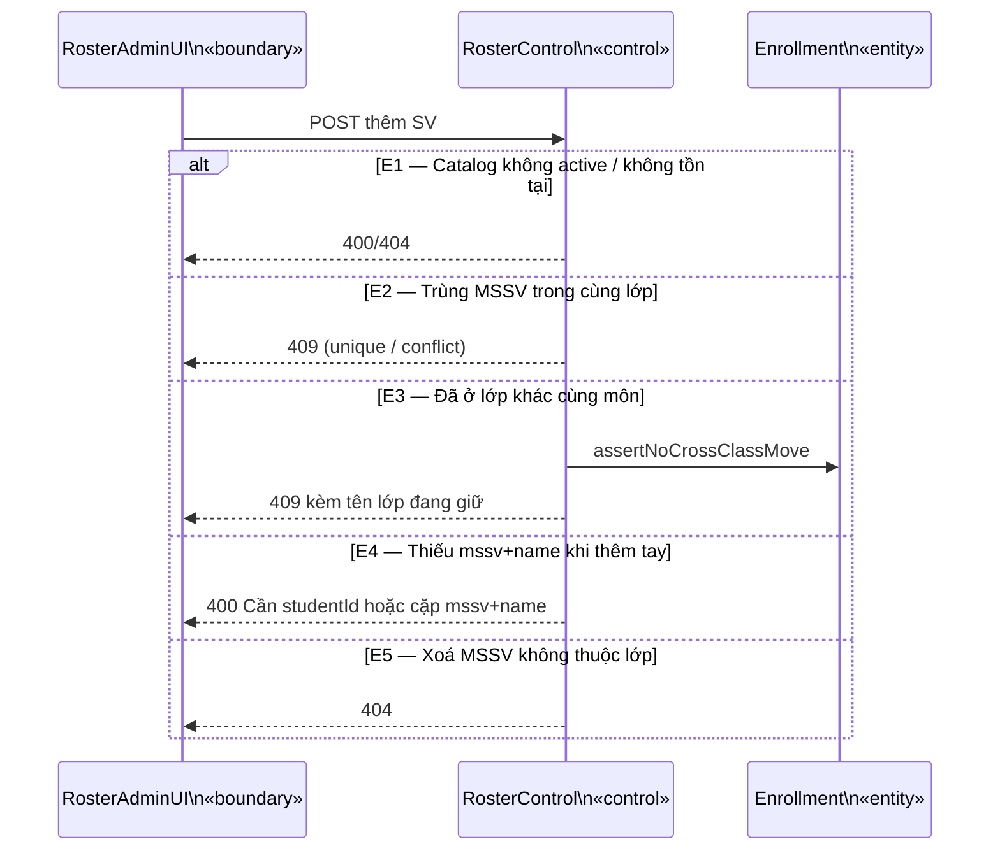
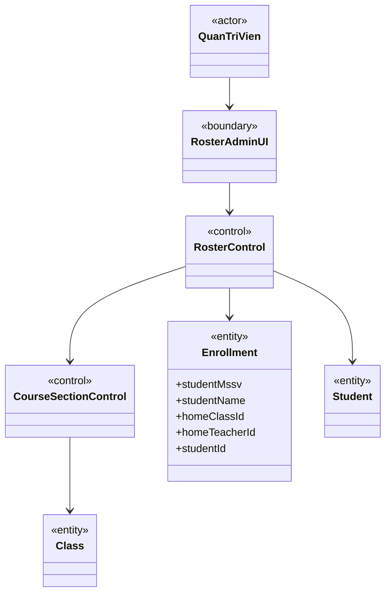

# Sequence diagram UC12 — Quản lý sĩ số lớp học phần (BCE)

**Use case:** UC12 / UC-SEC-03 — [Đặc tả use case](./usecase-spec-uc01-uc15.md)  
**Bộ mục lục:** [sequence-uc01-uc15-bce.md](./sequence-uc01-uc15-bce.md)  
**Code:** tab roster `course-sections/[id]` · `RosterService` · routes roster trên `AdminCourseSectionController`  
**Include từ:** UC10

```text
[Actor] <---> [Boundary] <---> [Controller] <---> [Entity]
                                    |
                                    +---> [Controller khác]
```

---

## 1. Ánh xạ BCE ↔ code

| BCE | Đối tượng | Code | Ghi chú |
| --- | --- | --- | --- |
| Actor | Quản trị viên | — | Teacher cũng roster lớp đã gán — sơ đồ admin |
| Boundary | `RosterAdminUI` | Chi tiết lớp — tab sĩ số | Thêm catalog / tay / import / sửa tên / xoá |
| Control | `RosterControl` | `RosterService` | add / import / updateName / remove / list |
| Control khác | `CourseSectionControl` | `getEntity(id)` trước mọi thao tác | Lấy `Class` |
| Control khác | resolve catalog | `StudentEntity` trong `resolveAddInput` | Khi `studentId` hoặc khớp mssv |
| Entity | `Enrollment` | `enrollment.entity.ts` | Snapshot mssv + name; optional `studentId` |
| Entity | `Class`, `Student` | homeClass / catalog | |

**Quy tắc chống chuyển lớp cùng môn:** `assertNoCrossClassMove` — Conflict nếu MSSV đã ở lớp khác cùng `course_id` (fallback `course_name`).

**Không vẽ:** ValidationPipe, apiClient, guards (gộp).

---

## 2. Luồng chính — Thêm từ catalog

### 2.1 Mermaid



### 2.2 Bảng thông điệp

| # | Từ | Tới | Thông điệp | Code |
| --- | --- | --- | --- | --- |
| 1 | Actor | UI | Chọn SV từ catalog | Search/lookup |
| 2 | UI | Roster | `thêmSV(studentId)` | `addSectionStudent` |
| 3 | Roster | Sec | `getEntity` | load Class |
| 4 | Sec | Class | findOne | |
| 5 | Roster | Student | findOne + status | `resolveAddInput` |
| 6 | Roster | Enroll | assert + save | `addStudent` |
| 7 | Roster | UI | `{ mssv, name }` | |
| 8 | UI | Actor | List sĩ số | |

---

## 3. Luồng thay thế

### 3.1 A1 — Thêm tay `{ mssv, name }`



### 3.2 A2 — Import nhiều dòng



### 3.3 A3 — Sửa họ tên một dòng



### 3.4 A4 — Xoá khỏi lớp



---

## 4. Luồng ngoại lệ



| Ngoại lệ | Điểm cắt | Phản ứng |
| --- | --- | --- |
| E1 | resolveAddInput + status | Không thêm |
| E2 | unique lớp+mssv | 409 |
| E3 | sibling cùng môn | 409 + hướng dẫn xoá lớp cũ |
| E4 | validate input | 400 |
| E5 | removeStudent | 404 |

---

## 5. Sơ đồ lớp BCE



---

## 6. Checklist

1. Happy path = thêm từ catalog `active`.
2. E3 cross-class bắt buộc trên sơ đồ ngoại lệ (đặc trưng ExamCollect).
3. Xoá sĩ số ≠ xoá hồ sơ UC07.
4. `getEntity` trước mọi thao tác — Control khác rõ ràng.
