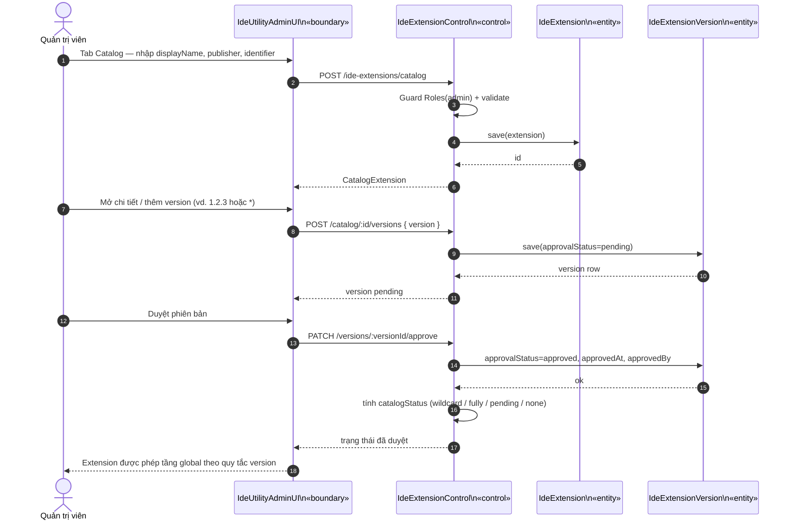
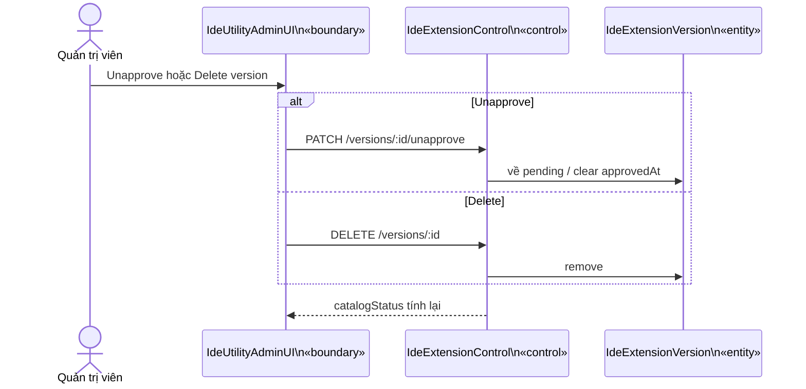
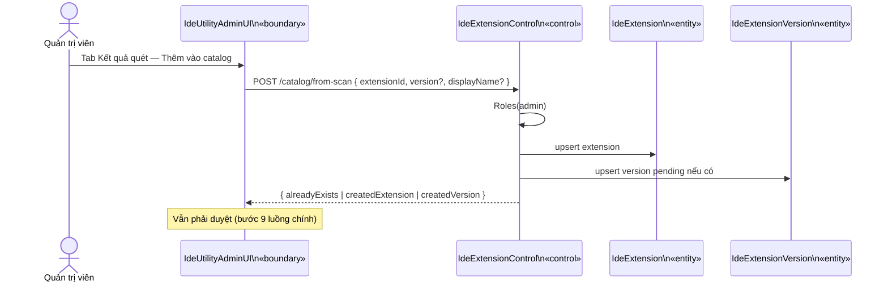
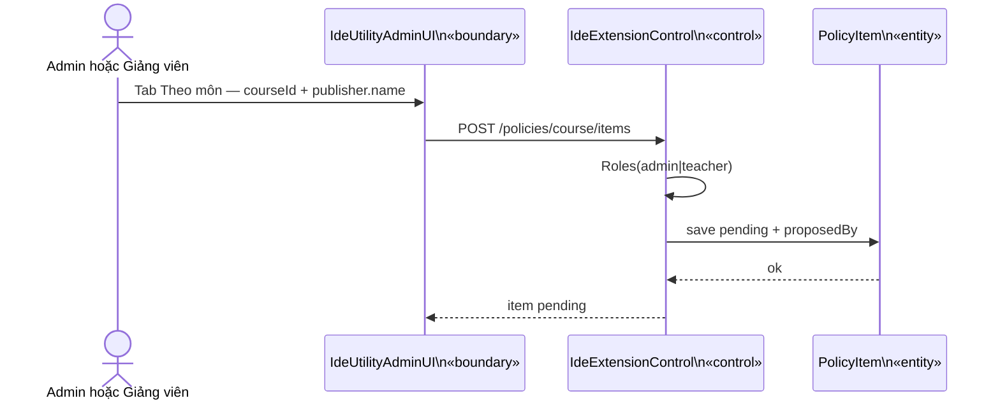
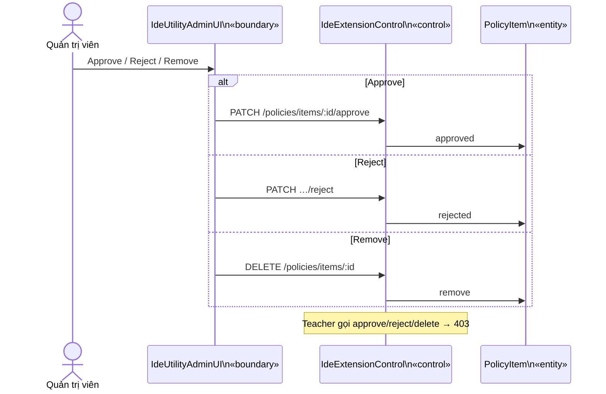
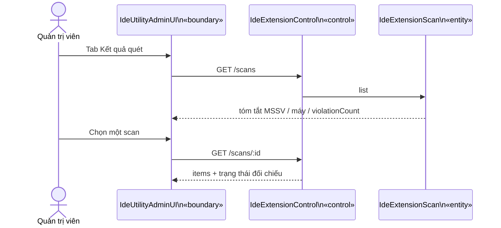
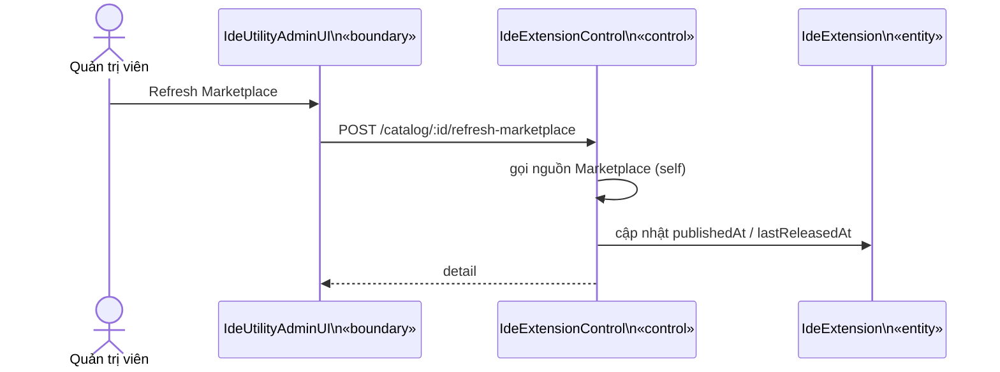
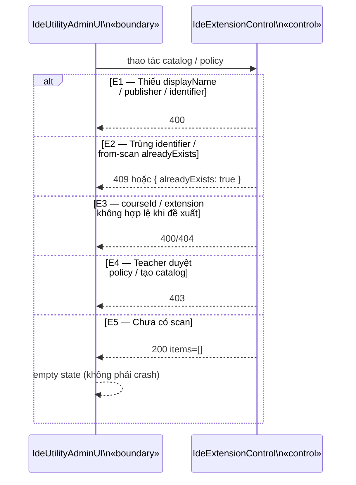
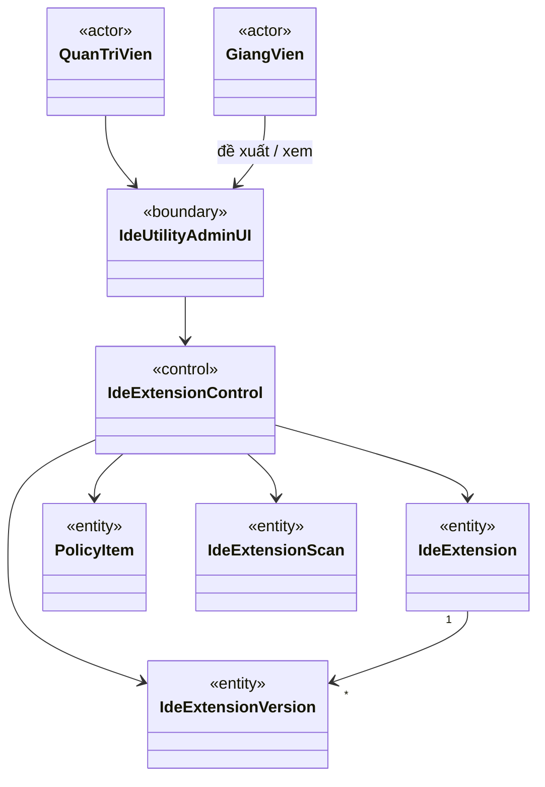

# Sequence diagram UC13 — Quản lý tiện ích IDE (BCE)

**Use case:** UC13 / UC-IDE-01 — [Đặc tả use case](./usecase-spec-uc01-uc15.md)  
**Bộ mục lục:** [sequence-uc01-uc15-bce.md](./sequence-uc01-uc15-bce.md)  
**Code:** `admin/ide-utilities/**` · `IdeExtensionsController` · `IdeExtensionsService` · `ide-extensions/entities/*`

```text
[Actor] <---> [Boundary] <---> [Controller] <---> [Entity]
                                    |
                                    +---> [Controller khác]
```

Một Nest service điều phối nhiều Entity. Trên sơ đồ giữ **một** `IdeExtensionControl`; nhánh phụ ghi note / tách sequence — không bịa thêm controller Nest không tồn tại.

---

## 1. Ánh xạ BCE ↔ code

| BCE | Đối tượng | Code | Ghi chú |
| --- | --- | --- | --- |
| Actor chính | Quản trị viên | — | Duyệt version / course policy, CRUD catalog |
| Actor phụ | Giảng viên | — | Đề xuất theo môn, xem scan; **không** approve admin-only |
| Boundary | `IdeUtilityAdminUI` | `ide-utilities/page.tsx`, `[id]/page.tsx` | Tab catalog / theo môn / kết quả quét |
| Control | `IdeExtensionControl` | `ide-extensions.controller.ts` + `ide-extensions.service.ts` | `/ide-extensions/...` |
| Entity | `IdeExtension` | catalog extension | identifier `publisher.name` |
| Entity | `IdeExtensionVersion` | version cụ thể hoặc `*` | approval_status pending/approved/… |
| Entity | `IdeExtensionPolicy` / `PolicyItem` | scope course | pending → approved |
| Entity | `IdeExtensionScan` (+ items) | kết quả Hub đồng bộ | read + from-scan |

**Không vẽ:** ValidationPipe, Marketplace HTTP client (gộp self-call Control khi refresh), apiClient, guards (gộp — ghi chú role trên từng nhánh).

---

## 2. Luồng chính — Thêm catalog + duyệt phiên bản

### 2.1 Mermaid



### 2.2 Bảng thông điệp

| # | Từ | Tới | Thông điệp | Code |
| --- | --- | --- | --- | --- |
| 1 | Actor | UI | Thêm extension | Tab catalog |
| 2 | UI | Ide | `tạoCatalog(dto)` | `createCatalog` |
| 3 | Ide | Ext | `save` | `createCatalogExtension` |
| 4 | Ide | UI | extension | |
| 5 | Actor | UI | Thêm version | Chi tiết |
| 6 | UI | Ide | `thêmVersion` | `addCatalogVersion` |
| 7 | Ide | Ver | `save pending` | |
| 8 | Actor | UI | Duyệt | |
| 9 | UI | Ide | `duyệtVersion` | `approveVersion` |
| 10 | Ide | Ver | set approved | |
| 11 | Ide | UI | status tổng hợp | `CATALOG_STATUS_LABEL` |

**Quy tắc allowlist (note, không phải message Actor):** `*` approved → mọi version; không `*` → chỉ exact version approved; không approved → blocked.

---

## 3. Luồng thay thế

### 3.1 A1 — Bỏ duyệt / xoá version



### 3.2 A2 — Đưa vào catalog từ bản quét



### 3.3 A3 — Đề xuất theo môn



### 3.4 A4 — Duyệt / từ chối / gỡ theo môn (admin)



### 3.5 A5 — Xem kết quả quét



### 3.6 A6 — Làm mới Marketplace



---

## 4. Luồng ngoại lệ



| Ngoại lệ | Điểm cắt | Phản ứng |
| --- | --- | --- |
| E1 | validate create | Không tạo |
| E2 | unique / upsert | Báo đã có |
| E3 | policy create | 400/404 |
| E4 | `@Roles('admin')` trên approve | 403 |
| E5 | listScans rỗng | UI empty |

---

## 5. Sơ đồ lớp BCE



---

## 6. Checklist

1. Happy path = catalog + approve version (tầng global).
2. Tách A3–A5 thành sơ đồ phụ — tránh một sequence quá dày.
3. Ghi rõ role admin vs teacher trên từng mũi tên nhạy cảm.
4. Không vẽ agent LAN / Hub như Entity web — scan đã sync sẵn.
