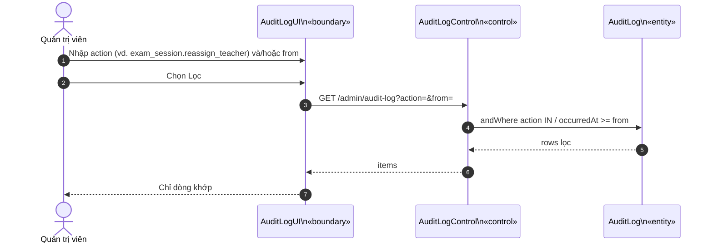
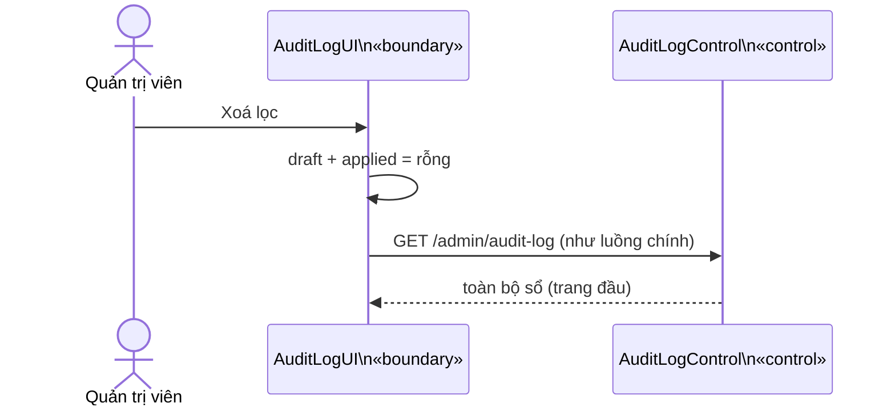
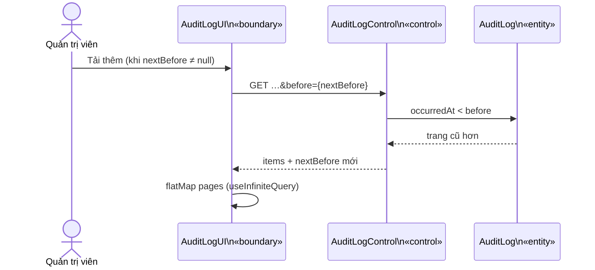
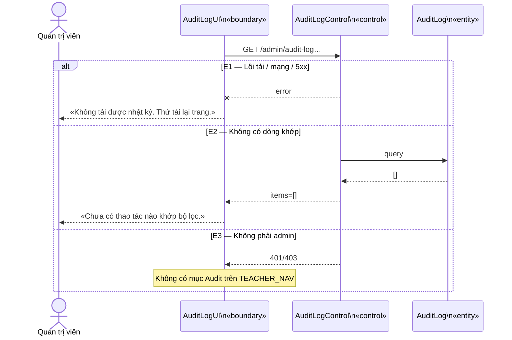
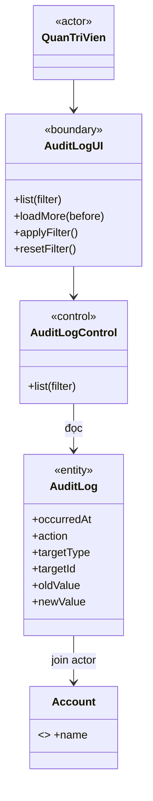

# Sequence diagram UC14 — Xem nhật ký kiểm toán (BCE)

**Use case:** UC14 / UC-AUD-01 — [Đặc tả use case](./usecase-spec-uc01-uc15.md)  
**Bộ mục lục:** [sequence-uc01-uc15-bce.md](./sequence-uc01-uc15-bce.md)  
**Code:** `admin/audit-log/page.tsx` · `useAuditLog` · `AuditLogController` · `AuditLogService.list` · `audit-log.entity.ts`

```text
[Actor] <---> [Boundary] <---> [Controller] <---> [Entity]
                                    |
                                    +---> [Controller khác]
```

UC14 **chỉ đọc**. Ghi sổ do Control khác (vd. UC15 `ExamSessionReassignControl`) gọi `recordUserAction` — không thuộc happy path xem.

---

## 1. Ánh xạ BCE ↔ code

| BCE | Đối tượng | Code | Ghi chú |
| --- | --- | --- | --- |
| Actor | Quản trị viên | — | `@Roles('admin')`; teacher không có nav |
| Boundary | `AuditLogUI` | `audit-log/page.tsx` + `hooks/useAuditLog.ts` + `lib/api/audit-log.ts` | Lọc action/from; infinite «Tải thêm» |
| Control | `AuditLogControl` | `audit-log.controller.ts` + `AuditLogService.list` | `GET /admin/audit-log` |
| Control khác | — (đọc) | Join `Account` actor để lấy `actor.name` | Có thể vẽ Entity `Account` chỉ đọc |
| Entity | `AuditLog` | `admin/entities/audit-log.entity.ts` | Append-only; **không** có API update/delete |
| Entity (join) | `Account` | leftJoin actor | `actorName` null → UI «Hệ thống» |

**Không trả về UI:** giá trị `oldValue` / `newValue` — chỉ `changedFields` = union keys.

**Không vẽ:** ValidationPipe list DTO chi tiết, apiClient, guards (gộp).

---

## 2. Luồng chính — Mở nhật ký

### 2.1 Mermaid

```mermaid
sequenceDiagram
  autonumber
  actor Admin as Quản trị viên
  participant UI as AuditLogUI\n«boundary»
  participant Audit as AuditLogControl\n«control»
  participant Log as AuditLog\n«entity»
  participant Account as Account\n«entity»

  Admin ->> UI: Mở /admin/audit-log
  UI ->> Audit: GET /admin/audit-log (limit mặc định 50)
  Audit ->> Audit: Guard admin
  Audit ->> Log: query order occurredAt DESC, id DESC
  Log ->> Account: leftJoin actor, select name
  Log -->> Audit: rows (limit+1 để biết còn trang)
  Audit ->> Audit: map items: changedFields = keys(old∪new); bỏ giá trị
  Audit -->> UI: { items, nextBefore }
  UI -->> Admin: Bảng thời điểm / người / action / đối tượng / trường đã đổi
```

### 2.2 Bảng thông điệp

| # | Từ | Tới | Thông điệp | Code |
| --- | --- | --- | --- | --- |
| 1 | Actor | UI | Mở trang nhật ký | Nav «Audit log» |
| 2 | UI | Audit | `liệtKêNhậtKý(filter?)` | `listAuditLog` |
| 3 | Audit | Audit | Roles admin | Guards |
| 4 | Audit | Log | query + join | `AuditLogService.list` |
| 5 | Log | Account | leftJoin name | |
| 6 | Log | Audit | rows | |
| 7 | Audit | Audit | `chiếuChangedFields` | không trả old/new values |
| 8 | Audit | UI | `AuditLogPage` | |
| 9 | UI | Actor | Render table | `toLocaleString('vi-VN')` |

---

## 3. Luồng thay thế

### 3.1 A1 — Lọc theo hành động / từ ngày



| # | Từ | Tới | Thông điệp | Code |
| --- | --- | --- | --- | --- |
| 1 | Actor | UI | Điền draft filter | form |
| 2 | UI | Audit | list với filter applied | `setApplied` |
| 3 | Audit | Log | WHERE | split action by comma |
| 4 | Audit | UI | page | |

### 3.2 A2 — Xoá lọc



### 3.3 A3 — Tải thêm



---

## 4. Luồng ngoại lệ



| Ngoại lệ | Điểm cắt | Phản ứng |
| --- | --- | --- |
| E1 | fetch / query | Alert; không giả dữ liệu cũ là mới |
| E2 | list rỗng | Empty state |
| E3 | RolesGuard | Từ chối |

**Cấm trên UC14:** mũi tên ghi Entity từ Boundary; không có PATCH/DELETE audit.

---

## 5. Sơ đồ lớp BCE



**Ghi chú phụ (ngoài UC14):** `ExamSessionReassignControl` → `AuditLogControl.recordUserAction` → `AuditLog` insert — xem UC15.

---

## 6. Checklist

1. Happy path chỉ GET; không vẽ ghi sổ trên cùng sơ đồ chính (tránh nhầm use case).
2. Note bắt buộc: UI không hiện giá trị cũ/mới.
3. A3 dùng cursor `before`, không offset page số.
4. Actor chỉ nối Boundary; Entity không update từ UC này.
