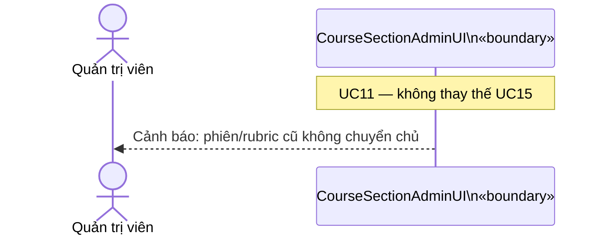
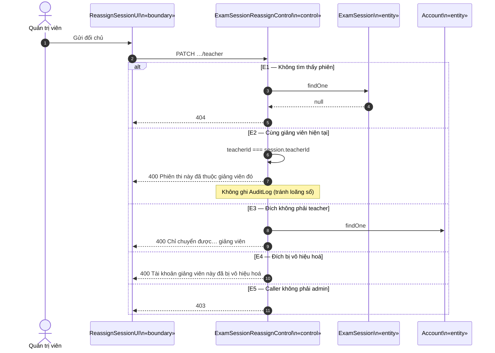
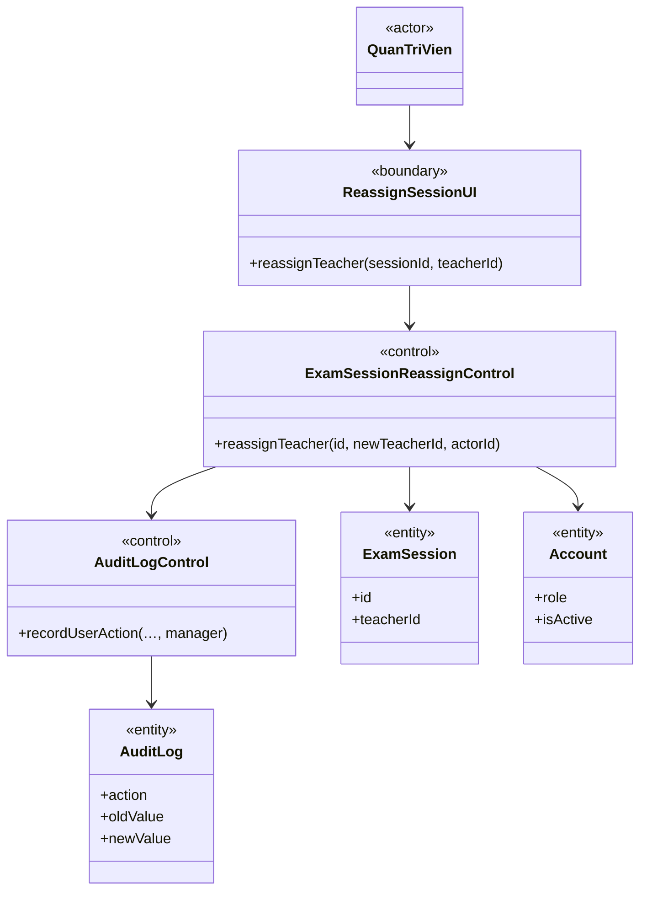

# Sequence diagram UC15 — Đổi giảng viên phụ trách phiên thi (BCE)

**Use case:** UC15 / UC-EXM-01 — [Đặc tả use case](./usecase-spec-uc01-uc15.md)  
**Bộ mục lục:** [sequence-uc01-uc15-bce.md](./sequence-uc01-uc15-bce.md)  
**Code:** `ExamSessionController.reassignTeacher` · `ExamSessionReassignService` · `AuditLogService.recordUserAction` · `exam-session.entity.ts`  
**Khác UC11:** Đổi GV **lớp** không kéo phiên; UC15 đổi `exam_session.teacher_id` + audit bắt buộc.

```text
[Actor] <---> [Boundary] <---> [Controller] <---> [Entity]
                                    |
                                    +---> [Controller khác]
```

---

## 1. Ánh xạ BCE ↔ code

| BCE | Đối tượng | Code | Ghi chú |
| --- | --- | --- | --- |
| Actor | Quản trị viên | — | `@Roles('admin')` trên `PATCH …/teacher` — kể cả chủ cũ cũng không tự chuyển |
| Boundary | `ReassignSessionUI` | **Hợp đồng** gọi API admin | Web chưa có trang admin riêng; Boundary vẫn là mặt Actor (HTTP client / UI tương lai / công cụ quản trị) |
| Control | `ExamSessionReassignControl` | `exam-session-reassign.service.ts` qua controller | Một trách nhiệm: chuyển chủ + audit cùng TX |
| Control khác | `AuditLogControl` | `AuditLogService.recordUserAction(..., manager)` | Cùng `EntityManager` transaction với save session |
| Entity | `ExamSession` | `teacherId` sở hữu | Mọi `findOwnedBy` đọc cột này → GV cũ mất quyền ngay |
| Entity | `Account` | Đích phải `role=teacher` và `isActive` | |
| Entity | `AuditLog` | action `exam_session.reassign_teacher` | old/new `{ teacherId }` |

**Không vẽ:** ValidationPipe `ReassignTeacherDto`, apiClient, guards (gộp bước vào Control).  
**Không đổi:** `class.teacher_id`, rubric ownership — ngoài phạm vi UC15.

---

## 2. Luồng chính — Chuyển chủ phiên

### 2.1 Mermaid

```mermaid
sequenceDiagram
  autonumber
  actor Admin as Quản trị viên
  participant UI as ReassignSessionUI\n«boundary»
  participant Reassign as ExamSessionReassignControl\n«control»
  participant Session as ExamSession\n«entity»
  participant Account as Account\n«entity»
  participant Audit as AuditLogControl\n«control»
  participant Log as AuditLog\n«entity»

  Admin ->> UI: Chọn examSessionId + teacherId mới
  UI ->> Reassign: PATCH /exam-sessions/:id/teacher { teacherId }
  Reassign ->> Reassign: JwtAuthGuard + Roles(admin)
  Reassign ->> Reassign: validate ReassignTeacherDto
  Reassign ->> Session: findOne(id)
  alt Không có phiên
    Session -->> Reassign: null
    Reassign -->> UI: 404 Exam session not found
  else Có phiên
    Session -->> Reassign: ExamSession
    Reassign ->> Reassign: assert teacherId ≠ session.teacherId
    Reassign ->> Account: findOne(newTeacherId) select role, isActive
    Account -->> Reassign: Account
    Reassign ->> Reassign: assert role=teacher và isActive
    Reassign ->> Reassign: begin transaction
    Reassign ->> Session: teacherId = newTeacherId; save
    Reassign ->> Audit: recordUserAction(actorId, exam_session.reassign_teacher, old, new)
    Audit ->> Log: insert (cùng manager)
    Log -->> Audit: ok
    Reassign ->> Reassign: commit
    Reassign -->> UI: ExamSession đã đổi chủ
    UI -->> Admin: Xác nhận; GV mới thấy phiên; GV cũ không đọc được bài/điểm
  end
```

### 2.2 Bảng thông điệp

| # | Từ | Tới | Thông điệp | Code |
| --- | --- | --- | --- | --- |
| 1 | Actor | UI | Chọn phiên + GV đích | Boundary admin |
| 2 | UI | Reassign | `đổiChủPhiên(id, teacherId)` | `PATCH …/teacher` |
| 3 | Reassign | Reassign | Guard admin + DTO | |
| 4 | Reassign | Session | `findOne` | |
| 5 | Session | Reassign | entity hoặc null | |
| 6 | Reassign | Reassign | `assertKhácChủHiệnTại` | BadRequest nếu trùng |
| 7 | Reassign | Account | `findOne` đích | |
| 8 | Reassign | Reassign | `assertTeacherActive` | |
| 9 | Reassign | Session | `save teacherId` | trong TX |
| 10 | Reassign | Audit | `recordUserAction` | cùng TX |
| 11 | Audit | Log | `insert` | oldValue/newValue teacherId |
| 12 | Reassign | UI | Session | |
| 13 | UI | Actor | Hậu điều kiện quyền đọc | |

**Audit bắt buộc cùng transaction:** tránh đổi quyền mà không có dòng sổ (comment service).

---

## 3. Luồng thay thế

**Không có** nhánh thay thế đạt cùng mục tiêu.

| Thao tác dễ nhầm | Kết quả thực tế |
| --- | --- |
| UC11 assign/unassign trên lớp | Chỉ `class.teacher_id` + enrollment — **phiên cũ giữ chủ** |
| Teacher tự PATCH teacher | **403** — chỉ admin |



---

## 4. Luồng ngoại lệ



| Ngoại lệ | Điểm cắt BCE | Phản ứng |
| --- | --- | --- |
| E1 | Session findOne | 404; không ghi sổ |
| E2 | assert cùng id | 400; **không** audit |
| E3 | Account.role | 400; tránh orphan UI |
| E4 | Account.isActive | 400 |
| E5 | RolesGuard | 403 |

---

## 5. Sơ đồ lớp BCE



---

## 6. Checklist khi vẽ lại

1. Control → AuditLogControl trên happy path (bắt buộc).
2. E2 không tạo dòng audit.
3. Note: mất quyền đọc ngay — không «ân hạn».
4. Tách rõ khỏi UC11 trên báo cáo (hai sequence, mũi tên include **không** nối UC11→UC15).
5. Boundary có thể note «API-first / UI admin chưa có trang riêng» — vẫn `«boundary»`.
6. Actor chỉ nối Boundary; Entity không gọi Control.
