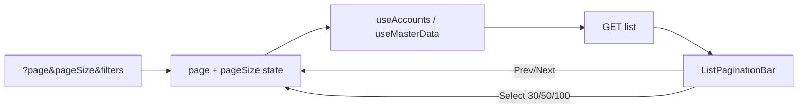

# List pagination + page-size picker — Implementation Plan

> **For agentic workers:** REQUIRED SUB-SKILL: Use superpowers:subagent-driven-development (recommended) or superpowers:executing-plans to implement this plan task-by-task. Steps use checkbox (`- [ ]`) syntax for tracking.

**Goal:** Phân trang server-side thống nhất + Select mức **30 / 50 / 100** trên 7 list admin theo [spec](../specs/2026-10-07-list-pagination-design.md).

**Architecture:** Không đổi contract API (`page` / `pageSize` / `{ items, total, … }`). Thêm constants + `ListPaginationBar` dùng chung; mỗi page giữ `page`/`pageSize` trong state, sync URL qua `buildCatalogQuery` / `router.replace`, reset `page → 1` khi đổi filter hoặc `pageSize`.

**Tech Stack:** Next.js App Router, TanStack Query, shadcn Button/Select (web). NestJS list DTO giữ nguyên (`@Max(100)` đã đủ).

**Branch:** `feature/list-pagination`  
**Spec:** `docs/superpowers/specs/2026-10-07-list-pagination-design.md`



---

## Quyết định đã chốt

- `PAGE_SIZE_OPTIONS = [30, 50, 100]`; `DEFAULT_PAGE_SIZE = 30`
- **Không** siết whitelist `pageSize` ở DTO backend (facet/dashboard vẫn dùng 1 hoặc 100)
- **Không** đổi default DTO `20` trong đợt này — UI luôn gửi explicit `pageSize`
- Facet/Select phụ (lớp, phòng, cohortYears…): giữ `pageSize` riêng (thường 100); **không** dùng state list chính
- Học kỳ `/academic/[id]`, teacher lists: **ngoài phạm vi**
- Commit **chỉ khi user yêu cầu**; không push/PR cho đến khi được bảo
- Mỗi Task dưới đây = **một commit** (message gợi ý ở cuối task)

## Verified facts

- API đã hỗ trợ `page`/`pageSize` + `@Max(100)`: [`list-query.dto.ts`](apps/api/src/master-data/dto/list-query.dto.ts), [`search-accounts.dto.ts`](apps/api/src/accounts/dto/search-accounts.dto.ts)
- Accounts: Prev/Next có sẵn, `PAGE_SIZE = 20` cứng — [`accounts/page.tsx`](apps/web/src/app/admin/accounts/page.tsx); `useAccounts` đã đưa cả `params` (gồm `pageSize`) vào queryKey
- Catalog pages hardcode `page: 1` + `pageSize: 50|100`, **không** có footer phân trang — courses/students/rooms/computers/academic/nominal-classes
- URL helpers: [`catalog-url.ts`](apps/web/src/app/admin/master-data/_components/catalog-url.ts) `buildCatalogQuery`
- `CatalogSection` có `toolbar`, **chưa** có slot `footer` — [`catalog-table.tsx`](apps/web/src/app/admin/master-data/_components/catalog-table.tsx)
- Rooms và Computers là **hai route riêng** (không còn ghép một trang)

## Global constraints

- Chỉ admin catalog + accounts — không đụng grading / exam-sessions
- Giữ search/filter/drill-down hiện có; chỉ thêm pagination controls
- Copy UI tiếng Việt (`Trước` / `Sau` / `Số dòng`)
- E2E API không bắt buộc cho đợt UI-only này (API đã paginate)

---

## Commit map

| # | Commit (subject gợi ý) | Task |
|---|---|---|
| 0 | `docs: list pagination spec and plan` | Task 0 |
| 1 | `feat(web): shared list pagination bar and page-size helpers` | Task 1 |
| 2 | `feat(accounts): page-size picker and URL sync` | Task 2 |
| 3 | `feat(master-data): pagination on courses, classes, students` | Task 3 |
| 4 | `feat(master-data): pagination on rooms and computers` | Task 4 |
| 5 | `feat(master-data): pagination on academic years` | Task 5 |

---

## Task 0: Docs

**Files:**
- `docs/superpowers/specs/2026-10-07-list-pagination-design.md`
- `docs/superpowers/plans/2026-10-07-list-pagination.md`

- [ ] Xác nhận spec + plan trên branch `feature/list-pagination`
- [ ] Commit khi user bảo:

```text
docs: list pagination spec and plan
```

---

## Task 1: Shared pagination bar + helpers

**Files:**
- Create: `apps/web/src/lib/list-pagination.ts` — constants + parse helpers
- Create: `apps/web/src/components/list-pagination-bar.tsx` — UI dùng chung (accounts + catalog)
- Modify (tuỳ chọn nhưng nên làm): `apps/web/src/app/admin/master-data/_components/catalog-table.tsx` — thêm prop `footer?: ReactNode` render dưới table

**API helpers:**

```ts
export const PAGE_SIZE_OPTIONS = [30, 50, 100] as const;
export type PageSize = (typeof PAGE_SIZE_OPTIONS)[number];
export const DEFAULT_PAGE_SIZE: PageSize = 30;

export function parsePageSize(raw: string | null | undefined): PageSize;
export function parsePage(raw: string | null | undefined): number; // ≥1, invalid → 1
export function totalPages(total: number, pageSize: number): number;
```

**API component:**

```tsx
type ListPaginationBarProps = {
  page: number;
  pageSize: PageSize;
  total: number;
  entityLabel: string;
  disabled?: boolean;
  onPageChange: (page: number) => void;
  onPageSizeChange: (pageSize: PageSize) => void;
};
```

### Steps

- [ ] Implement helpers + unit test nhỏ (optional): invalid `pageSize` → 30; `totalPages(0, 30) === 1`
- [ ] UI: nhãn `Trang {page}/{totalPages} • {total} {entityLabel}`; Select `Số dòng` với 30/50/100; nút Trước/Sau disabled đúng biên
- [ ] Đổi `pageSize` gọi `onPageSizeChange` (caller reset `page → 1`)
- [ ] `CatalogSection` nhận `footer` (nếu chọn cách này) — không bắt buộc nếu page render bar ngay dưới section
- [ ] Commit:

```text
feat(web): shared list pagination bar and page-size helpers
```

---

## Task 2: Accounts

**Files:**
- Modify: `apps/web/src/app/admin/accounts/page.tsx`
- (Hooks: `useAccounts` đã OK — không cần đổi trừ comment cũ về pageSize cố định)

### Behavior

- Bỏ `const PAGE_SIZE = 20`
- Init `page` / `pageSize` từ URL (`parsePage`, `parsePageSize`); default 1 / 30
- Sync URL: `page`, `pageSize` (+ `q` / `role` / `isActive` nếu trang đã sync hoặc state-only — **tối thiểu** sync `page` + `pageSize` nếu các filter chưa lên URL; nếu filter đã state-only thì giữ nguyên, chỉ thêm pagination params khi đang dùng URL)
- Đổi search/role/isActive → `setPage(1)` (đã có) — giữ `pageSize`
- Đổi `pageSize` → `page = 1`
- Thay footer hiện tại bằng `ListPaginationBar` (`entityLabel="tài khoản"`)

### Steps

- [ ] Wire state + fetch `pageSize` động
- [ ] Gắn `ListPaginationBar`
- [ ] Smoke: đổi size 30→50→100; Prev/Next; đổi filter về trang 1
- [ ] Commit:

```text
feat(accounts): page-size picker and URL sync
```

---

## Task 3: Courses, nominal classes, students

**Files:**
- Modify: `apps/web/src/app/admin/master-data/courses/page.tsx`
- Modify: `apps/web/src/app/admin/master-data/nominal-classes/page.tsx`
- Modify: `apps/web/src/app/admin/master-data/students/page.tsx`

### Pattern chung mỗi trang

```ts
const [page, setPage] = useState(() => parsePage(searchParams.get('page')));
const [pageSize, setPageSize] = useState(() => parsePageSize(searchParams.get('pageSize')));
// hooks: { page, pageSize, search, status, … }
// URL replace: giữ filter params + page + pageSize
// đổi search/filter → setPage(1)
// ListPaginationBar dưới CatalogSection
```

### Behavior riêng

| Trang | entityLabel | Lưu ý |
|---|---|---|
| Courses | `môn học` | Bỏ hardcode `page: 1, pageSize: 50` |
| Nominal classes | `lớp` | List chính dùng state pagination; **giữ** `cohortFacets` / facet call `pageSize: 100` riêng |
| Students | `sinh viên` | List chính paginate; Select lớp vẫn `useNominalClasses({ page: 1, pageSize: 100 })` |

- [ ] Courses: page/pageSize + bar + URL
- [ ] Nominal classes: như trên; không đụng facet
- [ ] Students: như trên; không đụng load lớp filter
- [ ] Commit:

```text
feat(master-data): pagination on courses, classes, students
```

---

## Task 4: Rooms & computers

**Files:**
- Modify: `apps/web/src/app/admin/master-data/rooms/page.tsx`
- Modify: `apps/web/src/app/admin/master-data/computers/page.tsx`

### Behavior

- Cùng pattern Task 3
- Rooms: `entityLabel="phòng"`; bỏ hardcode `pageSize: 50`
- Computers: `entityLabel="máy tính"`; Select phòng giữ `useRooms({ page: 1, pageSize: 100 })` riêng
- URL giữ `q` / `status` / `roomId` (computers) + `page` / `pageSize`

- [ ] Rooms wire + bar
- [ ] Computers wire + bar
- [ ] Commit:

```text
feat(master-data): pagination on rooms and computers
```

---

## Task 5: Academic years

**Files:**
- Modify: `apps/web/src/app/admin/master-data/academic/page.tsx`

### Behavior

- Chỉ list **năm học** trên trang này (học kỳ `/academic/[id]` ngoài phạm vi)
- `entityLabel="năm học"`
- Bỏ hardcode `pageSize: 50`; thêm `page` state (hiện có thể đang luôn `page: 1`)
- URL: giữ filter/search năm hiện có + `page` / `pageSize`
- Click drill-down sang chi tiết năm (nếu có) không bị phá bởi pagination

- [ ] Wire years list + `ListPaginationBar`
- [ ] Smoke full 7 trang theo acceptance §5 spec
- [ ] Commit:

```text
feat(master-data): pagination on academic years
```

---

## Acceptance checklist (cuối Task 5)

- [ ] 7 trang đều Prev/Next đúng theo `total`
- [ ] Select 30/50/100 đổi số dòng và về trang 1
- [ ] Default không query: `pageSize=30`, `page=1`
- [ ] Refresh giữ `page` + `pageSize` (+ filter)
- [ ] `pageSize` URL invalid → 30
- [ ] Đổi filter không mất `pageSize`
- [ ] Empty: Select vẫn dùng được; Prev/Next disabled
- [ ] Facet dropdown (lớp/phòng/cohort) vẫn đủ option
- [ ] Không regression CRUD / search / filter

---

## Liên quan

- Spec: `docs/superpowers/specs/2026-10-07-list-pagination-design.md`
- Search/filter: `docs/superpowers/specs/2026-10-07-master-data-search-filter-design.md`
- Plan search/filter: `docs/superpowers/plans/2026-10-07-master-data-search-filter.md`
