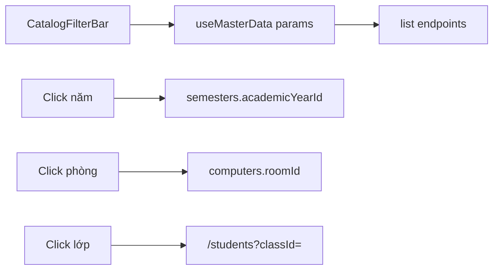

# Master data search / filter / drill-down — Implementation Plan

> **For agentic workers:** REQUIRED SUB-SKILL: Use superpowers:subagent-driven-development (recommended) or superpowers:executing-plans to implement this plan task-by-task. Steps use checkbox (`- [ ]`) syntax for tracking.

**Goal:** Search, filter, drill-down parent→child trên admin catalog + Accounts theo [spec](../specs/2026-10-07-master-data-search-filter-design.md).

**Architecture:** Mở rộng query list API hiện có; UI toolbar dùng chung + debounce; drill-down cùng trang (năm→kỳ, phòng→máy) hoặc `?classId=` (lớp→SV); sync filter chính vào URL qua `router.replace`.

**Tech Stack:** NestJS DTO/service + Jest e2e (api); Next.js App Router, TanStack Query, `useDebouncedValue`, shadcn Input/Select (web).

**Branch:** `feature/master-data-search-filter`  
**Spec:** `docs/superpowers/specs/2026-10-07-master-data-search-filter-design.md`



---

## Quyết định đã chốt

- Không tách trang Năm/Kỳ hay Phòng/Máy
- `building` filter phòng: **bỏ MVP** (chỉ search mã/tên)
- Computer search: `hostname` \| `ip_address` \| `location` (có thể giữ `cpu` trong OR)
- Empty state: phân biệt “Chưa có dữ liệu” vs “Không khớp bộ lọc”
- Commit **chỉ khi user yêu cầu**; không push/PR cho đến khi được bảo
- Mỗi Task dưới đây = **một commit** (message gợi ý ở cuối task)

## Verified facts

- Accounts UI đã có search + role + debounce — mẫu UX
- API đã có: course/room/student/computer `search`; semester `academicYearId`; student `nominalClassId`; computer `roomId`; status filters
- API thiếu: year/semester `search`; nominal-class `cohortYear`; accounts `isActive`; computer search chưa cover IP/location
- Web: [`apps/web/src/lib/api/master-data.ts`](apps/web/src/lib/api/master-data.ts) `ListParams` chưa có `cohortYear`; year/semester list chưa gửi `search`
- Hooks: [`apps/web/src/hooks/useMasterData.ts`](apps/web/src/hooks/useMasterData.ts) đã truyền `ListParams` vào queryKey
- Debounce: [`apps/web/src/hooks/useDebouncedValue.ts`](apps/web/src/hooks/useDebouncedValue.ts)
- Catalog UI: [`apps/web/src/app/admin/master-data/_components/catalog-table.tsx`](apps/web/src/app/admin/master-data/_components/catalog-table.tsx)

## Global constraints

- Chỉ `@Roles('admin')` catalog + accounts — không đụng grading/exam
- Không regenerate OpenAPI trừ khi typecheck bắt buộc (ưu tiên `masterDataFetch` thủ công như hiện tại)
- Copy UI tiếng Việt; comment giải thích *why* khi cần
- Edit/Delete: `stopPropagation` — không kích hoạt drill-down
- E2E chỉ `.env.test` local

---

## Commit map

| # | Commit (subject gợi ý) | Task |
|---|---|---|
| 0 | `docs: master-data search/filter spec and plan` | Task 0 |
| 1 | `feat(master-data): API search/filter gaps for catalog lists` | Task 1 |
| 2 | `feat(web): shared catalog filter bar` | Task 2 |
| 3 | `feat(master-data): academic year/semester search and drill-down` | Task 3 |
| 4 | `feat(master-data): rooms/computers search and drill-down` | Task 4 |
| 5 | `feat(master-data): class→students filter and cohortYear` | Task 5 |
| 6 | `feat(master-data): courses search and status filter UI` | Task 6 |
| 7 | `feat(accounts): filter by active status` | Task 7 |

URL sync (`q`, `yearId`, `roomId`, `classId`, …) làm **trong từng trang** (Tasks 3–7), không commit riêng.

---

## Task 0: Docs

**Files:**
- `docs/superpowers/specs/2026-10-07-master-data-search-filter-design.md`
- `docs/superpowers/plans/2026-10-07-master-data-search-filter.md`

- [ ] Xác nhận spec + plan trên branch `feature/master-data-search-filter`
- [ ] Commit khi user bảo:

```text
docs: master-data search/filter spec and plan
```

---

## Task 1: API gaps (+ test)

**Files:**
- Modify: `apps/api/src/master-data/dto/academic-year.dto.ts` — `search?: string`
- Modify: `apps/api/src/master-data/dto/semester.dto.ts` — `search?: string`
- Modify: `apps/api/src/master-data/dto/nominal-class.dto.ts` — `cohortYear?: number`
- Modify: `apps/api/src/master-data/master-data.service.ts` — ILIKE/exact filters; computer search OR `hostname`, `ip_address`, `location` (+ optional `cpu`)
- Modify: `apps/api/src/accounts/dto/search-accounts.dto.ts` — `isActive?: boolean`
- Modify: `apps/api/src/accounts/accounts.service.ts` — `andWhere` khi `isActive` set
- Modify / extend: e2e hoặc service spec hiện có (`master-data-academic`, `master-data-students`, `master-data-rooms`, `accounts`)

### Steps

- [ ] Academic years: `search` → `(code ILIKE OR name ILIKE)`
- [ ] Semesters: `search` tương tự (kết hợp `academicYearId` + `status`)
- [ ] Nominal classes: `cohortYear` exact
- [ ] Computers: mở rộng `search` theo spec §4
- [ ] Accounts: `isActive` boolean filter
- [ ] Test tối thiểu mỗi gap (e2e hoặc unit service) — ít nhất 1 case khớp / 1 case loại
- [ ] Commit:

```text
feat(master-data): API search/filter gaps for catalog lists
```

---

## Task 2: Shared filter bar (web)

**Files:**
- Create: `apps/web/src/app/admin/master-data/_components/catalog-filter-bar.tsx`
- Modify (tuỳ chọn): `catalog-table.tsx` — nhận `toolbar?: ReactNode` phía trên table nếu gọn hơn prop riêng

**API component (gợi ý):**

```tsx
type CatalogFilterBarProps = {
  search: string;
  onSearchChange: (v: string) => void;
  searchPlaceholder?: string;
  filters?: ReactNode; // Select(s)
  activeSummary?: string | null; // chip text
  onClear?: () => void;
};
```

- [ ] Input search + slot filters + chip + nút “Xóa lọc” (chỉ hiện khi có active)
- [ ] Không fetch trong component — controlled từ page
- [ ] Commit:

```text
feat(web): shared catalog filter bar
```

---

## Task 3: Academic page

**Files:**
- Modify: `apps/web/src/lib/api/master-data.ts` — gửi `search` cho years/semesters
- Modify: `apps/web/src/app/admin/master-data/academic/page.tsx`

### Behavior

- Năm: search + status; debounce 300ms
- Kỳ: search + status + `academicYearId`
- Click row năm → set `yearId` (toggle off nếu click lại); highlight row; chip trên bảng kỳ
- `RowActions` `stopPropagation`
- URL: `?qYear=&qSem=&statusYear=&statusSem=&yearId=` — tối thiểu sync `yearId` + search kỳ/năm nếu không quá rối; **bắt buộc** `yearId`
- Empty: “Không khớp bộ lọc” khi có filter/search mà `items.length === 0`

- [ ] Wire hooks params từ state
- [ ] Drill-down + clear
- [ ] Commit:

```text
feat(master-data): academic year/semester search and drill-down
```

---

## Task 4: Rooms & computers page

**Files:**
- Modify: `apps/web/src/app/admin/master-data/rooms/page.tsx`
- (API computer search đã xong ở Task 1)

### Behavior

- Phòng: search + status (+ CatalogFilterBar)
- Máy: search + status + `roomId` (Select đồng bộ với click)
- Click row phòng → `roomId`; highlight; chip “Đang xem: {code}”
- URL: bắt buộc sync `roomId` (+ `q` máy nếu đơn giản)
- Không thêm filter `building`

- [ ] Thay/ bổ sung Select hiện có bằng click + bar thống nhất
- [ ] Commit:

```text
feat(master-data): rooms/computers search and drill-down
```

---

## Task 5: Nominal classes → students

**Files:**
- Modify: `apps/web/src/lib/api/master-data.ts` — `cohortYear` trên `ListParams` + `listNominalClasses` qs
- Modify: `apps/web/src/app/admin/master-data/nominal-classes/page.tsx`
- Modify: `apps/web/src/app/admin/master-data/students/page.tsx`

### Behavior

**Lớp**
- Search + status + Select/input `cohortYear`
- Click row (không phải icon) → `router.push(/admin/master-data/students?classId={id})`
- Có thể thêm affordance nhỏ (cursor-pointer / title “Xem sinh viên”)

**Sinh viên**
- Đọc `classId` từ `useSearchParams` → `nominalClassId`
- Search + status + Select lớp (đồng bộ URL khi đổi)
- Clear lọc → bỏ `classId` khỏi URL (`router.replace`)

- [ ] Classes toolbar + navigate
- [ ] Students URL + search/status
- [ ] Commit:

```text
feat(master-data): class→students filter and cohortYear
```

---

## Task 6: Courses page

**Files:**
- Modify: `apps/web/src/app/admin/master-data/courses/page.tsx`

### Behavior

- Search mã/tên + filter status (API đã có)
- CatalogFilterBar + debounce + clear
- URL sync `q` + `status` (nice-to-have; nên làm cho đồng bộ với các trang khác)

- [ ] Wire UI
- [ ] Commit:

```text
feat(master-data): courses search and status filter UI
```

---

## Task 7: Accounts `isActive`

**Files:**
- Modify: `apps/web/src/lib/api/accounts.ts` (hoặc chỗ gọi search) — truyền `isActive`
- Modify: `apps/web/src/hooks/useAccounts.ts` nếu cần
- Modify: `apps/web/src/app/admin/accounts/page.tsx` — Select: Tất cả / Đang hoạt động / Đã vô hiệu
- Modify: `apps/web/src/app/admin/accounts/page.test.tsx` nếu có coverage filter

### Behavior

- Kết hợp AND với search + role hiện có
- `hasActiveFilters` gồm `isActive`
- API đã xong Task 1

- [ ] UI + hook
- [ ] Cập nhật test page nếu fail
- [ ] Commit:

```text
feat(accounts): filter by active status
```

---

## Acceptance checklist (sau Task 7)

- [ ] Academic: search/status năm + kỳ; click năm lọc kỳ; clear
- [ ] Rooms: search/status; click phòng lọc máy; search máy theo hostname/IP/location
- [ ] Classes: search/status/cohortYear; click → SV có filter
- [ ] Students: `?classId=` + search AND
- [ ] Courses: search + status
- [ ] Accounts: filter active/inactive
- [ ] Refresh giữ `yearId` / `roomId` / `classId` (và `q` nơi đã wire)
- [ ] Edit/Delete không kích hoạt drill-down
- [ ] CRUD create/update/delete không regression

---

## Ngoài phạm vi (nhắc lại)

- Filter `building`, expandable rows, sheet/drawer, trang detail `/:id`
- Tách trang cha/con
- OpenAPI regenerate bắt buộc (chỉ khi typecheck yêu cầu)
