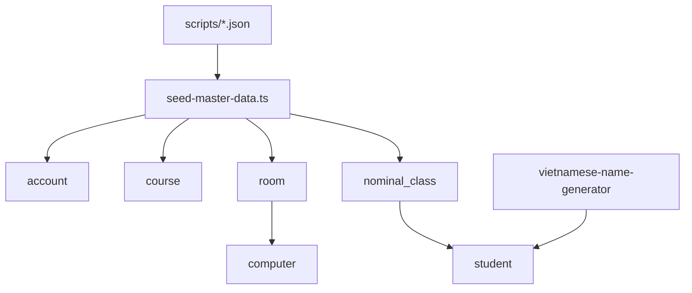

# Seed master data — Implementation Plan

> **For agentic workers:** REQUIRED SUB-SKILL: Use superpowers:subagent-driven-development (recommended) or superpowers:executing-plans to implement this plan task-by-task. Steps use checkbox (`- [ ]`) syntax for tracking.

**Goal:** Script CLI đổ catalog (2 admin + 77 teacher, 39 môn, 39 phòng, ~1560 máy, 96 lớp danh nghĩa, ~6k SV) theo [spec](../specs/2026-10-07-seed-master-data-design.md); ngừng phụ thuộc seed migration/demo cũ trong docs & `reset-dev-data.sql` (không xóa `INSERT` migration).

**Architecture:** CLI TypeORM `DataSource` (không HTTP/JWT), đọc JSON ở root `scripts/`, pure helpers tách riêng để unit test, `pnpm seed:master-data` trong `apps/api`.

**Tech Stack:** TypeORM + argon2id (khớp `AccountsService.create`) + `vietnamese-name-generator` (devDependency) + Jest unit tests cho pure logic.

**Branch:** `feature/seed-master-data`  
**Spec:** `docs/superpowers/specs/2026-10-07-seed-master-data-design.md`

---

## Quyết định đã chốt

- Script: `apps/api/scripts/seed-master-data.ts` + helpers `apps/api/scripts/seed-master-data/`
- JSON: resolve về monorepo root `scripts/danh_sach_*.json` (commit cùng PR)
- npm: `"seed:master-data": "node -r ts-node/register -r dotenv/config -r tsconfig-paths/register scripts/seed-master-data.ts"`
- Flags: `--seed <int>` (default `20261007`), `--reset-passwords`, `--fresh-catalog`
- `reset-dev-data.sql`: xóa hết catalog mới + business residue; **chỉ giữ** `bao@hui.edu.vn` / `phat@hui.edu.vn`; bỏ whitelist CS101/A1/demo-*; sau reset chạy lại `pnpm seed:master-data`
- Không đụng `INSERT` trong migration `AddCourseRoomExamType`

## Verified facts

- Catalog entities + `DataSource` đã đăng ký (`apps/api/src/database/data-source.ts`)
- Hash: `argon2.hash(pw, { type: argon2.argon2id })` như `AccountsService.create`
- Room/computer status enum: `active` | `maintenance` | `inactive`
- MSSV check: `^[A-Za-z0-9]{4,20}$` — 8 chữ số OK
- JSON: 77 GV (email sẵn `@hui.edu.vn`), 39 môn, 39 phòng, tổng `sucChua` = 1560

## Global constraints

- Chỉ ghi bảng catalog + `account`; không FK/seed `exam_session` / `class` / `enrollment`
- Không xóa seed trong migration
- E2E/smoke chỉ `.env` / `.env.test` local — không trỏ cloud
- Commit khi user yêu cầu; không push/PR cho đến khi được bảo

---

## Task 0: Commit docs (khi được yêu cầu)

**Files:**
- `docs/superpowers/specs/2026-10-07-seed-master-data-design.md`
- `docs/superpowers/plans/2026-10-07-seed-master-data.md`
- `scripts/danh_sach_giang_vien.json`
- `scripts/danh_sach_mon_hoc.json`
- `scripts/danh_sach_phong_may.json`

- [x] Ghi plan vào `docs/superpowers/plans/2026-10-07-seed-master-data.md`
- [ ] Commit docs + 3 JSON khi user bảo

---

## Task 1: Pure helpers + unit tests

**Files:**
- Create: `apps/api/scripts/seed-master-data/rules.ts` — parse floor từ mã phòng; map `Hoạt động`→`active`; hostname/location; danh sách 96 mã lớp; band sĩ số; sinh MSSV unique; pad `nn`
- Create: `apps/api/scripts/seed-master-data/rules.spec.ts`

Cover: `H1.1`→floor `"1"`; hostname `H1.1.01`; 96 codes `DHCNTT17A`…`DHHTTT20CTT`; cohort/middle; band A vs ATT; MSSV prefix `21`…`24` + unique trong set.

- [x] Viết test → implement → `npx jest scripts/seed-master-data/rules.spec.ts`

---

## Task 2: Dependency + CLI skeleton

**Files:**
- Modify: `apps/api/package.json` — `seed:master-data` + devDep `vietnamese-name-generator`
- Create: `apps/api/scripts/seed-master-data.ts` — parse flags, load `DataSource`, đọc 3 JSON, summary counts, exit code ≠0 nếu email GV invalid

- [x] `pnpm --filter api add -D vietnamese-name-generator`
- [x] Skeleton: parse JSON + validate 77 email `@hui.edu.vn`

---

## Task 3: Seed accounts → courses → rooms → computers

Upsert theo unique (`email`, `code`, `(roomId,hostname)`). Password chỉ ghi khi insert mới hoặc `--reset-passwords`.

| Bước | Nguồn | Ghi chú |
|------|--------|---------|
| Admin ×2 | cố định | `bao@` / `phat@hui.edu.vn`, `Admin@123` |
| Teacher ×77 | JSON | `email=href`, `name=text`, `Teacher@123` |
| Course ×39 | JSON | `code=maHocPhan`, `status=active` |
| Room ×39 | JSON | map §4.3 spec |
| Computer ×1560 | từ capacity | §4.4; batch insert theo phòng |

- [x] Implement + chạy trên DB local đã migrate; assert counts

---

## Task 4: Seed nominal_class → student

- 96 lớp theo prefix × middle × postfix; `name` theo spec
- Sĩ số random trong band với RNG từ `--seed`
- MSSV 8 số unique; `full_name` = `generateFullName` (seed dẫn xuất)
- Batch insert (~6k rows) — tránh N+1 từng row nếu chậm

- [x] Chạy seed; đếm lớp = 96; ~6k SV (band sĩ số)
- [x] Re-run không `--fresh-catalog` → không lỗi unique

---

## Task 5: `--fresh-catalog` + cập nhật docs/reset

**Files:**
- CLI: xóa `student` → `computer` → `nominal_class` / `course` / `room`; xóa account trong tập seed (2 admin + email từ JSON) rồi seed lại
- Rewrite: `scripts/reset-dev-data.sql` — xóa catalog mới; business delete giữ thứ tự FK; account chỉ giữ 2 admin; comment: chạy `pnpm seed:master-data` sau reset
- Update: `DEMO-RUNBOOK.md` / `README.md` chỗ CS101 / demo-teacher / phòng A1 → trỏ seed mới + mật khẩu

- [x] `--fresh-catalog` implemented (wipe catalog tables then re-seed)
- [x] Docs / `reset-dev-data.sql` trỏ seed mới + mật khẩu admin/teacher

---

## Acceptance (smoke)

1. Migration cũ vẫn còn `INSERT` seed (không regress)
2. Sau seed: 2 admin + 77 teacher, 39/39/1560/96 + SV đúng band
3. Login `bao@hui.edu.vn` / `Admin@123` và một teacher / `Teacher@123`
4. Sample: room `H1.1` có `H1.1.01`…`H1.1.40`, location `M01`…
5. Re-run idempotent OK
