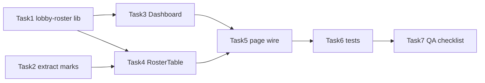

# UI Phòng chờ phiên thi — Implementation Plan

> **For agentic workers:** REQUIRED SUB-SKILL: Use superpowers:subagent-driven-development (recommended) or superpowers:executing-plans to implement this plan task-by-task. Steps use checkbox (`- [ ]`) syntax for tracking.

**Goal:** Thay layout hai panel (Điểm danh | Trạng thái nộp bài) bằng **dashboard tổng quan** + **một bảng SV gộp**, để giảng viên nhìn một lần biết sĩ số / vắng mặt / nộp bài và đối chiếu từng SV trên một dòng.

**Architecture:** Chỉ frontend (`apps/web`). Dữ liệu vẫn từ `useAttendance` + `useSubmissions` + socket merge trên `page.tsx`. Logic thuần (metric, trạng thái phòng, filter) tách ra `lib/`; UI mới là `LobbyDashboard` + `LobbyRosterTable`. `SubmissionStatusTable` **không** nhận props lobby — trang post-hoc giữ nguyên. Helper ghi chú (`StudentMarks`, `lateMinutes`) và `DiscrepancyNotice` tách khỏi `AttendancePanel` để bảng gộp dùng lại.

**Tech Stack:** Next.js App Router · React 19 · TanStack Query · Tailwind · Vitest + Testing Library (web)

**Spec:** `docs/superpowers/specs/2026-10-08-exam-waiting-room-ui-design.md` — mọi `§N` bên dưới trỏ vào spec đó.

**Nhánh:** `feature/exam-waiting-room-ui`

## Global Constraints

- **Không đổi API / socket / OpenAPI / migration.** Chỉ layout + copy UI.
- **Nhãn UI đúng spec §5 / §6** (không dùng từ cũ trên UI mới):
  - Vắng mặt (không “Chưa vào”)
  - Thi bổ sung (không “Thi bù”)
  - Đã nộp / Chưa nộp (không “… đủ”)
  - Xác nhận sĩ số / Xác nhận lại sĩ số (không “Chốt sĩ số”)
- **«Chưa nộp» = cả roster:** `rows.length - countFullySubmitted(...)` — spec §5.1. Không trừ `absent`.
- **Ghi chú chỉ tự sinh** — reuse `StudentMarks`; không ô ghi tay.
- **Không animate** cập nhật hàng khi socket đẩy event (spec §4.1).
- **Projector:** trạng thái nộp bài giữ chữ + ký hiệu (`STATE_PRESENTATION`).
- **Post-hoc không đổi:** `apps/web/src/app/teacher/submissions/[sessionId]/page.tsx` vẫn import `SubmissionStatusTable` như hiện tại; test của nó phải xanh không cần đổi hành vi.
- **File page frontend ≤ 500 dòng** (CLAUDE.md). `page.tsx` đã dài — logic UI mới vào component riêng, không phình page.
- **Line ending CRLF** cho `.ts`/`.tsx`.
- **Lệnh test:** `pnpm --filter web test` (hoặc vitest path tương ứng). Không cần api e2e cho plan này.

## Quyết định thi công (chốt trong plan, khớp spec §6.4 hướng 1)

Chọn **component lobby mới** (`LobbyRosterTable`) thay vì mở rộng `SubmissionStatusTable` bằng props tùy chọn. Lý do: trang post-hoc đã mock/assert hành vi bảng cũ; gắn cột điểm danh vào cùng file dễ regress focus-student / grading columns.

Nếu cần tái dùng cell nộp bài / dialog: extract helper nội bộ nhỏ (ví dụ `submission-cell.tsx`) **chỉ khi** trùng code thật sự đau — mặc định copy/adapt tối thiểu từ `SubmissionStatusTable` rồi refactor sau nếu test bắt buộc.

---

## File Structure

**Tạo mới**

| File | Trách nhiệm |
|---|---|
| `apps/web/src/lib/lobby-roster.ts` | Thuần hàm: `RoomStatus`, `resolveRoomStatus`, `buildLobbyRosterRows`, `countInvalidStudents`, `filterLobbyRows`, filter id |
| `apps/web/src/lib/lobby-roster.test.ts` | Unit cho metric + filter + map trạng thái phòng |
| `apps/web/src/app/(exam-live)/exam-sessions/[id]/_components/LobbyDashboard.tsx` | Ô số §5 |
| `apps/web/src/app/(exam-live)/exam-sessions/[id]/_components/LobbyDashboard.test.tsx` | |
| `apps/web/src/app/(exam-live)/exam-sessions/[id]/_components/LobbyRosterTable.tsx` | Toolbar (filter + Xác nhận sĩ số) + bảng gộp §6 |
| `apps/web/src/app/(exam-live)/exam-sessions/[id]/_components/LobbyRosterTable.test.tsx` | |
| `apps/web/src/app/(exam-live)/exam-sessions/[id]/_components/student-marks.tsx` | Export `StudentMarks`, `lateMinutes` (tách từ AttendancePanel) |
| `apps/web/src/app/(exam-live)/exam-sessions/[id]/_components/DiscrepancyNotice.tsx` | Tách từ AttendancePanel |

**Sửa**

| File | Sửa gì |
|---|---|
| `apps/web/src/app/(exam-live)/exam-sessions/[id]/page.tsx` | Bỏ grid 2 cột; render Dashboard + Roster; bỏ import AttendancePanel / card nộp bài riêng |
| `apps/web/src/app/(exam-live)/exam-sessions/[id]/page.test.tsx` | Assert nhãn mới, một bảng, xác nhận sĩ số, filter |
| `apps/web/src/app/(exam-live)/exam-sessions/[id]/_components/AttendancePanel.tsx` | Hoặc xóa nếu không còn consumer, hoặc thin re-export tạm — ưu tiên **xóa khỏi lobby** và cập nhật/xóa test panel cũ |
| `apps/web/src/app/(exam-live)/exam-sessions/[id]/_components/AttendancePanel.test.tsx` | Chuyển assertion còn giá trị sang `student-marks` / `LobbyRosterTable`, hoặc xóa file nếu panel bị gỡ |
| `apps/web/src/lib/submission-rows.ts` | (Tuỳ chọn) thêm `countNotFullySubmitted` = `rows.length - countFullySubmitted` nếu giúp đọc rõ; không bắt buộc |

**Không đụng**

- `SubmissionStatusTable.tsx` / `.test.tsx` (trừ khi extract cell dùng chung có chủ đích)
- API, agent, socket contract
- `AccessRequestPanel`, `ExamMaterialsCard`, `CollectionPhaseActions`, `FinalizeSessionButton` (chỉ khoảng cách layout nếu cần)

---

### Task 1: Pure helpers — trạng thái phòng, metric, filter

Spec §5.1, §6.2, §6.3. Làm trước UI để dashboard và bảng dùng cùng một định nghĩa.

**Files:**
- Create: `apps/web/src/lib/lobby-roster.ts`
- Create: `apps/web/src/lib/lobby-roster.test.ts`

**Interfaces:**

```ts
export type RoomStatus = 'present' | 'absent' | 'makeup' | 'disconnected' | 'unknown';

export type LobbyRosterFilter =
  | 'all'
  | 'present'
  | 'absent'
  | 'makeup'
  | 'not_submitted';

export interface LobbyRosterRow {
  studentMssv: string;
  fullName: string;
  roomStatus: RoomStatus;
  /** AttendanceStudent khi có trong present/absent/makeup — dùng cho StudentMarks */
  attendanceStudent: AttendanceStudent | null;
  makeupFromClass?: string;
  byDeliverable: SubmissionRowStudent['byDeliverable'];
}

export function resolveRoomStatus(
  mssv: string,
  attendance: Attendance | undefined,
): RoomStatus;

export function buildLobbyRosterRows(
  attendance: Attendance | undefined,
  submissionRows: SubmissionRowStudent[],
): LobbyRosterRow[];

export function countInvalidStudents(
  rows: SubmissionRowStudent[],
  deliverables: { id: string }[],
): number;

export function isNotFullySubmitted(
  row: SubmissionRowStudent,
  deliverables: { id: string }[],
): boolean;

export function filterLobbyRows(
  rows: LobbyRosterRow[],
  filter: LobbyRosterFilter,
  deliverables: { id: string }[],
): LobbyRosterRow[];
```

- [ ] **Step 1: Viết test thất bại**

Cover tối thiểu:

1. `resolveRoomStatus`: present+connected → `present`; present+!connected → `disconnected`; absent → `absent`; makeup → `makeup`; không có trong attendance → `unknown`.
2. `isNotFullySubmitted` / «Chưa nộp»: SV trong `absent` chưa có file **vẫn** `true`; SV đủ mọi deliverable `collected` → `false`.
3. `countInvalidStudents`: đếm SV có ≥1 `invalid`, không đếm theo số file.
4. `filterLobbyRows('not_submitted')` gồm cả dòng `roomStatus === 'absent'`.
5. `filterLobbyRows('makeup')` chỉ makeup.

- [ ] **Step 2: Implement `lobby-roster.ts`**

Map attendance bằng `Map<mssv, { group, student }>` từ `present` / `absent` / `makeup`. Ghép với `submissionRows` (đã sort MSSV). Không mutate input.

«Chưa nộp» dùng cùng điều kiện với đảo của `countFullySubmitted` (mọi deliverable `collected`). Khi `deliverables.length === 0`, coi không ai “đã nộp” theo `countFullySubmitted` hiện tại — filter `not_submitted` có thể trả toàn bộ rows (khớp `fullySubmitted === 0`).

- [ ] **Step 3: Chạy test**

```bash
pnpm --filter web test src/lib/lobby-roster.test.ts
```

Expected: PASS.

---

### Task 2: Tách `StudentMarks` + `DiscrepancyNotice`

Spec §6.1 ghi chú, §6.3 discrepancy. AttendancePanel hiện chứa cả hai; bảng gộp cần chúng mà không import cả panel.

**Files:**
- Create: `apps/web/src/app/(exam-live)/exam-sessions/[id]/_components/student-marks.tsx`
- Create: `apps/web/src/app/(exam-live)/exam-sessions/[id]/_components/DiscrepancyNotice.tsx`
- Modify: `AttendancePanel.tsx` — import lại từ file mới (tạm thời, trước khi Task 5 gỡ panel)
- Modify: `AttendancePanel.test.tsx` — trỏ assertion late-join sang `student-marks` nếu tách test

**Copy ghi chú (cập nhật wording “sau khi chốt” → “sau khi xác nhận sĩ số” theo spec §6.1):**

- `Vào muộn lúc … (trễ N phút)`
- `Kết nối lại sau khi xác nhận sĩ số`
- `Mới vào sau khi xác nhận sĩ số`
- `Mất kết nối lúc …`

- [ ] **Step 1: Move `lateMinutes`, `formatTime` (nếu dùng chung), `StudentMarks` sang `student-marks.tsx` và export**
- [ ] **Step 2: Move `DiscrepancyNotice` sang file riêng; export**
- [ ] **Step 3: AttendancePanel import từ file mới — test panel cũ vẫn xanh**

```bash
pnpm --filter web test src/app/\(exam-live\)/exam-sessions/\[id\]/_components/AttendancePanel.test.tsx
```

---

### Task 3: `LobbyDashboard`

Spec §5.

**Files:**
- Create: `LobbyDashboard.tsx`
- Create: `LobbyDashboard.test.tsx`

**Props (gợi ý):**

```ts
interface LobbyDashboardProps {
  rosterSize: number;
  presentCount: number;
  absentCount: number;
  makeupCount: number;
  fullySubmitted: number;
  /** rows.length - fullySubmitted — đã tính ở page hoặc trong component từ rows */
  notSubmitted: number;
  invalidCount: number;
  confirmedAt: string | null;
  confirmedCount: number | null;
  classId: string | null;
}
```

- [ ] **Step 1: Test — render nhãn đúng spec**

Assert text: `Sĩ số`, `Có mặt`, `Vắng mặt`, `Đã nộp`, `Chưa nộp`, `File lỗi`.  
Ô `Thi bổ sung` **không** render khi `makeupCount === 0`; có khi > 0.  
Khi chưa xác nhận: hiện “Chưa xác nhận” (hoặc không hiện số đã xác nhận). Khi có `confirmedAt`: hiện `confirmedCount` + giờ.

- [ ] **Step 2: Implement UI** — số + nhãn, `aria-live="polite"` cho vùng số chính (như badge attendance cũ). Dùng token/spacing hiện có (`Badge` / grid đơn giản — không invent design system mới).
- [ ] **Step 3: Chạy test component**

```bash
pnpm --filter web test src/app/\(exam-live\)/exam-sessions/\[id\]/_components/LobbyDashboard.test.tsx
```

---

### Task 4: `LobbyRosterTable` — toolbar + bảng gộp

Spec §6.

**Files:**
- Create: `LobbyRosterTable.tsx`
- Create: `LobbyRosterTable.test.tsx`

**Props (gợi ý):**

```ts
interface LobbyRosterTableProps {
  rows: LobbyRosterRow[];
  deliverables: DeliverableColumn[];
  startTime: string;
  filter: LobbyRosterFilter;
  onFilterChange: (f: LobbyRosterFilter) => void;
  canConfirm: boolean;
  confirming: boolean;
  confirmError: Error | null;
  onConfirm: () => void;
  confirmedAt: string | null;
  confirmedCount: number | null;
  noClass: boolean;
  discrepancy: Attendance['discrepancy'];
  submissionsError?: boolean; // cảnh báo REST submissions fail như card cũ
}
```

- [ ] **Step 1: Test toolbar**

- Nút `Xác nhận sĩ số` / `Xác nhận lại sĩ số` theo `confirmedAt`.
- Disabled khi `!canConfirm || confirming || noClass`.
- Filter «Thi bổ sung» ẩn/disabled khi không có dòng makeup.
- Chọn filter «Chưa nộp» chỉ còn dòng chưa đủ `collected` (fixture có 1 absent + 1 đủ bài).

- [ ] **Step 2: Test một dòng gộp**

Fixture: SV present, `joinedLate`, chưa nộp → một row có badge **Có mặt**, ghi chú vào muộn, ô nộp **Chưa nộp** (ký hiệu `—` hoặc label).

- [ ] **Step 3: Implement**

Thứ tự trong component:

1. `DiscrepancyNotice` (nếu có) + alert noClass / submissionsError  
2. Toolbar: filter tabs + nút xác nhận sĩ số + dòng “Đã xác nhận N lúc …”  
3. `<Table>` scroll region (`role="region"`, `tabIndex={0}`, `aria-label` rõ, sticky header như `SubmissionStatusTable`)

Cột: Họ tên | MSSV | Trạng thái phòng | Ghi chú | …deliverables… | Xem bài nộp.

Dialog xem bài: tái sử dụng pattern từ `SubmissionStatusTable` (state `selectedStudentMssv`). Trang lobby **không** truyền `focusStudentMssv` / `gradingByMssv`.

- [ ] **Step 4: Chạy test**

```bash
pnpm --filter web test src/app/\(exam-live\)/exam-sessions/\[id\]/_components/LobbyRosterTable.test.tsx
```

---

### Task 5: Ghép vào `page.tsx`

Spec §4 layout.

**Files:**
- Modify: `page.tsx`
- (Sau khi xanh) Remove usage of `AttendancePanel` + card “Trạng thái nộp bài” hai cột

- [ ] **Step 1: Tính derived data trên page**

```ts
const lobbyRows = useMemo(
  () => buildLobbyRosterRows(attendance.data, rows),
  [attendance.data, rows],
);
const fullySubmitted = useMemo(
  () => countFullySubmitted(rows, deliverables),
  [rows, deliverables],
);
const notSubmitted = rows.length - fullySubmitted;
const invalidCount = useMemo(
  () => countInvalidStudents(rows, deliverables),
  [rows, deliverables],
);
const [rosterFilter, setRosterFilter] = useState<LobbyRosterFilter>('all');
```

Giữ nguyên socket, `needsOpening`, `CollectionPhaseActions`, materials, access request.

- [ ] **Step 2: Thay khối `lg:grid-cols-2` bằng**

```tsx
<LobbyDashboard ... />
<LobbyRosterTable
  rows={lobbyRows}
  filter={rosterFilter}
  onFilterChange={setRosterFilter}
  ...
/>
```

Filter có thể apply trong page (`filterLobbyRows`) hoặc trong table — một chỗ thôi, đừng lọc hai lần.

- [ ] **Step 3: Gỡ import / JSX AttendancePanel và card nộp bài cũ**
- [ ] **Step 4: Xóa hoặc archive `AttendancePanel.tsx` nếu không còn import; cập nhật test panel (Task 6)**

---

### Task 6: Cập nhật `page.test.tsx` + dọn test panel cũ

**Files:**
- Modify: `page.test.tsx`
- Modify or delete: `AttendancePanel.test.tsx`

- [ ] **Step 1: Đổi assertion nút**

`/Chốt sĩ số/` → `/Xác nhận sĩ số/` (và “Xác nhận lại” nếu test cover).

- [ ] **Step 2: Đổi assertion layout**

- Không còn heading/text phụ thuộc hai panel cũ nếu test đang tìm `Điểm danh` theo nghĩa panel chính (xem test hiện tại quanh dòng expect `Điểm danh`).
- Có nhãn dashboard: `Vắng mặt`, `Chưa nộp`, v.v.
- Một bảng roster (region label mới).

- [ ] **Step 3: Giữ regress**

Mở phiên, finalize, access request, subscribe error — không đổi hành vi; chỉ đổi selector nếu dính layout.

- [ ] **Step 4: Chạy full web tests liên quan**

```bash
pnpm --filter web test src/app/\(exam-live\)/exam-sessions/\[id\]
pnpm --filter web test src/app/teacher/submissions/\[sessionId\]/page.test.tsx
pnpm --filter web test src/lib/lobby-roster.test.ts
pnpm --filter web test src/lib/submission-rows.test.ts
```

Expected: tất cả PASS. Post-hoc page test không đổi hành vi `SubmissionStatusTable`.

---

### Task 7: Kiểm tra chấp nhận thủ công (checklist)

Theo spec §9 — tick khi demo/qa:

- [ ] Dashboard: sĩ số, có mặt, vắng mặt, đã nộp, chưa nộp (roster đầy đủ); thi bổ sung chỉ khi có makeup
- [ ] Một dòng: có mặt + vào muộn + chưa nộp
- [ ] Filter «Chưa nộp» gồm SV vắng mặt
- [ ] Xác nhận sĩ số + discrepancy vẫn đúng
- [ ] Socket cập nhật ô nộp bài và số dashboard không reload
- [ ] Post-hoc submissions session detail không đổi
- [ ] Không có API ghi chú tay

---

## Thứ tự phụ thuộc



Task 2 song song được với Task 1. Task 3 và 4 song song sau Task 1 (+ Task 2 cho Task 4).

---

## Ngoài phạm vi (nhắc lại)

- Ghi chú tay, API mới, đổi socket
- Chấm điểm trên lobby
- Đổi copy bên trong dialog archive-check / STATE_PRESENTATION keys (`absent` deliverable vẫn là “Vắng thi” theo bảng nộp bài cũ — khác badge phòng “Vắng mặt”)
