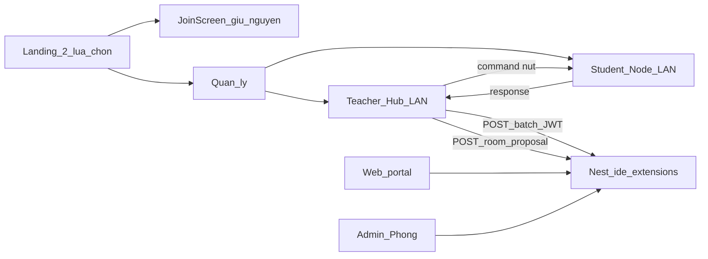

# Module Quản lý lab + kiểm soát extension VS Code — Implementation Plan

> **For agentic workers:** REQUIRED SUB-SKILL: Use superpowers:subagent-driven-development (recommended) or superpowers:executing-plans to implement this plan task-by-task. Steps use checkbox (`- [ ]`) syntax for tracking.

**Goal:** Một Electron app với màn hình 2 lựa chọn (phiên thi giữ nguyên | module Quản lý); LAN Teacher Hub ↔ Student Node; UI GV = nút thủ công; allowlist extension 2 tầng global+course; Hub tổng hợp rồi sync backend; web quản policy + xem kết quả — theo [spec](../specs/2026-10-18-lab-management-ide-extensions-design.md).

**Architecture:**
- `apps/agent`: landing → (1) JoinScreen hiện có không đổi hành vi | (2) Quản lý (auth + Hub/Node LAN + command bus + toolbar nút).
- `apps/api`: module Nest mới (policy, effective, batch scan, lab_mgmt persist); migration TypeORM thủ công.
- `apps/web`: trang admin/teacher “Quản lý tiện ích IDE” full màn hình — catalog (+ Trạng thái §6.3) → chi tiết; Marketplace dates; Kết quả → Thêm vào catalog; theo môn (§9); admin **Phòng** xem đề xuất phòng từ Hub (§9.5).

**Tech Stack:** Electron (electron-vite) · NestJS 11 + TypeORM + Postgres · Next.js App Router · TanStack Query · Jest e2e (api) · Vitest (agent/web khi có UI thuần).

**Spec:** `docs/superpowers/specs/2026-10-18-lab-management-ide-extensions-design.md` — mọi `§N` bên dưới trỏ vào spec đó.

**Nhánh gợi ý:** `feature/lab-management-ide-extensions`



---

## Quyết định đã chốt (khớp spec)

- **Không** sửa hành vi lựa chọn 1 (phiên thi / `agent:join`).
- **Không** pipeline tự động quét → đối chiếu → sync; chỉ nút trên Hub (§5).
- Auto chỉ ở: advertise Hub, discover, register máy, last_seen.
- Một LAN / một Hub: Hub thứ hai **từ chối** + hiện hostname Hub hiện tại (§3.1).
- Allowlist = catalog allow rules (§6.1a) ∪ course(approved); course item tạo = `pending` (§6).
- Duyệt global = **theo phiên bản exact** hoặc wildcard **`*`** (§6.1a, §9.2): `*` approved → mọi version của extension được phép kể từ `approved_at`; không có `*` → chỉ khớp đúng version đã approve.
- **Published / Last Released** = VS Marketplace; fallback «—» nếu không sync được (§7.1a).
- `catalogStatus`: `wildcard_approved` → «Duyệt mọi phiên bản (*)»; `fully_approved` → «Đã duyệt hết»; `has_pending` → «Có chờ duyệt»; `none_approved` → «Chưa duyệt» (§6.3).
- Từ Kết quả quét: **Thêm vào catalog** = upsert extension + thêm version nếu đã tồn tại; **không** tự tạo `*` (§9.4).
- UI quản lý **full màn hình** (§9.0).
- Trùng extension ở cả hai tầng → `matched_scope = global` (§6.1).
- **Đề xuất phòng máy** (§5.1): chỉ Teacher Hub; form phòng + **bảng máy editable** đủ field giống Máy tính (Hostname, CPU, RAM, Ổ cứng, GPU?, HĐH, IP, MAC, Trạng thái); prefill hostname/IP/OS từ registry Hub+SV; `proposed_by_*` từ login Quản lý; admin accept map 1-1 sang `computer` (§9.5). Student Node **không** có chức năng này. Không auto-collect WMI đợt này.
- SV Quản lý chỉ MSSV — không thêm `AccountRole = student`.
- Commit **chỉ khi user yêu cầu**; không push/PR cho đến khi được bảo.
- Mỗi Task dưới đây = **một commit** (message gợi ý ở cuối task), trừ khi user gộp.

## Verified facts (baseline repo)

- Agent UI vào thẳng `JoinScreen` khi chưa join: [`apps/agent/electron/renderer/src/App.tsx`](apps/agent/electron/renderer/src/App.tsx).
- IPC/preload: [`apps/agent/electron/preload/index.ts`](apps/agent/electron/preload/index.ts), [`apps/agent/electron/shared/ipc.ts`](apps/agent/electron/shared/ipc.ts).
- Login API sẵn: `POST /auth/login` email+password → JWT ([`auth.service.ts`](apps/api/src/auth/auth.service.ts)); `AccountRole = 'admin' | 'teacher'`.
- `class.course_id` → catalog `course` ([`class.entity.ts`](apps/api/src/course/entities/class.entity.ts)).
- Entities đăng ký thủ công trong [`data-source.ts`](apps/api/src/database/data-source.ts); migration mới dùng timestamp > `1789610000000` (ví dụ `1789620000000`).
- Nav web hardcode: [`apps/web/src/lib/nav-config.ts`](apps/web/src/lib/nav-config.ts).

## Global constraints

- Không đụng grading / exam-session gateway / snapshot / nộp bài trừ import dùng lại login JWT.
- Không regenerate OpenAPI trừ khi typecheck bắt buộc; ưu tiên client fetch thủ công hoặc typed DTO shared tối thiểu.
- Copy UI tiếng Việt; comment giải thích *why* khi lệch pattern.
- Line ending theo file hiện có trong từng app.
- E2E api chỉ `.env.test` local.
- Port LAN cố định (chốt trong Task 3): **UDP discover `41780`**, **TCP command `41781`** (đổi một chỗ constant nếu conflict lab).

---

## Commit map

| # | Commit (subject gợi ý) | Task |
|---|---|---|
| 0 | `docs: lab management IDE extensions spec and plan` | Task 0 |
| 1 | `feat(agent): landing screen two entry paths` | Task 1 |
| 2 | `feat(agent): lab management auth screens teacher and student` | Task 2 |
| 3 | `feat(agent): LAN teacher hub and student node registry` | Task 3 |
| 4 | `feat(agent): teacher hub manual action toolbar` | Task 4 |
| 5 | `feat(agent): SCAN_VSCODE_EXTENSIONS command and inventory UI` | Task 5 |
| 6 | `feat(api): ide extension catalog versions and policy schema` | Task 6 |
| 7 | `feat(api): effective allowlist and scan batch sync` | Task 7 |
| 8 | `feat(agent): compare allowlist and sync batch to API` | Task 8 |
| 9 | `feat(web): IDE utilities catalog list and version detail` | Task 9 |
| 10 | `feat(api): marketplace enrich and catalog from-scan upsert` | Task 10 |
| 11 | `feat(web): catalog status column scan import fullscreen layout` | Task 11 |
| 12 | `feat(api): lab room proposal schema and accept-create-room` | Task 12 |
| 13 | `feat(agent): teacher hub propose lab room from registry` | Task 13 |
| 14 | `feat(web): admin rooms review lab room proposals` | Task 14 |
| 15 | `feat(api): room proposal machine computer-parity fields` | Task 15 |
| 16 | `feat(agent,web): propose/review room with full PC fields` | Task 16 |

---

## File structure (tổng quan)

### Agent — tạo mới

| File | Trách nhiệm |
|---|---|
| `apps/agent/electron/renderer/src/components/LandingScreen.tsx` | 2 lựa chọn §2 |
| `apps/agent/electron/renderer/src/components/mgmt/MgmtRolePick.tsx` | Chọn GV / SV trong Quản lý |
| `apps/agent/electron/renderer/src/components/mgmt/TeacherLogin.tsx` | Email + mk |
| `apps/agent/electron/renderer/src/components/mgmt/StudentLogin.tsx` | Chỉ MSSV |
| `apps/agent/electron/renderer/src/components/mgmt/TeacherHubView.tsx` | Registry + toolbar nút §5 (+ đề xuất phòng §5.1) |
| `apps/agent/electron/renderer/src/components/mgmt/ProposeRoomDialog.tsx` | Form phòng + bảng máy editable (field Máy tính §5.1) |
| `apps/agent/electron/renderer/src/components/mgmt/StudentNodeView.tsx` | Trạng thái gắn Hub |
| `apps/agent/src/lab-mgmt/machine-identity.ts` | `machine_id`, hostname, IP §3.2 |
| `apps/agent/src/lab-mgmt/lan-protocol.ts` | Envelope request/response §4.1 + constants port |
| `apps/agent/src/lab-mgmt/teacher-hub.ts` | Advertise, accept register, gửi command, registry |
| `apps/agent/src/lab-mgmt/student-node.ts` | Discover, register, nhận/thực thi command |
| `apps/agent/src/lab-mgmt/vscode-extensions-scan.ts` | Quét thư mục extensions |
| `apps/agent/src/lab-mgmt/allowlist-compare.ts` | Thuần: inventory + effective → verdict |
| `*.test.ts` cạnh các module thuần trên | |

### API — tạo mới

| File | Trách nhiệm |
|---|---|
| `apps/api/src/database/migrations/1789620000000-IdeExtensionLabMgmt.ts` | Toàn bộ bảng §7 |
| `apps/api/src/ide-extensions/entities/*.entity.ts` | Catalog + version + policy + scan (~8–9 entity) |
| `apps/api/src/ide-extensions/ide-extensions.module.ts` | |
| `apps/api/src/ide-extensions/ide-extensions.service.ts` | Policy + effective + batch |
| `apps/api/src/ide-extensions/ide-extensions.controller.ts` | Routes §8 |
| `apps/api/src/ide-extensions/dto/*.ts` | |
| `apps/api/test/ide-extensions*.e2e-spec.ts` | |

### Web — tạo mới / sửa

| File | Trách nhiệm |
|---|---|
| `apps/web/src/app/admin/ide-utilities/page.tsx` | **List** full-screen: + cột Trạng thái; tabs Theo môn / Kết quả (§9.0–9.1, §9.3–9.4) |
| `apps/web/src/app/admin/ide-utilities/[id]/page.tsx` | **Chi tiết** full-screen + refresh Marketplace + versions (§9.2) |
| `apps/api/src/ide-extensions/marketplace-client.ts` | Gọi VS Marketplace / Open VSX → publishedAt, lastReleasedAt (§7.1b) |
| `apps/web/src/lib/api/ide-utilities.ts` | Catalog + from-scan + refresh-marketplace + course + scans |
| `apps/web/src/hooks/useIdeUtilities.ts` | |
| `apps/web/src/lib/nav-config.ts` | Thêm 1 mục nav |
| `apps/api/src/ide-extensions/entities/lab-room-proposal*.entity.ts` | Đề xuất phòng + máy snapshot §7.4 |
| `apps/web/src/app/admin/master-data/rooms/page.tsx` (+ panel đề xuất) | §9.5 — list/chi tiết đề xuất, tạo phòng |
| `apps/web/src/lib/api/lab-room-proposals.ts` | Client fetch đề xuất phòng |

---

## Task 0: Docs trên branch

**Files:**
- `docs/superpowers/specs/2026-10-18-lab-management-ide-extensions-design.md` (đã có)
- `docs/superpowers/plans/2026-10-18-lab-management-ide-extensions.md` (file này)

- [ ] Xác nhận spec + plan trên nhánh feature
- [ ] Commit khi user bảo:

```text
docs: lab management IDE extensions spec and plan
```

---

## Task 1: Landing — 2 lựa chọn (spec §2)

**Files:**
- Create: `apps/agent/electron/renderer/src/components/LandingScreen.tsx`
- Modify: `apps/agent/electron/renderer/src/App.tsx` — state route `landing | exam | mgmt`; mặc định `landing`
- Modify (tối thiểu): `JoinScreen` / IPC nếu cần nút “Quay lại” về landing **sau** khi chưa join thành công — không đổi contract join

### Steps

- [ ] Landing hai nút: **Vào phiên thi** | **Quản lý**
- [ ] Chọn (1) → render luồng hiện tại (`JoinScreen` → confirmed → detail) **không đổi** logic `session-controller`
- [ ] Chọn (2) → nhánh mgmt (placeholder “Sắp có” được chấp nhận nếu Task 2 chưa merge; ưu tiên nối Task 2 ngay)
- [ ] Test thủ công / smoke: vào (1) join mock vẫn chạy như trước
- [ ] Commit:

```text
feat(agent): landing screen two entry paths
```

---

## Task 2: Auth module Quản lý (spec §2.2–§2.3)

**Files:**
- Create: `MgmtRolePick.tsx`, `TeacherLogin.tsx`, `StudentLogin.tsx`, shell `mgmt` views
- Modify: preload/main — IPC `mgmt:loginTeacher` / `mgmt:startStudentNode`
- API: `GET /ide-extensions/lab/students/by-mssv/:mssv` (không JWT) — tra `student`

### Steps

- [ ] UI chọn Giảng viên / Sinh viên trong Quản lý
- [ ] GV: email + mk → login thành công mới vào Hub; lỗi tiếng Việt
- [ ] SV: nhập MSSV → main gọi API by-mssv:
  - **200 + active:** lấy `fullName` (và lớp danh nghĩa nếu có) → hiện trên UI Node → mới start LAN
  - **404 / không active:** thông báo, **không** start Node
- [ ] `register` LAN gửi kèm `studentFullName`
- [ ] Nút quay về landing
- [ ] Commit:

```text
feat(agent): lab management auth screens teacher and student
```

### Task 2b (nếu tách commit API): lookup MSSV

```text
feat(api): public lab student lookup by mssv for management login
```

---

## Task 3: LAN Hub / Node + registry (spec §3)

**Files:**
- Create: `machine-identity.ts`, `lan-protocol.ts`, `teacher-hub.ts`, `student-node.ts` + tests
- Modify: main process — start Hub sau teacher login; start Node sau student MSSV; wire IPC state registry
- Modify: `TeacherHubView` / `StudentNodeView` — list máy online (MSSV, hostname, IP, last_seen)

### Steps

- [ ] Sinh `machine_id` ổn định (persist file local app data)
- [ ] Hub: UDP advertise `lab-mgmt-hub` + TCP server command port; tạo `lab_mgmt_session_id` (uuid local; sync DB ở Task 7/8)
- [ ] Node: discover → TCP connect → `register` payload §3.2
- [ ] Hub thứ hai trên cùng LAN: từ chối + message hostname Hub đang chạy
- [ ] Registry live chỉ trên Hub; không POST Postgres ở task này
- [ ] Test: unit parse envelope; integration mock socket nếu khả thi trên CI Windows/Linux
- [ ] Commit:

```text
feat(agent): LAN teacher hub and student node registry
```

---

## Task 4: Toolbar nút thủ công trên Hub (spec §5)

**Files:**
- Modify: `TeacherHubView.tsx` — toolbar nút (có thể disable khi chưa đủ điều kiện)
- Create: `apps/agent/src/lab-mgmt/hub-actions.ts` — handlers gọi từ IPC, **không** tự chain

### Steps

- [ ] Nút: Làm mới danh sách máy | Quét extension | Đối chiếu allowlist | Tổng hợp phòng máy | Đồng bộ lên hệ thống
- [ ] Placeholder / disable **Đề xuất thông tin phòng máy** đến Task 13 (chỉ hiện trên Teacher Hub, không trên Student Node)
- [ ] Mỗi nút = một IPC/handler riêng; Quét/Đối chiếu/Đồng bộ có thể no-op hoặc toast “chưa gắn” cho đến Task 5/8 — **không** gọi ngầm từ register
- [ ] Assert trong test UI hoặc hub-actions: `register` không trigger scan/sync
- [ ] Commit:

```text
feat(agent): teacher hub manual action toolbar
```

---

## Task 5: Command `SCAN_VSCODE_EXTENSIONS` (spec §4)

**Files:**
- Create: `vscode-extensions-scan.ts` + `.test.ts` (fixture thư mục giả)
- Modify: `student-node.ts` — dispatch command
- Modify: `teacher-hub.ts` — broadcast/unicast khi bấm Quét; lưu inventory theo `machine_id` trên Hub
- Modify: Hub UI — bảng inventory thô sau khi có response

### Steps

- [ ] Quét path Windows phổ biến (`%USERPROFILE%\.vscode\extensions`, Insiders nếu có); đọc `package.json` → `publisher.name` + version
- [ ] Envelope §4.1; lỗi path → `ok: false` + `error`
- [ ] Nút Quét: gửi tới máy chọn hoặc toàn phòng; hiện kết quả / lỗi từng máy
- [ ] Commit:

```text
feat(agent): SCAN_VSCODE_EXTENSIONS command and inventory UI
```

---

## Task 6: API schema catalog + versions + policy course (spec §7.1a, §7.1, §8 một phần)

**Files:**
- Create / extend migration `1789620000000-IdeExtensionLabMgmt.ts` (hoặc migration mới sau timestamp hiện có nếu DB đã chạy migration cũ) — bảng **`ide_extension`**, **`ide_extension_version`** + policy/scan §7
- Create entities: `IdeExtension`, `IdeExtensionVersion`, policy/scan entities; register `data-source.ts` + module
- Create controller/service DTO:
  - Catalog list/detail/create; version add / approve / unapprove / delete
  - Course policy items; approve/reject course item
- Create e2e: thêm extension + version → approve → unapprove → delete; thêm `*` → approve; course pending → approve

### Steps

- [ ] Unique `ide_extension.identifier`; unique `(extension_pk, version)` — cho phép đúng một `*`
- [ ] Thêm version: chấp nhận semver hoặc `*`; reject trùng `*`
- [ ] Approve set `approved_at` + `approved_by`; unapprove → `pending`, clear `approved_at`/`approved_by`
- [ ] Xóa version CASCADE không xóa parent extension
- [ ] `published_at` / `last_released_at` cột sẵn; enrich Marketplace ở Task 10 (Task 6 có thể tạm NULL)
- [ ] List/detail trả `catalogStatus` gồm `wildcard_approved` khi `*` approved (§6.3)
- [ ] Course create → `pending`; `@Roles('admin')` duyệt catalog versions + course; teacher POST course pending + GET
- [ ] Nếu đã ship CRUD «global policy item» cũ: migrate data sang catalog versions hoặc deprecate endpoint global item — **catalog là source of truth global**
- [ ] Commit:

```text
feat(api): ide extension catalog versions and policy schema
```

---

## Task 7: Effective allowlist + scan batch (spec §6.1a, §7.2–7.3, §8)

**Files:**
- Extend service: `resolveEffectiveAllowlist` — trả rules dạng `{ extensionId, match: 'wildcard' | 'exact', version?: string, scope }` từ catalog (§6.1a) ∪ course approved
- Update `allowlist-compare` (agent, Task 8) cùng hợp đồng: wildcard → mọi version; exact → khớp chuỗi
- `POST /ide-extensions/scans/batch` — upsert scans/items/summary + optional `lab_mgmt_session` / machines snapshot
- E2E: `*` approved → mọi version allowed; chỉ `1.2.3` approved → `1.2.4` blocked; unapprove `*` → hết wildcard; course pending không vào; batch ghi scan

### Steps

- [ ] Resolve `course_id` từ `exam_session` → `class.course_id` khi có `examSessionId`
- [ ] Trùng id → `matched_scope: global`
- [ ] Effective **không** còn nghĩa «≥1 version bất kỳ = cả extension»; chỉ §6.1a
- [ ] Batch chỉ `teacher` \| `admin` JWT; `reported_by = teacher_hub`
- [ ] Commit:

```text
feat(api): effective allowlist and scan batch sync
```

---

## Task 8: Hub — Đối chiếu + Đồng bộ nối API (spec §5–§6)

**Files:**
- Create/update: `allowlist-compare.ts` + test bảng truth §6.2 **và** §6.1a (`*` / exact)
- Modify: Hub — nút Đối chiếu gọi GET effective (cần `courseId` hoặc `examSessionId` chọn trên UI Hub — dropdown tối thiểu)
- Modify: nút Tổng hợp — view local gộp vi phạm
- Modify: nút Đồng bộ — POST batch từ trạng thái đã đối chiếu; cảnh báo nếu chưa đối chiếu

### Steps

- [ ] Không auto-compare sau scan
- [ ] Compare: `match === 'wildcard'` → allowed mọi version; `exact` → `installedVersion === rule.version`
- [ ] UI cảnh báo khi không có `course_id` (chỉ global)
- [ ] Commit:

```text
feat(agent): compare allowlist and sync batch to API
```

---

## Task 9: Web — Quản lý tiện ích IDE (spec §9.0–9.3 baseline)

**Files:**
- Create/replace: `apps/web/src/app/admin/ide-utilities/page.tsx` — **danh sách** (§9.1)
- Create: `apps/web/src/app/admin/ide-utilities/[id]/page.tsx` — **chi tiết + phiên bản** (§9.2)
- Optional: tabs «Theo môn» | «Kết quả» (§9.3); teacher mirror
- Hooks/API client — catalog list/detail, version approve/unapprove/delete, course, scans
- Modify `nav-config.ts` — mục admin/teacher

### Steps

- [ ] Layout **full màn hình** trong shell admin (§9.0): bảng full-width, sticky header
- [ ] List: Extension name | Publisher | Identifier | Published | Last Released | **Trạng thái** (nhãn §6.3; có thể derive tạm nếu API chưa trả)
- [ ] Click row → chi tiết (metadata + versions)
- [ ] Versions: Approve / Hủy approved / Xóa (confirm); preset **«Thêm duyệt mọi phiên bản (*)»**; banner khi `*` approved
- [ ] Theo môn + Kết quả (list scan); nút «Thêm vào catalog» gắn ở Task 11 nếu API Task 10 chưa sẵn
- [ ] Commit:

```text
feat(web): IDE utilities catalog list and version detail
```

---

## Task 10: Marketplace enrich + upsert từ scan (spec §7.1b, §8, §9.4)

**Files:**
- Create: `apps/api/src/ide-extensions/marketplace-client.ts` (+ unit test mock HTTP)
- Extend migration nếu thiếu `marketplace_synced_at`
- Extend service: `refreshMarketplace(id)`, `upsertFromScan({ extensionId, version?, displayName? })`
- Controller: `POST catalog/:id/refresh-marketplace`, `POST catalog/from-scan`
- List/detail: trả `catalogStatus` (§6.3)

### Steps

- [ ] Gọi Marketplace theo identifier → map `published_at`, `last_released_at`, display/publisher
- [ ] Timeout/404 Marketplace → không fail upsert; field NULL / giữ cũ
- [ ] from-scan: chưa có → tạo + version pending; đã có → thêm version nếu mới; trùng version → alreadyExists
- [ ] E2E/unit: status derived đúng 3 nhánh; from-scan idempotent
- [ ] Commit:

```text
feat(api): marketplace enrich and catalog from-scan upsert
```

---

## Task 11: Web — Trạng thái, import từ quét, polish full-screen (spec §6.3, §9.0, §9.4)

**Files:**
- Modify list/detail/Kết quả pages + `ide-utilities.ts` client
- Badge/component trạng thái catalog

### Steps

- [ ] Cột **Trạng thái**: gồm **Duyệt mọi phiên bản (*)** / Đã duyệt hết / Có chờ duyệt / Chưa duyệt (+ màu badge)
- [ ] Detail: nút **Làm mới từ Marketplace**; UI `*` rõ ràng (nhãn «Mọi phiên bản», confirm khi xóa/hủy)
- [ ] Kết quả (từng dòng extension): **Thêm vào catalog** → from-scan; toast thành công / đã tồn tại; link sang detail; không tạo `*`
- [ ] Rà full-screen: không layout hẹp/card giữa trang; bảng + chi tiết tận dụng viewport
- [ ] Commit:

```text
feat(web): catalog status column scan import fullscreen layout
```

---

## Task 12: API — đề xuất phòng máy (spec §7.4, §8)

**Files:**
- Migration mới (timestamp > catalog): `lab_room_proposal`, `lab_room_proposal_machine`
- Entities + register `data-source` / module
- Service/controller: create (teacher), list/detail, reject, withdraw, `accept-create-room` (admin)
- E2E: teacher POST proposal gắn `proposed_by_*` từ JWT; admin accept → có `room` + `computer` theo hostname snapshot

### Steps

- [ ] Body create: `code`, `name`, `capacity`, `building?`, `floor?`, `machines[]`, optional `labMgmtSessionId`
- [ ] Server set `proposed_by_account_id` / email / displayName từ JWT — **không** tin client tự ghi đè người gửi
- [ ] `accept-create-room`: transaction tạo `room` + `computer` (MVP sớm có thể placeholder — **Task 15** siết field đầy đủ)
- [ ] Roles: POST teacher; accept/reject admin; Student không có endpoint riêng / 403
- [ ] Commit:

```text
feat(api): lab room proposal schema and accept-create-room
```

---

## Task 13: Agent — nút đề xuất phòng trên Teacher Hub (spec §5.1)

**Files:**
- `ProposeRoomDialog.tsx` + `TeacherHubView.tsx`
- IPC `mgmt:proposeRoom` → main POST API với JWT teacher đã login
- `StudentNodeView`: **không** thêm nút / dialog

### Steps

- [ ] Snapshot registry gồm **Hub (`teacher_hub`) + mọi `student_node`** → dialog (hiện role)
- [ ] Form phòng: Mã, Tên, Sức chứa (default = số máy Hub+SV), Tòa, Tầng
- [ ] (Field máy đầy đủ — Task 16) MVP sớm có thể gửi hostname/IP/OS; Task 16 siết đủ Máy tính
- [ ] Disable chỉ khi không lấy được máy Hub; toast thành công / lỗi tiếng Việt
- [ ] Commit:

```text
feat(agent): teacher hub propose lab room from registry
```

---

## Task 14: Web admin Phòng — duyệt đề xuất (spec §9.5)

**Files:**
- Extend `apps/web/src/app/admin/master-data/rooms/page.tsx` (tab/panel đề xuất) hoặc route con
- API client `lab-room-proposals.ts`
- Form tạo phòng từ đề xuất (prefill room)

### Steps

- [ ] List đề xuất: mã, tên, sức chứa, tòa, tầng, số máy, **người gửi**, thời gian, trạng thái
- [ ] Chi tiết + bảng máy (Task 16: đủ cột Máy tính)
- [ ] **Tạo phòng từ đề xuất** / **Từ chối**
- [ ] Chỉ admin; không thêm UI này cho teacher rooms (nếu teacher không có trang Phòng)
- [ ] Commit:

```text
feat(web): admin rooms review lab room proposals
```

---

## Task 15: API — field máy đề xuất parity với `computer` (spec §5.1, §7.4)

**Files:**
- Migration mới: thêm `cpu`, `ram_gb`, `storage`, `gpu`, `mac_address`, `status` trên `lab_room_proposal_machine`
- Entity + `RoomProposalMachineDto` validation
- `accept-create-room`: map 1-1 sang `computer` (bỏ placeholder)

### Steps

- [ ] Bắt buộc: hostname, cpu, ram_gb (>0), storage, os, local_ip, mac_address, status
- [ ] GPU nullable; default status `active` nếu client gửi
- [ ] E2E: create thiếu cpu → 400; accept tạo computer đủ cột
- [ ] Commit:

```text
feat(api): room proposal machine computer-parity fields
```

---

## Task 16: Hub + Admin UI — nhập/xem đủ field Máy tính

**Files:**
- `ProposeRoomDialog.tsx` — bảng editable
- IPC payload machines đầy đủ
- `room-proposals-panel.tsx` — cột chi tiết + accept không nhập lại hardware

### Steps

- [ ] Prefill hostname/IP/OS từ registry; RAM mặc định 16; status `active`
- [ ] Validate trước POST; không gửi nếu thiếu field bắt buộc
- [ ] Admin chi tiết hiện Hostname, CPU, RAM, Ổ cứng, GPU, HĐH, IP, MAC, Trạng thái (+ role)
- [ ] Commit:

```text
feat(agent,web): propose/review room with full PC fields
```

---

## Tiêu chí xong (map spec §12)

- [ ] Landing 2 lựa chọn; phiên thi hành vi cũ giữ nguyên
- [ ] GV → Hub; SV MSSV → Node; registry đúng metadata
- [ ] Không auto quét/đối chiếu/sync khi SV vào
- [ ] Quét → inventory; Đối chiếu → verdict theo §6.1a (exact + `*`); Đồng bộ → DB; web đọc được
- [ ] Course `pending` không `allowed`
- [ ] Web full-screen; list kèm Trạng thái §6.3 (có wildcard); Published/Last Released từ Marketplace
- [ ] `*` approve → mọi version allowed; hủy/xóa `*` → chỉ exact; from-scan không tự tạo `*`
- [ ] Teacher Hub đề xuất phòng: máy Hub+SV đủ field Máy tính; Student Node không có; admin tạo room+computers map 1-1

## Rủi ro khi thi công

- Firewall lab — ghi chú port trong README agent ngắn (không bắt buộc trang docs dài).
- CI không có UDP multicast — mock protocol layer trong unit test; manual QA trên 2 máy LAN.
- OpenAPI: nếu web dùng `apiClient` generated mà thiếu path — dùng fetch wrapper riêng như master-data cho đến khi regenerate.
- Marketplace rate-limit / CORS — chỉ gọi **từ API** (server-side), không gọi thẳng từ browser.
- Nhầm `*` với semver — validate `version === '*'` đúng literal; UI preset riêng, không nhập nhầm.
- Accept đề xuất vs `room.code` unique — UI admin cho sửa mã trước khi tạo.
- Hardware không tự lấy từ OS — GV phải nhập tay trên dialog (đợt này).
