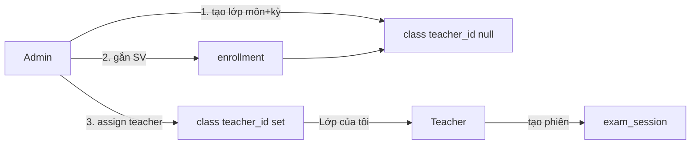

# Admin tạo lớp học phần + phân công giảng viên — thiết kế

**Ngày:** 2026-10-07 · **Branch:** `feature/sync-master-data-schema` · **Baseline:** catalog master data đã có  
**Trạng thái:** implemented (2026-10-07) — API + UI admin; teacher không còn tạo lớp  
**Liên quan:** [master-data-entities](./2026-10-07-master-data-entities-design.md) · [sync session FK](./2026-10-07-sync-master-data-schema-design.md) (phase phiên thi — độc lập)

Admin quản lý **lớp học phần**: chọn môn + học kỳ từ catalog, gắn danh sách
sinh viên (từ catalog / thêm từng em), rồi **phân công giảng viên**. Lớp đã
gán xuất hiện trong **「Lớp của tôi」**; giảng viên dùng để mở phiên thi như
hiện tại. Không tạo bảng song song — tái dùng `class` + `enrollment` để
`exam_session.class_id` / roster / thi bù không phải viết lại.

---

## 0. Vì sao cần cái này

Sau `ContractMasterData`, giảng viên tự tạo lớp và tự nhập roster; không còn
gắn môn/kỳ chuẩn. Catalog đã có `course`, `semester`, `student` nhưng **chưa**
nối vào lớp nghiệp vụ.

Luồng mong muốn (phòng đào tạo / admin):

1. Tạo lớp học phần theo **môn + học kỳ**
2. Gắn / thêm sinh viên vào lớp
3. Phân công giảng viên → lớp vào **Lớp của tôi**

Giảng viên không còn là người tạo lớp học phần; họ nhận lớp và vận hành thi.

---

## 1. Phạm vi

### 1.1 Trong phạm vi

| Hạng mục | Ghi chú |
|---|---|
| Mở rộng bảng `class` | `course_id`, `semester_id` (FK catalog); `teacher_id` **nullable** tới khi gán |
| Dual-write snapshot | `course_name` từ `course.name` (bỏ phụ thuộc hằng `COURSE_NAME` cho lớp **mới**) |
| Admin API CRUD lớp học phần | Tạo / sửa / xoá / list / lọc kỳ·môn·GV |
| Admin quản lý roster | List, thêm 1 SV (từ catalog hoặc mssv+tên), xoá; import JSON/Excel-parsed như teacher |
| Admin phân công / đổi GV | `PATCH …/assign` → set `teacher_id` + backfill `enrollment.home_teacher_id` |
| `enrollment.home_teacher_id` nullable | Cho phép gắn SV **trước** khi có GV |
| Optional `enrollment.student_id` | FK nullable → catalog `student`; snapshot `student_mssv` / `student_name` giữ nguyên |
| Teacher「Lớp của tôi」 | Chỉ lớp `teacher_id = me`; **không** tạo / xoá lớp |
| Teacher roster sau khi được gán | Giữ add/import/remove (sửa ngày thi) |
| UI admin | Trang quản lý lớp học phần + roster + gán GV |
| Migration handwritten + e2e | |

### 1.2 Cố ý KHÔNG trong phạm vi

- Đổi `exam_session` / chống trùng phòng / grading / agent protocol.
- Bảng mới `course_section` (tránh materialize kép).
- Gán máy / chỗ ngồi.
- Teacher tự tạo lớp học phần mới (nút「Tạo lớp」bỏ khỏi UI teacher).
- Bắt buộc mọi lớp lịch sử có `course_id` / `semester_id` (NULL = legacy).
- Xoá catalog `nominal_class` (lớp hành chính vẫn tách với lớp học phần).
- Spec sync `exam_session.semester_id` / `room_id` — làm riêng; khi tạo phiên
  có thể copy `semester_name` từ lớp đã gán kỳ (phase sau hoặc cùng PR nếu
  tiện, **không** chặn đợt này).

---

## 2. Mô hình dữ liệu

### 2.1 Sơ đồ vòng đời

### 2.2 `class` — cột mới / đổi

| Cột | Thay đổi |
|---|---|
| `course_id` | uuid NULL → FK `course(id)` **ON DELETE RESTRICT** |
| `semester_id` | uuid NULL → FK `semester(id)` **ON DELETE RESTRICT** |
| `teacher_id` | **NULLABLE** (trước: NOT NULL). NULL = chưa phân công |
| `course_name` | Giữ; lớp mới = snapshot `course.name` lúc tạo/đổi môn |
| `name` | Giữ — tên lớp học phần (vd. `N01`, `D21-CNTT-1`) |

**Tạo mới (admin):** `course_id` + `semester_id` + `name` **bắt buộc**;
`teacher_id` optional (có thể gán ngay hoặc để sau).

**Unique mới:** `(semester_id, course_id, name)` khi cả hai FK non-null  
(`uq_class_semester_course_name`).  
Unique cũ `(teacher_id, course_name, name)`: giữ cho hàng legacy hoặc thay bằng
unique mới + partial index legacy — migration phải không vỡ dữ liệu hiện có
(mọi lớp cũ có `teacher_id` + `COURSE_NAME`).

**Gợi ý migration unique:**

1. Thêm cột FK nullable.
2. Drop `uq_class_teacher_course_name`.
3. Add `uq_class_semester_course_name` trên `(semester_id, course_id, name)` —
   Postgres: nhiều hàng legacy `course_id`/`semester_id` NULL không đụng nhau
   trong unique (NULL distinct).
4. Optional partial unique legacy: `(teacher_id, name) WHERE course_id IS NULL`
   nếu cần chặn trùng tên trên lớp cũ.

### 2.3 `enrollment` — cột mới / đổi

| Cột | Thay đổi |
|---|---|
| `home_teacher_id` | **NULLABLE**. NULL khi lớp chưa gán GV |
| `student_id` | uuid NULL → FK `student(id)` **ON DELETE SET NULL** |
| `student_mssv`, `student_name` | Giữ — snapshot / nguồn auth `agent:join` |

Unique `(home_class_id, student_mssv)` giữ nguyên.

**Thêm SV từ catalog:** client gửi `studentId` → server điền mssv + full_name;
từ chối nếu `student.status` không `active`.  
**Thêm tay:** mssv + name như hiện tại; `student_id` NULL (hoặc resolve theo
mssv nếu khớp catalog — **nên resolve** khi trùng mssv để liên kết mềm).

### 2.4 Phân công giảng viên

`POST /admin/course-sections/:id/assign` body `{ teacherId }`:

1. Account tồn tại, `role = teacher`.
2. Set `class.teacher_id = teacherId`.
3. Trong cùng transaction:  
   `UPDATE enrollment SET home_teacher_id = :teacherId WHERE home_class_id = :id`.
4. Đổi GV (reassign): cùng bước; phiên thi / rubric đã tạo của GV cũ **không**
   chuyển chủ trong đợt này (ghi rõ trong UI: chỉ lớp + enrollment).

**Gỡ phân công** (optional MVP): `teacher_id = NULL` + `home_teacher_id = NULL`
chỉ khi lớp **không** có `exam_session` trỏ tới — nếu có phiên → 409.

### 2.5 Xoá lớp

- RESTRICT nếu còn enrollment hoặc còn exam_session (như hiện tại / rõ 409).
- Admin xoá lớp chưa gán + roster trống: cho phép.
- Có roster: bắt xoá hết SV hoặc hard-delete roster trong transaction có confirm.

### 2.6 Quan hệ với hằng `COURSE_NAME`

- Lớp **mới** do admin tạo: `course_name` = catalog, **không** ép `COURSE_NAME`.
- Lớp **legacy** và đường teacher cũ: có thể vẫn mang `CTDL&GT`.
- `RosterService.siblingEnrollments` / thi bù cùng môn: ưu tiên so `course_id`
  khi cả hai phía non-null; fallback `course_name` như hiện tại.
- Không xóa file `course-name.ts` trong đợt này nếu còn chỗ grading phụ thuộc;
  đánh dấu nợ: dọn khi multi-môn ổn định.

---

## 3. API

Prefix admin: `/admin/course-sections` (tránh đụng `/classes` teacher).  
Tất cả `@Roles('admin')` trừ ghi chú.

| Method | Path | Việc |
|---|---|---|
| GET | `/admin/course-sections` | List: filter `semesterId`, `courseId`, `teacherId`, `unassigned=true`, `q` tên |
| POST | `/admin/course-sections` | Tạo: `courseId`, `semesterId`, `name`, optional `teacherId` |
| GET | `/admin/course-sections/:id` | Chi tiết + `studentCount` + teacher |
| PATCH | `/admin/course-sections/:id` | Đổi `name`; đổi môn/kỳ chỉ khi **chưa** có enrollment + chưa có session |
| DELETE | `/admin/course-sections/:id` | Xoá (điều kiện §2.5) |
| POST | `/admin/course-sections/:id/assign` | `{ teacherId }` |
| GET | `/admin/course-sections/:id/roster` | List SV |
| POST | `/admin/course-sections/:id/roster` | Import bulk (reuse shape `ImportRosterDto`) |
| POST | `/admin/course-sections/:id/roster/students` | Thêm 1: `studentId` **hoặc** `{ mssv, name }` |
| DELETE | `/admin/course-sections/:id/roster/students/:mssv` | Xoá 1 |

Teacher routes hiện có:

| Route | Đổi |
|---|---|
| `GET /classes/teaching` | Giữ — chỉ lớp đã `teacher_id = me` |
| `POST /classes` | **Gỡ** hoặc 403 cố định + bỏ UI |
| `PATCH/DELETE /classes/:id` | Teacher: chỉ đổi `name` (optional) hoặc **chỉ admin** sửa meta; **khuyến nghị:** teacher không PATCH/DELETE lớp — chỉ admin |
| Roster teacher | Giữ cho lớp đã gán |

Response lớp (admin + teaching): thêm `courseId`, `semesterId`, `teacherId`
(nullable), `courseName`, `semesterName` (join snapshot hoặc join read-only
để hiển thị — list admin được join; teacher list có thể embed `semesterName`
từ join `semester.name`).

---

## 4. Web

### 4.1 Admin — nhóm nav

**Lớp học phần** dưới khu vực admin (cạnh Dữ liệu nền):

- List: cột tên, môn, học kỳ, GV (hoặc「Chưa phân công」), sĩ số.
- Filter kỳ / môn / chưa gán.
- Tạo: select môn, select học kỳ (lọc theo năm), tên lớp, optional chọn GV.
- Chi tiết: tab Roster (thêm từ catalog search mssv/tên, xoá, import file
  parse client như teacher) + nút **Phân công giảng viên** (dialog chọn account
  teacher).

### 4.2 Teacher — Lớp của tôi

- Bỏ nút「Tạo lớp」và dialog tạo/xoá lớp.
- Copy: lớp do phòng đào tạo phân công; vào roster để kiểm tra / bổ sung SV.
- Form tạo phiên: `GET /classes/teaching` không đổi hợp đồng tối thiểu
  (`id`, `name`, `courseName`, `studentCount`); bổ sung `semesterId` /
  `semesterName` nếu UI muốn prefill kỳ (optional cùng đợt).

---

## 5. Quy tắc nghiệp vụ

1. Một SV (`mssv`) không thuộc hai lớp **cùng môn** (cùng `course_id`, hoặc
   cùng `course_name` nếu thiếu id) — giữ logic `assertNoCrossClassMove`.
2. Chỉ gán account `role=teacher`.
3. Lớp `teacher_id IS NULL` **không** hiện ở `/classes/teaching` → không tạo
   được phiên từ lớp chưa gán.
4. `agent:join` / session roster: không đổi; chỉ chạy khi đã có phiên của GV.
5. Sửa catalog `course.name` / `student.full_name` **không** cascade vào
   `class.course_name` / `enrollment.student_name` đã chụp (trừ khi admin
   chủ động sửa roster).

---

## 6. Migration (expand)

Thứ tự gợi ý trong một migration (hoặc hai nếu tách relax NULL):

1. `ALTER class ADD course_id, semester_id` + FK RESTRICT.
2. `ALTER class ALTER teacher_id DROP NOT NULL`.
3. `ALTER enrollment ALTER home_teacher_id DROP NOT NULL`.
4. `ALTER enrollment ADD student_id` + FK SET NULL.
5. Đổi unique indexes (§2.2).
6. Không backfill `course_id`/`semester_id` cho hàng cũ (NULL).

Entity TypeORM cập nhật khớp; `verify-schema` nếu assert cột.

---

## 7. Kiểm thử

| Ca | Kỳ vọng |
|---|---|
| Admin tạo lớp môn+kỳ, chưa gán GV | 201; `teacher_id` NULL |
| Thêm SV từ `studentId` trước khi gán | 201; `home_teacher_id` NULL; mssv/tên đúng catalog |
| Assign teacher | `teacher_id` set; mọi enrollment `home_teacher_id` cập nhật |
| Teacher `GET /classes/teaching` | Thấy lớp vừa gán |
| Teacher `POST /classes` | 403 hoặc route đã gỡ |
| Tạo phiên từ lớp đã gán | Như e2e hiện có |
| Import roster trùng mssv lớp khác cùng môn | 409 |
| Xoá lớp còn session | 409 |
| Reassign GV | enrollment theo GV mới; session cũ vẫn `teacher_id` cũ |

---

## 8. Thứ tự implement gợi ý

1. Migration + entity `class` / `enrollment`  
2. Admin service/controller course-sections + assign + roster  
3. Gỡ/ khoá teacher tạo·xoá lớp; chỉnh UI teacher  
4. UI admin list/create/roster/assign  
5. OpenAPI client + e2e admin + regression teaching/session  

---

## 9. Tóm tắt quyết định

| Quyết định | Chọn |
|---|---|
| Bảng mới section? | **Không** — tái dùng `class` + `enrollment` |
| Ai tạo lớp học phần? | **Admin** |
| Gán GV | Sau (hoặc lúc tạo); `teacher_id` nullable |
| Roster trước khi gán? | **Có** — `home_teacher_id` nullable + backfill lúc assign |
| Nguồn SV | Catalog `studentId` ưu tiên; thêm tay vẫn được |
| Teacher tạo lớp? | **Không** (bỏ UI + chặn API) |
| Teacher sửa roster? | **Có** sau khi được gán |
| Snapshot | `course_name`, mssv, tên SV — không cascade từ catalog |
| Đụng exam_session FK phase? | Không bắt buộc trong spec này |

---

## 10. Việc cố ý để sau

- Prefill `exam_session.semesterId` từ `class.semester_id` khi tạo phiên.
- `class.course_id` bắt buộc trên mọi hàng + bỏ hằng `COURSE_NAME`.
- Import lớp hàng loạt (CSV nhiều lớp + email GV) — thiết kế lại
  `POST /classes/import` cũ.
- Đồng bộ đổi tên SV catalog → enrollment theo cờ admin.
