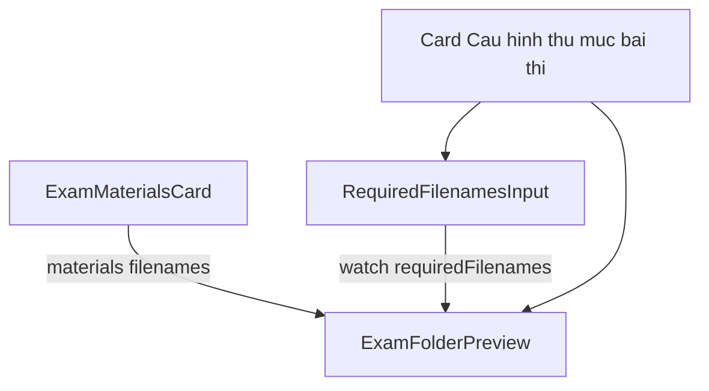

# Design: Cấu hình thư mục bài thi + preview trên hub Thiết lập

**Ngày:** 2026-10-18  
**Trạng thái:** implemented (plan `docs/superpowers/plans/2026-10-18-exam-folder-config-preview.md`)  
**Trang:** `apps/web/src/app/teacher/exam-sessions/[id]/page.tsx`  
**Liên quan:**
- [exam-session-setup-edit-flow](./2026-10-18-exam-session-setup-edit-flow-design.md) — hub Thiết lập; khối “File bắt buộc” (§5.2)
- [exam-session-create-slim](./2026-10-18-exam-session-create-slim-design.md) — khai file trên hub khi `scheduled`; mở phiên ≥ 1 file nộp
- [archive-content-validation](./2026-09-21-archive-content-validation-design.md) — shape filenames / entries (không đổi)

---

## 1. Vấn đề

Trên hub Thiết lập phiên, khối **File bắt buộc** chỉ nói về tên file agent sẽ thu. Giảng viên không thấy mối liên hệ với:

1. **Đề / hướng dẫn / tài liệu** đã upload (“Đề thi và tài liệu”).
2. **Hình ảnh thư mục trên máy sinh viên** — đề nằm cạnh file phải nộp thế nào.

Hệ quả: “file bắt buộc” đọc như checklist kỹ thuật, không như cấu hình không gian làm bài. User yêu cầu đổi framing thành **Cấu hình thư mục bài thi** và **preview** nội dung thư mục (kể cả đề, hướng dẫn) sau khi cấu hình.

Dữ liệu để preview **đã có ở client** (`useExamMaterials` + `requiredDeliverables` / form `requiredFilenames`). Không cần API mới.

---

## 2. Phạm vi

### Trong phạm vi

- Đổi copy khối deliverables trên hub Thiết lập (title, description, legend form, nút/toast lưu, checklist blockReason, mô tả trang tạo nhắc bước Thiết lập).
- Thêm component **preview cây thư mục bài thi**: nhánh “Được phát” (materials) + nhánh “Phải nộp” (deliverables).
- Preview **live** khi đang sửa form; preview **đã lưu** khi phiên không còn `mutable` (sau mở).
- Unit test preview + cập nhật assert copy liên quan.

### Ngoài phạm vi

| Không làm | Vì sao |
|---|---|
| Gộp `ExamMaterialsCard` vào một card duy nhất với form khai file | Upload vs khai tên là hai thao tác khác nhau; gộp làm card dài, không giúp rõ hơn |
| Đổi API / DTO `required-deliverables` / materials | Chỉ framing + UI đọc dữ liệu sẵn có |
| Đổi contract agent workspace / tạo file trước trên máy SV | Preview là mô hình tinh thần cho GV, không đồng bộ 1:1 mọi file agent sinh |
| Đổi hàng loạt copy “file bắt buộc” trên lobby / submissions / grading | Ở đó nghĩa vận hành vẫn đúng; chỉ hub + điểm vào Thiết lập đổi framing |
| Đổi title card “Đề thi và tài liệu” | Giữ nhãn upload quen thuộc; preview mới là chỗ “nhìn tổng” |

---

## 3. Quyết định đã chốt

1. **Hai card chỉnh sửa, một preview.** Card đề và card cấu hình thư mục vẫn tách; preview thống nhất nằm trong (hoặc ngay dưới) card cấu hình thư mục.
2. **Title card:** `File bắt buộc` → **Cấu hình thư mục bài thi**.
3. **Legend form** (trong fieldset): **File sinh viên phải nộp** — vẫn rõ “nộp”, không lẫn với đề được phát.
4. **Preview gồm hai nhánh cố định:** `Được phát` | `Phải nộp`. Thiếu đề → placeholder trong nhánh phát; thiếu file nộp → placeholder / trạng thái trống trong nhánh nộp (checklist vẫn chặn mở nếu 0 file nộp).
5. **Token preview** tái dùng mẫu sẵn có trong `RequiredFilenamesInput` (`{MSSV}` → `SV20120001`, …) — cùng mẫu ASCII, không cố mô phỏng bỏ dấu tiếng Việt trên client.
6. **Không đổi luật mở phiên:** vẫn ≥ 1 file nộp; thiếu đề chỉ **cảnh báo** (giữ create-slim / setup-edit).

---

## 4. Copy mục tiêu (hub + điểm vào)

| Vị trí | Hiện tại (rút gọn) | Mục tiêu |
|---|---|---|
| Card title | File bắt buộc | **Cấu hình thư mục bài thi** |
| Card description (`mutable`) | Khai báo trước khi mở… | Cấu hình file SV phải nộp trên máy; xem preview bên dưới để đối chiếu với đề/hướng dẫn đã upload. Có thể sửa khi còn Sắp diễn ra. |
| Card description (khoá) | Danh sách đã khoá… | Thư mục bài thi đã khoá sau khi mở phiên. |
| Fieldset legend | File bắt buộc nộp | **File sinh viên phải nộp** |
| Help text (rút) | Máy SV chỉ thu đúng… | Các tên dưới đây là file trong thư mục bài thi mà agent thu bài. Chỉ dùng chữ, số, `_` `-` `.`. (Giữ đoạn token / bỏ dấu như hiện tại.) |
| Nút submit | Lưu danh sách file | **Lưu cấu hình thư mục** |
| Toast success | Đã lưu danh sách file bắt buộc | **Đã lưu cấu hình thư mục bài thi** |
| Checklist blockReason | Hãy khai báo file bắt buộc… | **Hãy cấu hình thư mục bài thi (ít nhất 1 file nộp) trước khi mở phiên.** |
| Empty (khoá, 0 file) | Chưa khai báo file bắt buộc. | **Chưa cấu hình file phải nộp.** |
| `new/page` description | …File bắt buộc và rubric gắn ở bước Thiết lập… | …**Thư mục bài thi** và rubric gắn ở bước Thiết lập sau khi tạo. |

Aria-label hàng / nút xoá trong `RequiredFilenamesInput`: đổi “file bắt buộc số N” → **“file phải nộp số N”** (đồng bộ test).

Schema message tối thiểu (client):  
`Cần khai báo ít nhất 1 file bắt buộc` → **`Cần ít nhất 1 file phải nộp`** (cùng file `schema.ts` dùng trên hub). Không bắt buộc đổi mọi chuỗi lỗi trùng tên sâu trong refine nếu không hiện trên hub.

---

## 5. Layout hub (đoạn liên quan)

Thứ tự card trên `/teacher/exam-sessions/[id]` **giữ nguyên**:

```
… lịch …
ExamMaterialsCard          ← "Đề thi và tài liệu" (không đổi title)
Card cấu hình thư mục      ← ĐỔI framing + THÊM preview
  ├─ RequiredFilenamesInput (khi mutable)
  ├─ Nút Lưu cấu hình thư mục
  └─ ExamFolderPreview
     hoặc chỉ ExamFolderPreview khi đã khoá
Rubric ca thi
```

Preview **không** thay `ExamMaterialsCard`; GV vẫn upload ở card trên, rồi nhìn tổng ở preview dưới.



---

## 6. Component `ExamFolderPreview`

**File mới:** `apps/web/src/app/teacher/exam-sessions/[id]/_components/ExamFolderPreview.tsx`

### 6.1 Props

```ts
type ExamFolderPreviewProps = {
  /** Tên file đề / tài liệu đã upload (thứ tự API trả về). */
  materialFilenames: string[];
  /** File SV phải nộp — pattern + type + entries (+ language optional). */
  requiredFiles: Array<{
    pattern: string;
    deliverableType: 'document' | 'code_project' | 'image';
    language?: string | null;
    entries: string[];
  }>;
};
```

Không bind React Query bên trong — page / editor truyền data để test thuần và tránh double-fetch.

### 6.2 Rendering (cây text)

 monospace / indent nhẹ; **không** bọc thêm Card trong Card.

```
Thư mục bài thi (máy sinh viên)
├── Được phát
│   ├── <material filename> …
│   └── (trống) — chưa upload đề/tài liệu     ← chỉ khi materialFilenames.length === 0
└── Phải nộp
    ├── <pattern>  →  <previewRender>         ← mũi tên chỉ khi pattern có token
    │     · loại: Tài liệu | Mã nguồn | Ảnh chụp
    │     · ngôn ngữ: …                       ← chỉ code_project + có language
    │     · trong nén: a, b, …                ← chỉ khi entries.length > 0
    └── (trống) — chưa khai file phải nộp     ← chỉ khi không có pattern non-empty
```

Quy tắc:

- **Được phát:** mỗi `ExamMaterial.originalFilename` (hoặc field tên hiển thị hiện card materials đang dùng) một dòng.
- **Phải nộp:** bỏ qua dòng `pattern` trim rỗng khi đang gõ; nếu sau lọc còn 0 dòng → placeholder trống.
- **Token sample:** cùng bảng token với `RequiredFilenamesInput` (`{MSSV}`, `{TEN}`, `{PHONG}`, `{SOMAY}` + sample cố định). Extract hàm `previewFilenamePattern(pattern)` dùng chung (module nhỏ cạnh input hoặc export từ input) để preview và form không lệch mẫu.
- Không hiện kích thước file / URL download trong cây (đủ ở card đề).

### 6.3 Wire dữ liệu

| Trạng thái | Materials | Required files |
|---|---|---|
| `mutable` (scheduled, editor mở) | `materials.data?.map(…)` từ page → prop editor | `useWatch('requiredFilenames')` trong `RequiredDeliverablesEditor`, map sang `requiredFiles` |
| Không mutable | Cùng materials | `session.requiredDeliverables` → `pattern: requiredFilename`, `entries`, … |

Ưu tiên: preview **bên trong** `RequiredDeliverablesEditor` (nhận `materialFilenames`) khi mutable; page tự render cùng component khi khoá (tránh list `<ul>` cũ).

### 6.4 Visual / a11y

- Vùng preview: `role="region"`, `aria-label="Preview thư mục bài thi"`.
- Một composition với form phía trên; không metric strip, không badge chồng lên cây.
- Giữ token màu / `text-muted` cho nhánh meta (loại, trong nén); pattern và preview render dùng `font-mono`.

---

## 7. Checklist & create-slim — ghi chú override copy

Luật § create-slim **không đổi** (chặn mở nếu `deliverableCount < 1`; thiếu đề = warning).

Chỉ đổi **chuỗi** `blockReason` trong `evaluateSetupChecklist` và assert trong `SetupChecklist.test.tsx`.

Ghi chú một dòng vào [create-slim](./2026-10-18-exam-session-create-slim-design.md) / [setup-edit](./2026-10-18-exam-session-setup-edit-flow-design.md) khi implement: nhãn UI hub “Cấu hình thư mục bài thi”; checklist copy theo spec này — **không** đổi nghĩa “≥ 1 required deliverable”.

---

## 8. Tests

| File | Nội dung |
|---|---|
| `ExamFolderPreview.test.tsx` | (1) 0 material → placeholder phát; (2) có material → liệt kê tên; (3) pattern có `{MSSV}` → hiện `→` + sample; (4) entries → dòng “trong nén”; (5) 0 required non-empty → placeholder nộp |
| `SetupChecklist.test.tsx` | Assert blockReason khớp copy mới |
| `RequiredFilenamesInput.test.tsx` | Cập nhật legend / aria nếu đổi |
| (tuỳ chọn) editor smoke | Toast / nút text nếu có test editor |

Không bắt buộc e2e API — không đổi backend.

---

## 9. Hành trình GV (mục tiêu)

```
Hub Thiết lập (scheduled)
  │
  ├─ Upload đề / hướng dẫn          (card Đề thi và tài liệu)
  │
  ├─ Khai file phải nộp + Lưu       (card Cấu hình thư mục bài thi)
  │
  └─ Nhìn ExamFolderPreview
        Được phát = đề vừa upload
        Phải nộp  = tên agent sẽ thu (+ ví dụ token)
  │
  ▼
Checklist cho mở khi ≥ 1 file nộp
```

---

## 10. Tiêu chí xong

1. Trên hub, không còn title card “File bắt buộc”; thành “Cấu hình thư mục bài thi”.
2. Sau khi có materials và/hoặc form nộp (kể cả đang gõ), preview cây hiện đúng hai nhánh.
3. Khi phiên đã mở, preview vẫn đọc được (khoá), không còn chỉ list đĩa thuần thiếu ngữ cảnh “phát / nộp”.
4. Checklist / toast / nút lưu / legend khớp §4.
5. Test §8 xanh; không regression API create/open.

---

## 11. File chạm (dự kiến)

| File | Việc |
|---|---|
| `…/[id]/page.tsx` | Title/description card; truyền materials; preview khi khoá |
| `…/[id]/_components/RequiredDeliverablesEditor.tsx` | Props materials; toast/nút; nhúng preview live |
| `…/[id]/_components/ExamFolderPreview.tsx` (+ `.test.tsx`) | Mới |
| `…/[id]/_components/SetupChecklist.tsx` (+ test) | blockReason |
| `…/new/_components/RequiredFilenamesInput.tsx` (+ test) | Legend, help, aria |
| `…/new/schema.ts` | Message min 1 file (nếu đổi) |
| `…/new/page.tsx` | Description bước Thiết lập |
| (tuỳ chọn) helper `previewFilenamePattern` | Extract dùng chung input + preview |
