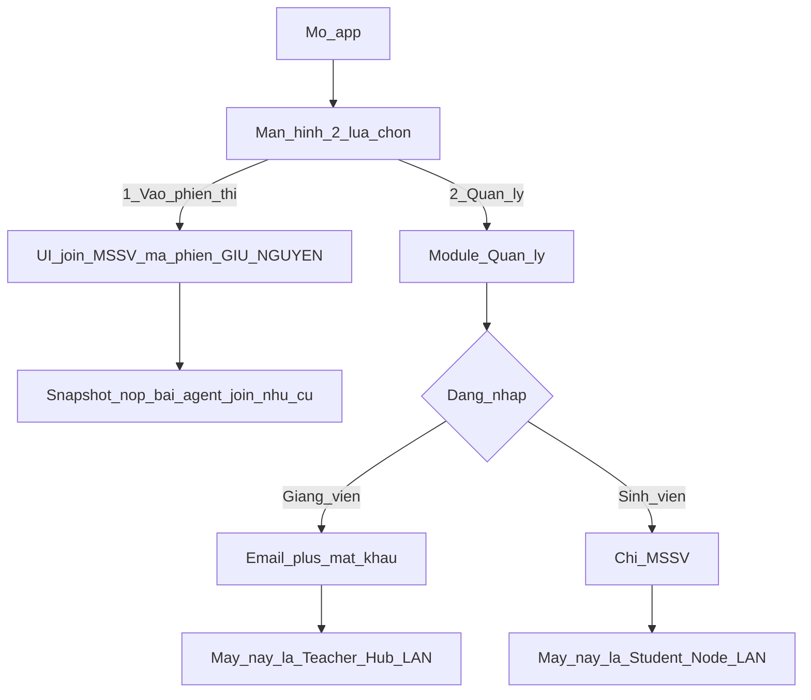
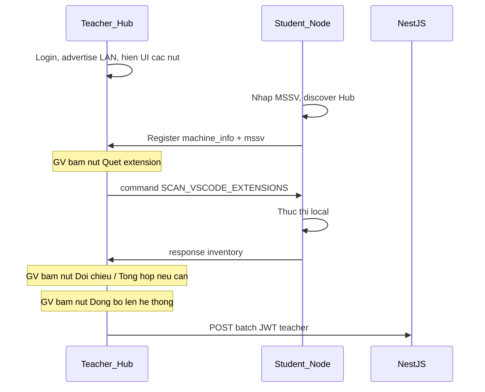

# Module Quản lý lab + kiểm soát extension VS Code — thiết kế

**Ngày:** 2026-10-18 · **Trạng thái:** spec, chưa implement  
**Ứng dụng:** `apps/agent` (Electron, một binary) + `apps/api` (Postgres/TypeORM) + `apps/web` (admin/teacher xem kết quả & quản allowlist)  
**Builds on:** `2026-09-01-student-agent-electron-design.md` (luồng phiên thi giữ nguyên); catalog môn `course` / lớp `class.course_id`  
**Nguồn chốt:** plan hội thoại “VS Code extension policy” / module Quản lý tiện ích IDE (2026-10-18)

---

## 0. Vì sao có module này

Trong giờ lab / trước giờ thi, giảng viên cần biết trên máy sinh viên đang cài **extension VS Code nào**, và extension đó **có được phép** với môn đang dạy hay không.

Danh sách được phép có hai tầng:

1. **Global** — extension cài mặc định trên lab, áp dụng mọi môn.
2. **Theo môn** — extension bổ sung; phải **được duyệt** trước khi tính là hợp lệ.

Thu thập inventory không đi thẳng từng máy SV lên cloud: mỗi phòng lab có LAN riêng; **máy giảng viên** là hub nhận dữ liệu, đối chiếu / tổng hợp khi GV bấm nút, rồi mới đồng bộ backend.

Module này **không** phải CMS menu/tiêu đề trang web, và **không** thay luồng vào phiên thi hiện có.

---

## 1. Phạm vi

### 1.1 Trong phạm vi

| Hạng mục | Ghi chú |
|---|---|
| Màn hình mở app: **2 lựa chọn** tách biệt | §2 |
| Lựa chọn 1 — Vào phiên thi: UI + hành vi **giữ nguyên** | §2.1 |
| Lựa chọn 2 — Module **Quản lý**: login GV / SV, LAN hub↔node | §2.2, §3 |
| Định danh máy (role, hostname, IP, machine_id, …) | §3 |
| Command bus: GV gửi lệnh → SV thực thi → trả response | §4 |
| UI GV = **nút thủ công**, không pipeline tự động nghiệp vụ | §5 |
| GV đề xuất phòng máy từ registry LAN → admin duyệt / tạo `room` + `computer` | §5.1, §7.4, §9.5 |
| Allowlist 2 tầng global + course (có duyệt) | §6 |
| Schema Postgres + API sync từ Teacher Hub | §7, §8 |
| Web: catalog full-screen (Marketplace dates, trạng thái §6.3, list → chi tiết) + từ quét thêm catalog + theo môn + kết quả | §9 |

### 1.2 Ngoài phạm vi

- Sửa UI / logic màn hình **Vào phiên thi** (`agent:join`, snapshot, nộp bài).
- Hai installer riêng cho GV và SV.
- `AccountRole = student` (SV module Quản lý chỉ nhập MSSV).
- Remote desktop, lockdown OS, tự gỡ / chặn chạy extension trên máy SV.
- Flow tự động “SV vào → quét → đối chiếu → sync backend”.
- Override allowlist theo từng `exam_session` (chỉ global ∪ course).
- Thay `nav-config` / PageHeader web bằng “tiện ích IDE” (trừ thêm mục nav tới trang module khi UI web sẵn sàng).

---

## 2. Electron — màn hình 2 lựa chọn

Một binary `apps/agent`. Mở app → **màn hình mới** với đúng hai lựa chọn; mỗi lựa chọn là một nhánh UI độc lập.



| Lựa chọn | Đăng nhập | UI / chức năng |
|---|---|---|
| **1. Vào phiên thi** | MSSV + mã phiên (như hiện tại) | Giữ nguyên toàn bộ UI và luồng `agent:join`, snapshot, nộp bài |
| **2. Quản lý** | GV: email + mật khẩu (JWT `account`). SV: **chỉ MSSV** | Module mới: định danh máy, LAN, command, nút nghiệp vụ trên Hub, đồng bộ backend |

Vào (1) không lộ UI Quản lý. Vào (2) không thay form phiên thi.

### 2.1 Lựa chọn 1 — không đổi hợp đồng

Mọi hành vi đã mô tả trong `2026-09-01-student-agent-electron-design.md` và gateway `agent:join` **giữ nguyên**. Spec này chỉ yêu cầu thêm một bước landing phía trước; không refactor join screen trừ khi cần nhánh route “quay về landing”.

### 2.2 Lựa chọn 2 — auth module Quản lý

| Vai trò UI | Input | Kết quả trên máy này |
|---|---|---|
| Giảng viên | Email + mật khẩu → API login hiện có (`account.role` ∈ `teacher` \| `admin`) | Máy trở thành **Teacher Hub** của phiên Quản lý trên LAN |
| Sinh viên | Chỉ MSSV | **Đối chiếu catalog `student` trên backend** trước khi vào LAN (xem §2.3); nếu hợp lệ → Student Node + đăng ký Hub kèm họ tên |

Không tạo account sinh viên trong identity service cho đợt này.

### 2.3 Đăng nhập Quản lý — sinh viên (đối chiếu MSSV)

Trước khi máy trở thành Student Node / discover Hub:

1. Agent gọi API công khai (không JWT): `GET /ide-extensions/lab/students/by-mssv/:mssv`.
2. Backend tra bảng `student` (citext MSSV, unique).
3. **Có và `status = active`:** trả `{ mssv, fullName, status, nominalClass?: { code, name } }` → UI hiện thông tin SV → mới khởi động Node và gửi `register` lên Hub (kèm `studentMssv` + `studentFullName`).
4. **Không có trong DB:** HTTP 404 → UI thông báo rõ, ví dụ *«Không tìm thấy sinh viên với MSSV … trong hệ thống.»* — **không** start Node.
5. **Có nhưng không `active`** (`inactive` / `graduated` / `withdrawn`): HTTP 403 hoặc 404 có message riêng, ví dụ *«Tài khoản sinh viên không còn hiệu lực.»* — **không** start Node.

Endpoint chỉ trả trường cần thiết cho UI/LAN (không lộ dữ liệu thừa). Có thể bổ sung rate-limit theo IP sau; MVP chưa bắt buộc.

---

## 3. Định danh máy trên LAN phòng lab

Mỗi phòng lab có subnet LAN riêng → Hub chỉ thấy máy trong phòng đó (không giả định VPN xuyên phòng).

### 3.1 Gán vai trò máy

- Login **Giảng viên** thành công → **Teacher Hub**.
- Login **Sinh viên** (MSSV) → **Student Node**, gắn vào Hub đang advertise.

Một LAN / một lúc: **một Hub**. Máy GV thứ hai login cùng subnet bị từ chối hoặc được hỏi chiếm quyền (implement chọn một; mặc định khuyến nghị: từ chối + hiện hostname Hub hiện tại).

### 3.2 Thông tin máy

Thu thập lúc Hub tạo session / Node đăng ký:

| Trường | Ý nghĩa |
|---|---|
| `machine_id` | Ổn định trên máy (UUID lưu local hoặc hash hostname + machine-id OS) |
| `hostname` | Tên máy Windows |
| `local_ip` | IP LAN hiện tại |
| `role` | `teacher_hub` \| `student_node` |
| `student_mssv` | Chỉ node — đã xác thực qua catalog §2.3 |
| `student_full_name` | Chỉ node — từ `student.full_name` sau lookup |
| `teacher_account_id` / email | Chỉ hub |
| `lab_mgmt_session_id` | Phiên Quản lý do Hub tạo sau login |
| `app_version`, `os` | Metadata |
| `last_seen` | Cập nhật khi register / response command |

**Registry live** nằm trên máy Hub (bộ nhớ / store local). Không bắt heartbeat từng giây lên Postgres. Khi GV bấm **Đồng bộ**, có thể gửi snapshot danh sách máy kèm kết quả nghiệp vụ.

---

## 4. Kênh command Hub → Node

- Chỉ **Hub** gửi command; chỉ khi GV **bấm nút** tương ứng.
- Node thực thi local và trả **response** về Hub.
- Node **không** gọi API allowlist / batch scan; **không** tự gắn `allowed`/`blocked`.



### 4.1 Hợp đồng envelope (LAN, v1)

**Request**

```ts
{
  requestId: string;   // uuid
  command: string;     // xem §4.2
  payload?: unknown;
  issuedAt: string;    // ISO
}
```

**Response**

```ts
{
  requestId: string;
  ok: boolean;
  error?: string;
  payload?: unknown;
  machineId: string;
  mssv: string;
}
```

### 4.2 Command phiên bản 1

| Command | Payload response (khi `ok`) | Gắn nút UI Hub |
|---|---|---|
| `SCAN_VSCODE_EXTENSIONS` | `{ extensions: { extensionId, version, displayName? }[], vscodeVersion? }` | Quét extension VS Code |
| `PING` (tuỳ chọn sớm) | `{ pongAt }` | (sau) Ping máy |
| `GET_MACHINE_INFO` (tuỳ chọn) | snapshot §3.2 | (sau) Lấy thông tin máy |

`extensionId` dạng Marketplace: `publisher.name` (ví dụ `ms-python.python`).

Path thư mục extensions VS Code trên Windows lab có thể khác nhau — Node tự dò các vị trí phổ biến và/hoặc đọc cấu hình local; lỗi path → `ok: false` + `error` rõ ràng trên Hub.

---

## 5. UI Giảng viên — nút thủ công (không auto-flow)

Sau login Hub và khi đã có máy SV trong registry: **không** tự quét, **không** tự đối chiếu, **không** tự sync backend.

Phần **tự động chỉ ở hạ tầng kết nối:** advertise Hub, discover, đăng ký máy, cập nhật online/last_seen.

Mỗi nghiệp vụ = **một nút** (hoặc nhóm nút) độc lập; thứ tự bấm do GV quyết.

| Nút | Hành vi khi bấm |
|---|---|
| Làm mới danh sách máy | Refresh registry / last_seen trên LAN |
| Quét extension VS Code | Gửi `SCAN_VSCODE_EXTENSIONS` tới máy đã chọn hoặc toàn phòng → hiện inventory thô |
| Đối chiếu allowlist | Dùng inventory đã có + `effective` (§6) → gắn `allowed`/`blocked` trên UI Hub (**chưa** lên backend) |
| Tổng hợp phòng máy | Gộp view theo máy / theo extension vi phạm (local trên Hub) |
| Đồng bộ lên hệ thống | `POST` batch đã tổng hợp lên backend (JWT teacher) |
| **Đề xuất thông tin phòng máy** | Chỉ **UI Giảng viên (Teacher Hub)** — §5.1 |

Cho phép: quét lại nhiều lần; đối chiếu mà không sync; sync chỉ khi GV chủ động bấm.

### 5.1 Đề xuất thông tin phòng máy (chỉ Teacher Hub)

**Ai thấy nút:** chỉ sau login **Giảng viên** (Teacher Hub). UI Sinh viên / Student Node **không** có nút hay màn hình này.

**Mục đích:** GV gửi đề xuất phòng lab lên hệ thống để admin tạo bản ghi master-data `room` + `computer`, dựa trên **toàn bộ máy đang có trong danh sách registry** trên Hub tại thời điểm bấm.

**Luồng UI Hub:**

1. GV bấm **«Đề xuất thông tin phòng máy»**.
2. Hệ thống lấy danh sách **toàn bộ máy trong phòng**: máy **giảng viên (Teacher Hub)** + mọi **`student_node`** đang đăng ký. Prefill từ registry: `hostname`, IP LAN, OS (nếu có), role, MSSV/họ tên (node SV).
3. Hiện form metadata phòng (map sang `room`):

| Trường form | Map `room` | Bắt buộc |
|---|---|---|
| **Mã** | `code` | Có |
| **Tên** | `name` | Có |
| **Sức chứa** | `capacity` | Có (`> 0`); gợi ý mặc định = số máy (**Hub + SV**) |
| **Tòa** | `building` | Không |
| **Tầng** | `floor` | Không |

4. **Bảng máy — chỉnh sửa trước khi gửi** (cùng bộ field với master-data **Máy tính**; không auto-collect WMI trong đợt này):

| Trường UI | Map `computer` / `lab_room_proposal_machine` | Bắt buộc |
|---|---|---|
| **Hostname** | `hostname` | Có (prefill registry) |
| **CPU** | `cpu` | Có |
| **RAM (GB)** | `ram_gb` | Có (mặc định 16 — bắt buộc khi tạo `computer`) |
| **Ổ cứng** | `storage` | Có |
| **GPU** | `gpu` | Không |
| **Hệ điều hành** | `os` | Có (prefill registry nếu có) |
| **IP** | `ip_address` / `local_ip` | Có (prefill registry) |
| **MAC** | `mac_address` | Có |
| **Trạng thái** | `status` (`active` \| `maintenance` \| `inactive`) | Có (mặc định `active`) |

Mỗi dòng hiện role `teacher_hub` / `student_node`. `location` trên `computer` để trống khi accept. Thiếu field bắt buộc → không cho gửi.

5. Xác nhận → `POST` đề xuất lên API (JWT teacher từ login Quản lý).

**Người gửi đề xuất** (bắt buộc lưu, lấy từ phiên login Quản lý — không nhập tay):

| Trường | Nguồn |
|---|---|
| `proposed_by_account_id` | `account.id` (JWT `sub`) |
| `proposed_by_email` | email account lúc login (snapshot) |
| `proposed_by_display_name` | họ tên / display name nếu API login có; không thì email |

**Không** tạo `room` / `computer` ngay khi gửi — chỉ tạo bản ghi **đề xuất** (`pending`). Admin xử lý trên web §9.5.

Disable nút / báo lỗi nếu không có máy nào (ít nhất máy Hub; thường kèm 0..n node SV).

---

## 6. Allowlist extension — 2 tầng + catalog phiên bản

Danh sách được phép vẫn có hai tầng phạm vi (global / theo môn). **Đơn vị duyệt trên web** là **phiên bản** của một extension trong catalog (§7.1a, §9), không còn CRUD phẳng chỉ theo `extension_id` không có version row.

| Tầng | Phạm vi | Ai quản | Duyệt |
|---|---|---|---|
| **Global** | Mọi môn | Admin (web — catalog §9) | Phiên bản → `approve` / `unapprove` / `xóa` |
| **Course** | Một môn (`course.id` catalog môn) | Admin / GV đề xuất trên web | Gắn extension (hoặc phiên bản) vào môn → `pending` → duyệt mới vào allowlist |

### 6.1 Allowlist hiệu lực

```text
effective(context) =
    catalog_allow_rules(global)   // xem §6.1a
  ∪ course_items(course_id, active ∧ approved)
```

`course_id` lấy khi Hub chọn ngữ cảnh: gắn `lab_mgmt_session` với một `exam_session` (qua `session.class.course_id`) hoặc chọn thẳng môn catalog. Phiên/lớp legacy `course_id` NULL → chỉ tầng global; UI Hub **cảnh báo**.

Trùng `extension_id` ở cả hai tầng → `matched_scope = global` (hoặc ghi cả hai nếu UI cần; implement mặc định ưu tiên `global`).

### 6.1a Khớp phiên bản catalog (global) — exact + wildcard `*`

Mỗi extension trong catalog có các row `ide_extension_version`. Giá trị đặc biệt **`version = '*'`** là cấu hình **duyệt mọi phiên bản** cho extension đó.

| Rule | Khi nào | Hiệu lực đối chiếu inventory |
|---|---|---|
| **Wildcard** | Tồn tại row `version = '*'` và `approval_status = approved` | Mọi version cài trên máy SV của `extension_id` đó → `allowed` (global), **kể từ lúc `*` được duyệt** (`approved_at`). Không cần duyệt từng version cụ thể. |
| **Exact** | Không có `*` approved; có row `version = <semver>` `approved` | Chỉ version **khớp đúng** chuỗi trên máy SV → `allowed`. Version khác (kể cả mới hơn) → `blocked` trừ khi sau này được duyệt hoặc bật `*`. |
| **Chưa đủ** | Không có version `approved` nào (kể cả `*` chưa duyệt / chưa tạo) | Extension → `blocked` |

**Cấu hình `*`:**

1. Trên trang chi tiết (§9.2): thêm phiên bản với giá trị đúng `*` (nút / preset «Duyệt mọi phiên bản (*)»).
2. Row `*` tạo ra ở trạng thái `pending` như version thường.
3. Chỉ khi admin **Approve** row `*` → rule wildcard có hiệu lực.
4. **Hủy approved** hoặc **xóa** row `*` → hết wildcard; quay về khớp exact theo các version cụ thể còn `approved`.
5. Các version cụ thể vẫn có thể tồn tại song song (ghi nhận / audit); khi `*` đang approved chúng **không bắt buộc** cho allowlist nhưng vẫn hiện trên UI.

`POST .../from-scan` **không** tự tạo `*` — chỉ tạo version cụ thể từ inventory. Admin chủ động thêm `*` trên chi tiết.

### 6.2 Verdict khi đối chiếu (trên Hub, khi bấm nút)

| Extension trên máy SV | Verdict | `matched_scope` |
|---|---|---|
| Catalog: `*` approved cho `extension_id` | `allowed` | `global` |
| Catalog: exact `version` approved khớp version cài | `allowed` | `global` |
| Có trong `effective` (course) | `allowed` | `course` |
| Có trong policy môn nhưng `pending` / `rejected` | `blocked` | null |
| Có trong catalog nhưng version cài không khớp rule (§6.1a) | `blocked` | null |
| Không nằm ở đâu | `blocked` | null |
| Builtin (nếu policy bỏ qua) | bỏ qua hoặc `allowed` + `is_builtin` | — |

### 6.3 Trạng thái tổng hợp extension trên catalog (UI list)

Trạng thái **tính từ các `ide_extension_version`**, không lưu cột riêng trên DB (API trả `catalogStatus` derived). Ưu tiên đánh giá:

1. Có row `version = '*'` và `approved` → **`wildcard_approved`**
2. Có **≥1** version `pending` (kể cả `*` đang pending) → **`has_pending`**
3. Có **≥1** version cụ thể và **mọi** version (trừ khi không có version) đều `approved` → **`fully_approved`**
4. Còn lại → **`none_approved`**

| Mã (`catalogStatus`) | Nhãn UI (tiếng Việt) | Điều kiện |
|---|---|---|
| `wildcard_approved` | **Duyệt mọi phiên bản (*)** | `*` đã được duyệt |
| `fully_approved` | **Đã duyệt hết** | ≥1 version cụ thể và tất cả đều `approved` (không có `*` approved) |
| `has_pending` | **Có chờ duyệt** | ≥1 version đang `pending` |
| `none_approved` | **Chưa duyệt** | Chưa có version nào `approved` |

Badge: xanh đậm (`wildcard_approved`) · xanh (`fully_approved`) · vàng/amber (`has_pending`) · xám (`none_approved`).

---

## 7. Schema database (Postgres)

Cùng convention TypeORM / `BaseEntity` (uuid, `created_at`, `updated_at`) trừ bảng append-only nếu có.

### 7.1a Catalog extension + phiên bản (nguồn UI §9)

**`ide_extension`** — một dòng = một extension Marketplace / catalog nội bộ

| Cột | Kiểu | Ghi chú |
|---|---|---|
| `id` | uuid PK | |
| `identifier` | varchar(200) UNIQUE | `publisher.name` (ví dụ `ms-python.python`) |
| `display_name` | varchar(200) | Extension name trên UI |
| `publisher` | varchar(200) | Tên publisher |
| `published_at` | timestamptz NULL | **Published** — lấy từ **VS Marketplace** (ngày xuất bản extension), không dùng `created_at` nội bộ làm nguồn chính |
| `last_released_at` | timestamptz NULL | **Last Released** — lấy từ **VS Marketplace** (ngày phát hành version mới nhất / `lastUpdated`) |
| `marketplace_synced_at` | timestamptz NULL | Lần gần nhất enrich metadata từ Marketplace (tuỳ chọn) |
| `is_active` | boolean default true | Soft-hide khỏi list nếu cần |
| `created_at` / `updated_at` | timestamptz | |

**Nguồn Marketplace (§7.1b):** khi tạo extension / thêm version từ catalog hoặc từ kết quả quét, backend gọi Marketplace API (Open VSX hoặc `marketplace.visualstudio.com` extensionquery) theo `identifier` → điền/cập nhật `display_name`, `publisher`, `published_at`, `last_released_at`. Nếu Marketplace lỗi / không tìm thấy: giữ field hiện có hoặc NULL; UI hiện «—»; **không** chặn thêm version vào catalog.

**`ide_extension_version`** — nhiều phiên bản / một extension

| Cột | Kiểu | Ghi chú |
|---|---|---|
| `id` | uuid PK | |
| `extension_pk` | uuid FK → `ide_extension.id` ON DELETE CASCADE | |
| `version` | varchar(50) | Semver / chuỗi version VS Code **hoặc** `*` (wildcard — §6.1a) |
| `added_at` | timestamptz | Ngày thêm phiên bản vào hệ thống (`created_at` hoặc cột riêng; UI: «Ngày thêm phiên bản») |
| `approval_status` | enum `pending` \| `approved` \| `rejected` | Mặc định `pending` khi thêm |
| `approved_at` | timestamptz NULL | Ngày approved; với `*` = thời điểm bắt đầu hiệu lực «mọi phiên bản»; **NULL** khi chưa duyệt / đã hủy |
| `approved_by` | uuid NULL FK → `account` | |
| `note` | text NULL | |

Unique `(extension_pk, version)` — tối đa **một** row `*` mỗi extension.

**Thao tác nghiệp vụ (service):**

| Thao tác | Hiệu lực |
|---|---|
| **Thêm `*`** | Tạo row `version='*'`, `pending` (reject nếu đã có `*`) |
| **Approve** (kể cả `*`) | `approval_status = approved`, `approved_at = now()`, ghi `approved_by`. Approve `*` → mọi version của extension được phép (§6.1a) |
| **Hủy approved** | `approval_status = pending` (mặc định), clear `approved_at` / `approved_by`. Hủy `*` → hết wildcard, chỉ còn exact |
| **Xóa phiên bản** | DELETE row (kể cả `*`); parent `ide_extension` giữ nguyên |

`published_at` / `last_released_at`: **ưu tiên giá trị Marketplace** sau mỗi lần sync metadata. Không ghi đè bằng `added_at` nội bộ khi Marketplace đã trả ngày. Chỉ fallback `last_released_at ≈ added_at` của version mới khi Marketplace không có dữ liệu.

### 7.1 Policy (theo môn + tương thích Hub)

Giữ policy course để gắn extension vào môn. Tầng **global** trong `effective` ưu tiên đọc từ catalog versions `approved` (§6.1); bảng policy global cũ có thể migrate sang catalog hoặc giữ mirror — implement chọn **catalog là source of truth cho global**.

**`ide_extension_policy`**

| Cột | Kiểu | Ghi chú |
|---|---|---|
| `id` | uuid PK | |
| `scope_type` | enum `global` \| `course` | `global` có thể deprecate dần sau khi catalog đủ |
| `course_id` | uuid NULL FK → `course` | Bắt buộc khi `course`; NULL khi `global` |
| `name` | varchar | |
| `is_active` | boolean | |
| `created_at` / `updated_at` | timestamptz | |

CHECK: `(scope_type = 'global' AND course_id IS NULL) OR (scope_type = 'course' AND course_id IS NOT NULL)`.

Khuyến nghị: tối đa **một** policy `is_active` per `course_id`.

**`ide_extension_policy_item`** (chủ yếu **course**)

| Cột | Kiểu | Ghi chú |
|---|---|---|
| `id` | uuid PK | |
| `policy_id` | uuid FK | |
| `extension_id` | varchar(200) | `publisher.name` — khớp `ide_extension.identifier` |
| `display_name` | varchar(200) NULL | |
| `min_version` / `max_version` | varchar NULL | Trống = mọi version |
| `approval_status` | enum `approved` \| `pending` \| `rejected` | Course: tạo → `pending` |
| `requested_by` | uuid NULL FK → `account` | |
| `reviewed_by` | uuid NULL FK → `account` | |
| `reviewed_at` | timestamptz NULL | |
| `note` | text NULL | |

Unique `(policy_id, extension_id)`.

### 7.2 Kết quả sau khi Hub đồng bộ

**`ide_extension_scan`**

| Cột | Kiểu | Ghi chú |
|---|---|---|
| `id` | uuid PK | |
| `exam_session_id` | uuid NULL FK | Ngữ cảnh phiên nếu có |
| `course_id` | uuid NULL FK | Fallback nếu chưa gắn phiên |
| `lab_mgmt_session_id` | uuid NULL FK | Liên kết phiên Quản lý LAN |
| `student_mssv` | citext | |
| `machine_id` | varchar | |
| `machine_name` | varchar NULL | hostname |
| `scanned_at` | timestamptz | |
| `reported_by` | enum | `teacher_hub` |
| `teacher_account_id` | uuid NULL FK → `account` | |
| `vscode_version` | varchar NULL | |
| `extension_count` | int | |
| `violation_count` | int | |
| `status` | enum `clean` \| `has_violations` | |

Upsert giữ bản mới nhất theo khóa nghiệp vụ khuyến nghị: `(lab_mgmt_session_id, student_mssv)` hoặc `(exam_session_id, student_mssv)` tùy ngữ cảnh sync.

**`ide_extension_scan_item`**

| Cột | Kiểu |
|---|---|
| `id` | uuid PK |
| `scan_id` | uuid FK ON DELETE CASCADE |
| `extension_id` | varchar(200) |
| `display_name` | varchar NULL |
| `version` | varchar NULL |
| `verdict` | enum `allowed` \| `blocked` |
| `matched_scope` | enum `global` \| `course` NULL |
| `is_builtin` | boolean default false |

**`ide_extension_session_summary`**

| Cột | Kiểu |
|---|---|
| `exam_session_id` hoặc `lab_mgmt_session_id` | PK/FK tùy chọn implement — một khóa ngữ cảnh |
| `machines_scanned` | int |
| `machines_with_violations` | int |
| `effective_extension_count` | int |
| `last_synced_at` | timestamptz |

### 7.3 Phiên Quản lý LAN (persist khi sync / audit)

**`lab_mgmt_session`**

- `id`, `teacher_account_id`, `room_hint` NULL, `course_id` NULL, `exam_session_id` NULL, `started_at`, `ended_at` NULL

**`lab_mgmt_machine`**

- Snapshot lúc sync: `lab_mgmt_session_id`, `machine_id`, `role`, `hostname`, `local_ip`, `student_mssv` NULL, `last_seen_at`

Không thay registry live trên Hub.

### 7.4 Đề xuất phòng máy (từ Teacher Hub)

**`lab_room_proposal`**

| Cột | Kiểu | Ghi chú |
|---|---|---|
| `id` | uuid PK | |
| `status` | enum `pending` \| `accepted` \| `rejected` \| `withdrawn` | Mặc định `pending` |
| `code` | varchar(50) | Đề xuất mã phòng |
| `name` | varchar(150) | |
| `capacity` | int | CHECK `> 0` |
| `building` | varchar(100) NULL | Tòa |
| `floor` | varchar(50) NULL | Tầng |
| `proposed_by_account_id` | uuid FK → `account` | Người gửi (login Quản lý) |
| `proposed_by_email` | varchar | Snapshot lúc gửi |
| `proposed_by_display_name` | varchar NULL | Snapshot |
| `lab_mgmt_session_id` | uuid NULL | Phiên Hub nếu có |
| `machine_count` | int | Số máy trong snapshot |
| `note` | text NULL | Admin / GV |
| `reviewed_by` | uuid NULL FK → `account` | |
| `reviewed_at` | timestamptz NULL | |
| `created_room_id` | uuid NULL FK → `room` | Khi `accepted` và đã tạo phòng |
| `created_at` / `updated_at` | timestamptz | |

**`lab_room_proposal_machine`** — cùng thông tin cốt lõi với `computer` (trừ `room_id` / `location`)

| Cột | Kiểu | Ghi chú |
|---|---|---|
| `id` | uuid PK | |
| `proposal_id` | uuid FK ON DELETE CASCADE | |
| `machine_id` | varchar | Từ registry Hub |
| `hostname` | varchar | Bắt buộc |
| `cpu` | varchar | Bắt buộc |
| `ram_gb` | int | Bắt buộc; CHECK `> 0` |
| `storage` | varchar | Ổ cứng — bắt buộc |
| `gpu` | varchar NULL | Tuỳ chọn |
| `os` | varchar | Hệ điều hành — bắt buộc |
| `local_ip` / map `ip_address` | varchar | IP — bắt buộc |
| `mac_address` | varchar | Bắt buộc |
| `status` | enum `active` \| `maintenance` \| `inactive` | Giống `computer_status` |
| `student_mssv` | citext NULL | Meta LAN (không map `computer`) |
| `student_full_name` | varchar NULL | Meta LAN |
| `role` | varchar | `teacher_hub` \| `student_node` |
| `last_seen_at` | timestamptz NULL | |
| `sort_order` | int | Thứ tự hiện UI |

Khi admin **Tạo phòng từ đề xuất**: tạo `room` từ metadata; mỗi máy → một `computer` **map 1-1** từ snapshot (hostname, cpu, ram_gb, storage, gpu, os, ip_address←local_ip, mac_address, status); `location = ''`. **Không** dùng placeholder «Chưa cập nhật».

---

## 8. API (backend) — hướng hợp đồng

Route quản trị / sync yêu cầu JWT `teacher` \| `admin`. Ngoại lệ: login đã có, và **lookup MSSV** (§2.3) không JWT.

| Nhóm | Ví dụ | Ghi chú |
|---|---|---|
| Lab SV lookup | `GET /ide-extensions/lab/students/by-mssv/:mssv` | **Không JWT**; 200 + active / 404 không có / 403 không active |
| Catalog list | `GET /ide-extensions/catalog` | List §9.1 — kèm `catalogStatus` derived (§6.3); Published/Last Released từ Marketplace |
| Catalog detail | `GET /ide-extensions/catalog/:id` | Metadata + versions (§9.2) |
| Catalog create/update | `POST` / `PATCH` catalog | Admin; create nên enrich Marketplace |
| Refresh Marketplace | `POST .../catalog/:id/refresh-marketplace` | Admin — kéo lại Published / Last Released / tên |
| Version | `POST .../catalog/:id/versions` | Thêm phiên bản (`pending`); sau đó có thể refresh Marketplace |
| Upsert từ quét | `POST /ide-extensions/catalog/from-scan` | Body: `{ extensionId, version?, displayName? }` — §9.4 |
| Duyệt version | `PATCH .../versions/:versionId/approve` | Admin — §7.1a |
| Hủy duyệt | `PATCH .../versions/:versionId/unapprove` | Admin — về `pending`, clear `approved_at` |
| Xóa version | `DELETE .../versions/:versionId` | Admin |
| Policy course | CRUD items theo `course_id` | Tạo → `pending` |
| Duyệt course item | `PATCH .../items/:id/approve` \| `reject` | Admin (tab Theo môn) |
| Effective | `GET .../effective?examSessionId=` hoặc `?courseId=` | Catalog approved ∪ course approved |
| Sync | `POST .../scans/batch` | Batch từ Teacher Hub (JWT) |
| Scans (web) | `GET .../scans`, `GET .../scans/:id` | Tab Kết quả — nút thêm vào catalog (§9.4) |
| Đề xuất phòng | `POST /ide-extensions/lab/room-proposals` | JWT **teacher** (Hub); body metadata phòng + `machines[]` đủ field Máy tính (§5.1); `proposed_by_*` từ JWT |
| List đề xuất | `GET /ide-extensions/lab/room-proposals` | Admin (và teacher xem đề xuất của mình — tuỳ chọn) |
| Chi tiết đề xuất | `GET .../room-proposals/:id` | Kèm danh sách máy |
| Từ chối / rút | `PATCH .../reject` \| `withdraw` | Admin reject; teacher withdraw nếu `pending` |
| Tạo phòng từ đề xuất | `POST .../room-proposals/:id/accept-create-room` | **Admin** — tạo `room` + `computer[]` trong transaction; set `accepted` + `created_room_id` |

**`POST .../catalog/from-scan` (upsert):**

1. Chuẩn hoá `extensionId` = `publisher.name`.
2. Nếu **chưa có** `ide_extension` → tạo row + enrich Marketplace; nếu có `version` → tạo `ide_extension_version` `pending`.
3. Nếu **đã có** extension → nếu có `version` và chưa tồn tại `(extension_pk, version)` → thêm version `pending`; nếu version đã có → no-op (hoặc 200 + `alreadyExists: true`).
4. Luôn cố gắng cập nhật `published_at` / `last_released_at` từ Marketplace khi gọi.

---

## 9. Web portal — Quản lý tiện ích IDE

Nav: mục **Quản lý tiện ích IDE** (admin; teacher xem kết quả / đề xuất môn nếu được quyền).

Landing Electron không thay thế web; Hub chỉ **đọc** `effective` và **ghi** kết quả quét.

### 9.0 Bố cục full màn hình

Trang module (list + chi tiết + tab Kết quả/Theo môn) thiết kế **full viewport** trong khung admin/teacher:

- Vùng nội dung chiếm toàn chiều rộng / chiều cao còn lại sau sidebar + top bar (không «card hẹp giữa trang»).
- Bảng catalog: full-width, header sticky, hàng đủ cao để click; scroll trong vùng bảng nếu danh sách dài.
- Trang chi tiết: metadata trên + bảng phiên bản full-width bên dưới; thao tác luôn nhìn thấy (toolbar / cột thao tác không bị cắt).
- Tab bar dính phía trên vùng nội dung; empty state căn theo vùng full, không form nhỏ giữa màn.

### 9.1 Trang danh sách — `/admin/ide-utilities` (và mirror teacher nếu cần)

Hiển thị **bảng danh sách extension** (catalog §7.1a). Mỗi dòng một extension.

| Cột UI | Nguồn |
|---|---|
| **Extension name** | `display_name` (ưu tiên từ Marketplace khi sync) |
| **Publisher** | `publisher` |
| **Identifier** | `identifier` (`publisher.name`) |
| **Published** | `published_at` từ **Marketplace** (format ngày locale; «—» nếu chưa sync) |
| **Last Released** | `last_released_at` từ **Marketplace** |
| **Trạng thái** | `catalogStatus` §6.3 — nhãn **Đã duyệt hết** / **Có chờ duyệt** / **Chưa duyệt** |

Hành vi:

- Click **một dòng** → trang chi tiết §9.2.
- Nút «Thêm extension» (nhập identifier) → tạo + enrich Marketplace; «Làm mới Marketplace» trên detail (§9.2).
- Sort/filter theo Trạng thái khuyến nghị; empty state tiếng Việt.

### 9.2 Trang chi tiết — `/admin/ide-utilities/[id]` (hoặc `[identifier]`)

**Phần trên — thông tin extension** (đầy đủ cột list, gồm Trạng thái tổng hợp §6.3):

- Extension name, Publisher, Identifier, Published, Last Released, Trạng thái  
- Nút **Làm mới từ Marketplace** → `POST .../refresh-marketplace`.

**Phần dưới — danh sách phiên bản**

| Cột UI | Nguồn |
|---|---|
| **Phiên bản** | `version` — hiển thị `*` kèm chú thích «Mọi phiên bản» |
| **Ngày thêm phiên bản** | `added_at` (thời điểm đưa vào hệ thống) |
| **Ngày approved** | `approved_at` — với `*` = mốc bắt đầu duyệt mọi version; «—» nếu chưa duyệt / đã hủy |
| **Trạng thái** | `pending` \| `approved` \| `rejected` |
| **Thao tác** | Theo trạng thái |

**Thao tác trên mỗi phiên bản** (admin):

| Nút | Điều kiện hiện | API |
|---|---|---|
| **Approve** / Duyệt | `pending` hoặc đã hủy duyệt | `PATCH .../approve` |
| **Hủy approved** | đang `approved` | `PATCH .../unapprove` |
| **Xóa phiên bản** | luôn (confirm dialog; xóa `*` có cảnh báo mất wildcard) | `DELETE .../versions/:id` |

Nút **Thêm phiên bản** → form nhập semver → `pending`.

Nút / preset **«Thêm duyệt mọi phiên bản (*)»** → tạo row `version='*'` `pending` nếu chưa có; disable nếu đã có `*`. Banner trên trang khi `*` đang `approved`: *«Đang duyệt mọi phiên bản kể từ &lt;approved_at&gt;»*.

Breadcrumb / «Quay lại danh sách» về §9.1.

### 9.3 Tab / khu vực phụ

1. **Theo môn** — list/pending/duyệt course policy items.  
2. **Kết quả** — scan đã sync từ Hub + thao tác §9.4.

Mặc định vào nav = list catalog §9.1; tab cạnh nhau trên layout full màn hình §9.0.

### 9.4 Thêm extension vào catalog từ kết quả quét

Trên tab **Kết quả** (chi tiết một bản quét / từng dòng extension trong scan):

- Mỗi dòng inventory có nút **«Thêm vào catalog»** (admin; teacher nếu được quyền ghi catalog — mặc định **admin**).
- Gọi `POST /ide-extensions/catalog/from-scan` với `extensionId` + `version` (+ `displayName` nếu scan có).
- **Chưa có** trong catalog → tạo extension + version `pending` + enrich Marketplace.
- **Đã có** → chỉ **thêm version** nếu version chưa có; nếu version đã có → toast «Đã có trong catalog».
- Sau thành công: toast ngắn; có thể link sang trang chi tiết extension.

Cùng hành vi có thể có trên Teacher Hub (inventory sau quét) trong giai sau — web Kết quả là bắt buộc cho đợt này.

### 9.5 Admin — Phòng: xem đề xuất & tạo phòng

Trang master-data **Phòng** (`/admin/master-data/rooms` hoặc tương đương):

1. Tab / panel **«Đề xuất từ lab»** (chỉ **admin**): list đề xuất `pending` (và lịch sử accepted/rejected).
2. Cột tối thiểu: mã đề xuất, tên, sức chứa, tòa, tầng, **số máy**, **người gửi** (email / tên), thời gian gửi, trạng thái.
3. Click đề xuất → chi tiết: metadata phòng + bảng máy **đủ cột như Máy tính** (Hostname, CPU, RAM, Ổ cứng, GPU, HĐH, IP, MAC, Trạng thái) + role Hub/SV + người gửi.
4. Thao tác admin:
   - **Tạo phòng từ đề xuất** → form chỉnh metadata `room` (code/name/capacity/building/floor); máy lấy nguyên từ snapshot → `accept-create-room` tạo `computer` đầy đủ.
   - **Từ chối** đề xuất (kèm note tuỳ chọn).
5. Teacher **web** không bắt buộc quản lý đề xuất phòng (nút đề xuất chỉ trên Electron Hub); admin là nơi duyệt/tạo.

Không lộ UI đề xuất phòng trên nhánh Student Node.

---

## 10. Thứ tự triển khai đề xuất

1. Electron landing: 2 lựa chọn; nhánh (1) giữ nguyên.
2. Module Quản lý — auth UI GV / SV.
3. LAN Hub/Node: advertise, discover, register, registry.
4. UI Hub — toolbar nút (§5), chưa cần đủ command.
5. Command `SCAN_VSCODE_EXTENSIONS` + hiển thị inventory.
6. Backend migration §7 (gồm catalog + versions §7.1a) + API §8; nút Đối chiếu / Đồng bộ nối API.
7. Web §9 — full-screen catalog (kèm Trạng thái) → chi tiết; Marketplace enrich; tab Theo môn / Kết quả + «Thêm vào catalog».
8. Đề xuất phòng máy §5.1 / §7.4 / §9.5 — Hub nút + API + admin Phòng.

---

## 11. Rủi ro & quyết định vận hành

| Rủi ro | Hướng xử lý |
|---|---|
| Firewall Windows chặn port LAN | Port cố định + tài liệu mở rule phòng máy |
| Hai Hub trên một LAN | Từ chối Hub thứ hai (mặc định) hoặc UI chiếm quyền |
| Path VS Code khác nhau | Tự dò + cấu hình local trên Node |
| `course_id` NULL | Chỉ global + cảnh báo trên Hub |
| Lab mất internet | Hub vẫn quét/đối chiếu local; sync khi có mạng |
| Marketplace không trả / timeout | Giữ metadata cũ hoặc «—»; vẫn cho thêm catalog/version |
| Trùng version khi «Thêm vào catalog» từ quét | No-op + thông báo đã tồn tại |
| `room.code` trùng khi accept đề xuất | API 409; admin đổi mã trên form trước khi tạo |
| Snapshot thiếu hardware | Dialog Hub bắt buộc điền CPU/ổ cứng/MAC/… trước khi gửi; API 400 nếu thiếu |
| SV cố gọi API đề xuất phòng | Chỉ role teacher (+ JWT Hub); Student Node không có UI |

---

## 12. Tiêu chí chấp nhận (mức spec)

- [ ] Mở app thấy đúng 2 lựa chọn; vào phiên thi không đổi hành vi cũ.
- [ ] GV login email+mk → Hub; SV nhập MSSV → đối chiếu DB: có (active) thì hiện thông tin + Node; không có / không active thì thông báo, không vào LAN.
- [ ] Registry Hub hiện máy đúng role/MSSV/họ tên/hostname.
- [ ] Không có quét/đối chiếu/sync tự động khi SV vào; mỗi việc chỉ chạy khi bấm nút.
- [ ] Nút Quét gửi command và hiện inventory; nút Đối chiếu gắn verdict theo effective global∪course(approved).
- [ ] Nút Đồng bộ ghi được scan + items lên backend; web đọc được.
- [ ] Course item `pending` không làm `allowed` cho đến khi `approved`.
- [ ] Web **Quản lý tiện ích IDE** full màn hình (§9.0); list: name, Publisher, Identifier, Published, Last Released, **Trạng thái** (§6.3); click → chi tiết + versions.
- [ ] Published / Last Released lấy từ Marketplace (hoặc «—» khi chưa sync); không dùng ngày tạo nội bộ làm nguồn chính.
- [ ] Trạng thái list đúng §6.3 gồm **Duyệt mọi phiên bản (*)** khi `*` approved.
- [ ] Chi tiết: thêm / duyệt / hủy / xóa `*`; khi `*` approved → mọi version inventory của extension đó `allowed`; hủy/xóa `*` → chỉ exact còn hiệu lực (§6.1a).
- [ ] Tab Kết quả: **Thêm vào catalog** — tạo mới hoặc thêm version nếu đã tồn tại (§9.4); không tự tạo `*`.
- [ ] Chi tiết: Approve / Hủy approved / Xóa phiên bản cụ thể; exact approve chỉ cho phép đúng version đó.
- [ ] Teacher Hub: nút **Đề xuất thông tin phòng máy** — form phòng + bảng máy (Hub+SV) đủ field Máy tính (Hostname, CPU, RAM, Ổ cứng, GPU?, HĐH, IP, MAC, Trạng thái); người gửi từ login Quản lý; Student Node không có nút (§5.1).
- [ ] Admin **Phòng**: xem đề xuất + người gửi + bảng máy đủ cột; tạo phòng/máy map 1-1 từ snapshot hoặc từ chối (§9.5).
