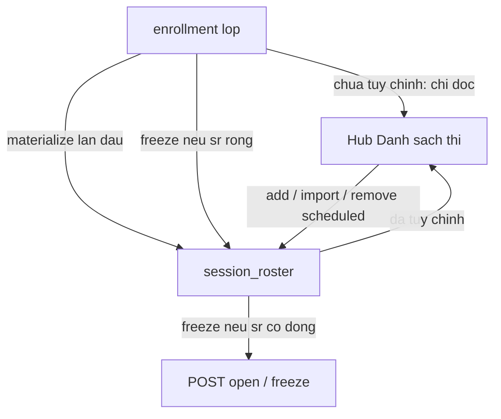

# Design: Cấu hình danh sách thi trên hub Thiết lập (theo phiên)

**Ngày:** 2026-10-18  
**Trạng thái:** implemented (plan `docs/superpowers/plans/2026-10-18-session-exam-roster-setup.md`)  
**Trang:** `/teacher/exam-sessions/[id]` — khối mới **Danh sách thi**  
**Liên quan:**
- [exam-session-setup-edit-flow](./2026-10-18-exam-session-setup-edit-flow-design.md) — hub; §5.2 bổ sung khối danh sách
- [resources-and-roster](./2026-08-29-resources-and-roster-design.md) — import Excel lớp; **không** sửa enrollment từ hub phiên
- [exam-ops-lobby-ux](./2026-10-18-exam-ops-lobby-ux-design.md) — vận hành; attendance sau mở vẫn từ ảnh chốt

**Quyết định user (2026-10-18):** danh sách **chỉ theo phiên**; mặc định lấy từ lớp học phần; cho upload file + thêm tay. Không sửa roster lớp.

---

## 1. Vấn đề

Giảng viên cần chỉnh danh sách dự thi **cho một ca** (thi bù một phần lớp, bỏ SV, thêm ngoài file lớp) trước khi mở phiên — không muốn đụng enrollment lớp (ảnh hưởng ca khác).

Hiện trạng:

- Trước mở: không có ảnh chốt; attendance/lobby suy từ `enrollment` lớp.
- `POST …/open` → `SessionRosterService.freeze()` **chép toàn bộ** enrollment → `session_roster` (`source=frozen`), rồi `active`.
- Sau mở: thêm tay / gỡ tay (`manual`) đã có; **không** gỡ được dòng `frozen`.
- Hub Thiết lập **chưa** có UI cấu hình danh sách.

Footgun sẵn có: `addManually` không đòi hỏi đã freeze — nếu thêm 1 SV khi `scheduled` rồi mở, nhánh “đã có dòng roster” chỉ flip `active` **không** chép phần còn lại của lớp. Spec này **chuẩn hoá** hành vi: hoặc chưa tùy chỉnh (mở = chép lớp), hoặc đã tùy chỉnh (mở = dùng đúng danh sách phiên đã dựng).

---

## 2. Phạm vi

### Trong phạm vi

- Khối **Danh sách thi** trên hub khi `scheduled` (và chỉ đọc sau mở).
- Mặc định: hiển thị roster lớp (enrollment), chưa ghi `session_roster`.
- Tùy chỉnh phiên: materialize enrollment → `session_roster`, rồi thêm tay / import file / gỡ dòng (kể cả dòng gốc lớp) **chỉ khi `scheduled`**.
- `freeze`/`open`: nếu chưa có `session_roster` → chép enrollment như hiện tại; nếu đã có → dùng danh sách đó, gieo seats nếu thiếu, flip `active`.
- API GET danh sách hiệu lực + import theo phiên; nới DELETE khi `scheduled`.
- Tái dùng UI import (column mapper / diff) kiểu `RosterScreen`, adapter theo phiên.

### Ngoài phạm vi

| Không làm | Vì sao |
|---|---|
| Sửa `enrollment` / import lớp từ hub phiên | User chốt chỉ phiên |
| Đổi `agent:join` / access-request sau mở | Giữ rule ảnh chốt |
| Cho gỡ dòng `frozen` sau `active` | Tránh phá sĩ số đã mở; chỉ nới khi `scheduled` |
| Phiên không gắn lớp (`classId` null) full flow | Guard hiện tại; có thể chỉ thêm tay — phase sau nếu cần |
| Tự sync lại từ lớp sau khi đã tùy chỉnh | Tránh ghi đè thầm; có CTA “Khôi phục từ lớp” (tuỳ chọn phase 2) |

---

## 3. Quyết định đã chốt

1. **Phạm vi = phiên.** Enrollment lớp chỉ là nguồn mặc định / materialize lần đầu.
2. **Hai chế độ:**
   - **Chưa tùy chỉnh:** `session_roster` rỗng → UI đọc enrollment; mở phiên chép lớp.
   - **Đã tùy chỉnh:** có ≥ 1 dòng `session_roster` → UI/API chỉ nói về ảnh chốt phiên; mở phiên **không** chép lại lớp.
3. **Materialize trước thao tác ghi:** thêm tay / import / gỡ lần đầu (khi roster phiên còn rỗng) phải **chép toàn bộ enrollment** vào `session_roster` (`source=frozen`) rồi mới áp dụng thao tác — tránh mở phiên chỉ còn 1 SV vừa thêm.
4. **Upload:** flow giống roster lớp — map cột → diff → xác nhận; `removeMissing: true` = thay thế theo file; `false` = chỉ thêm/cập nhật tên. Diff so với **danh sách hiệu lực hiện tại** (enrollment nếu chưa tùy chỉnh, sau materialize thì `session_roster`).
5. **Khi `scheduled`:** được gỡ mọi `source` (kể cả `frozen`). Khi `active+`: giữ rule hiện tại (chỉ gỡ `manual`).
6. **Sau mở:** khối hub chỉ đọc (+ link vận hành); thêm/gỡ tay vẫn ở vận hành như hiện có.

---

## 4. Mô hình & API

### 4.1 Nguồn sự thật



### 4.2 Endpoints

| Method | Path | Việc |
|---|---|---|
| GET | `/exam-sessions/:id/roster` | Danh sách hiệu lực + cờ `customized: boolean` + `source` từng dòng (`class` ảo khi chưa materialize, hoặc `frozen`/`manual`) |
| POST | `/exam-sessions/:id/roster/materialize` | Idempotent: nếu rỗng thì chép enrollment → `session_roster`; 409 nếu không `scheduled` |
| POST | `/exam-sessions/:id/roster/import` | Body: `{ students: {mssv,name}[], removeMissing: boolean }` — materialize nếu cần, rồi apply (chỉ `scheduled`) |
| POST | `/exam-sessions/:id/roster/students` | Giữ — materialize-if-empty rồi `addManually` |
| DELETE | `/exam-sessions/:id/roster/students/:mssv` | `scheduled`: gỡ mọi source (+ xoá seats nếu đã gieo). `active`: chỉ `manual` như hiện tại |

Response GET gợi ý:

```ts
{
  customized: boolean;
  students: Array<{
    mssv: string;
    name: string;
    source: 'class' | 'frozen' | 'manual';
  }>;
}
```

`source: 'class'` chỉ khi `customized === false` (ảo từ enrollment).

### 4.3 `freeze()` / open

Trong transaction:

1. Nếu `session_roster` **rỗng** → chép enrollment (`source=frozen`) như hiện tại; nếu enrollment rỗng → 400 như hiện tại.
2. Nếu **đã có dòng** → **không** chép lại enrollment; đảm bảo mọi SV trong roster đã có seats (`seedSeats` bổ sung thiếu); flip `status=active`.
3. Vẫn yêu cầu ≥ 1 required deliverable (create-slim).

---

## 5. UI hub — khối Danh sách thi

Vị trí: sau **Lịch & phòng**, trước đề / thư mục bài thi (gần checklist mở).

### 5.1 Khi `scheduled`

- Tiêu đề: **Danh sách thi**
- Mô tả: Mặc định lấy từ lớp học phần. Chỉnh tại đây chỉ áp dụng cho phiên này — không đổi danh sách lớp.
- Badge: **Theo lớp** | **Đã tùy chỉnh cho phiên** (`customized`)
- Bảng MSSV / họ tên / nguồn (Lớp · Đã chốt từ lớp · Thêm tay) + ô tìm
- CTA:
  - **Thêm sinh viên** → form tay (reuse `ManualAddStudentForm`)
  - **Tải file danh sách** → wizard map cột + `ImportReview` (reuse `roster-file` / ColumnMapper)
  - Gỡ từng dòng (khi `scheduled`)
- Empty lớp + chưa tùy chỉnh: cảnh báo như checklist (không chặn cứng trừ khi open vẫn 400)

### 5.2 Khi không `scheduled`

- Chỉ đọc bảng từ `session_roster` (đã freeze); không import / không gỡ `frozen`.

### 5.3 Checklist (§5.4 setup-edit)

Cập nhật copy: cảnh báo khi **danh sách hiệu lực** = 0 (enrollment rỗng và chưa import/thêm tay), không đổi mức “cảnh báo vs chặn” trừ khi open API vẫn 400.

---

## 6. Copy

| Chỗ | Copy |
|---|---|
| Card title | Danh sách thi |
| Theo lớp | Đang dùng danh sách lớp học phần. Mọi chỉnh sửa chỉ áp dụng cho phiên này. |
| Đã tùy chỉnh | Danh sách đã tách khỏi lớp — mở phiên sẽ chốt đúng danh sách dưới đây. |
| Nút import | Tải file danh sách |
| Toast materialize/import | Đã cập nhật danh sách thi của phiên |

---

## 7. Tests

- API: materialize idempotent; import `removeMissing`; add khi rỗng → materialize rồi thêm; delete `frozen` khi scheduled OK / khi active 409; freeze với roster sẵn không chép lại lớp; freeze rỗng vẫn chép enrollment.
- Web: card hub hiện enrollment; sau add hiện customized; import review; khoá khi không scheduled.
- E2E: tạo phiên → import/thêm trên hub → open → attendance/roster khớp danh sách tùy chỉnh (không phải full lớp nếu đã bỏ SV).

---

## 8. Tiêu chí xong

1. Hub `scheduled` cấu hình được danh sách chỉ cho phiên (xem lớp / upload / thêm tay / gỡ).
2. Chưa đụng gì → mở phiên = đúng enrollment lớp như cũ.
3. Đã tùy chỉnh → mở phiên = đúng danh sách phiên, không kéo lại SV đã gỡ.
4. Enrollment lớp không đổi sau import/thêm trên hub.
5. Sau `active`, không gỡ được dòng gốc lớp từ hub/API remove.

---

## 9. File dự kiến

| Vùng | File |
|---|---|
| API | `session-roster.service.ts`, `exam-session.controller.ts`, DTO import, e2e freeze/roster |
| Web API/hooks | `lib/api/exam-session.ts` hoặc `session-roster.ts`, `useExamSession.ts` |
| UI | `…/[id]/_components/SessionExamRosterCard.tsx` (+ test); wire `page.tsx` |
| Reuse | `ManualAddStudentForm`, `ColumnMapper`, `ImportReview`, `lib/roster-file` |
| Docs | setup-edit §5.2 một dòng trỏ spec này |
