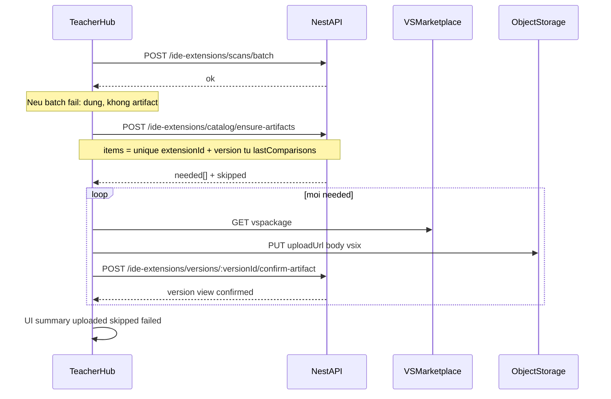

# Đồng bộ VSIX catalog lên object storage — thiết kế

**Ngày:** 2026-11-02 · **Trạng thái:** implementing (`docs/superpowers/plans/2026-11-02-ide-extension-vsix-storage-sync.md`)  

**Ứng dụng:** `apps/agent` (Teacher Hub) + `apps/api` (NestJS / TypeORM) + `apps/web` (catalog detail, hiển thị tối thiểu)  
**Builds on:** `2026-10-18-lab-management-ide-extensions-design.md` (catalog / version / «Đồng bộ lên hệ thống»); object storage S3-compatible (`StorageService`); runbook chuyển MinIO → Supabase `docs/deploy/03-storage-supabase.md`  
**Nguồn chốt:** plan hội thoại «Sync VSIX Storage» (2026-11-02) — điều kiện **1B**, gắn vào nút Đồng bộ; local **MinIO Docker**, production **Supabase Storage** chỉ bằng env

---

## 0. Vì sao có thay đổi này

Module Quản lý tiện ích IDE đã có:

- Catalog `ide_extension` + `ide_extension_version` (duyệt `pending` / `approved` / `rejected`).
- Teacher Hub: quét → đối chiếu allowlist → **Đồng bộ lên hệ thống** (`POST /ide-extensions/scans/batch`).
- Nút riêng **Tải VSIX extension vi phạm**: Hub tải `.vsix` từ VS Marketplace về `Downloads/cine-vsix` (local only).

Thiếu: bản binary của từng phiên bản **trên object storage của hệ thống** để sau này cài lại / phân phối / audit khi admin duyệt — kể cả version mới chỉ mới thấy trên máy SV và chưa được approve.

Phát triển hằng ngày dùng **MinIO trong Docker**; khi đưa lên production chỉ cần trỏ cùng abstraction sang **Supabase Storage** (S3-compatible), **không** fork code theo vendor.

---

## 1. Phạm vi

### 1.1 Trong phạm vi

| Hạng mục | Ghi chú |
|---|---|
| Gắn thu thập artifact vào **«Đồng bộ lên hệ thống»** | Sau `scans/batch`, best-effort |
| Điều kiện cần binary (**1B**) | Chưa có row version **hoặc** đã có row nhưng chưa có object / `storage_key` |
| Upsert catalog `pending` khi thiếu extension/version | Giống tinh thần `POST .../catalog/from-scan`; **không** auto-approve |
| Hub tải từ VS Marketplace → presigned PUT Storage → confirm | Security rule 5: bytes không qua Nest |
| Abstraction storage vendor-agnostic | Chỉ qua `StorageService` + `STORAGE_*`; MinIO local ↔ Supabase prod bằng env (§4.3) |
| Schema artifact trên `ide_extension_version` | `storage_key`, hash, size, uploaded_at |
| UI Hub: tóm tắt uploaded / skipped / failed | Không chặn thành công sync scan |
| Web catalog detail: badge/cột «Đã có file» | Chỉ đọc |

### 1.2 Ngoài phạm vi

- Thay / gộp nút **Tải VSIX extension vi phạm** (giữ tải local như hiện tại).
- Auto-approve version khi đã có file.
- Tạo wildcard `*` từ sync.
- Nút tải / cài VSIX từ web admin trong đợt này (chỉ badge).
- Đóng gói từ thư mục extension đã giải nén trên máy SV (chỉ Marketplace `vspackage`).
- Student Node tự upload lên Storage.
- Thay đổi verdict allowlist dựa trên việc có/không có artifact.
- SDK / client riêng của MinIO hoặc Supabase REST Storage API cho luồng VSIX.
- Migration dữ liệu object từ bucket MinIO local sang bucket Supabase (deploy mới / môi trường mới; không phải yêu cầu runtime của feature này).

---

## 2. Quyết định đã chốt

| # | Quyết định | Chi tiết |
|---|---|---|
| 1B | Khi nào cần artifact | `(extensionId, version)` **chưa có** row trong `ide_extension_version`, **hoặc** đã có row nhưng `storage_key` NULL / object không tồn tại trên Storage |
| 2 | Thời điểm chạy | Trong «Đồng bộ lên hệ thống», **sau** `POST .../scans/batch` thành công |
| 3 | Best-effort | Lỗi tải/upload/confirm từng VSIX **không** làm fail bước ghi kết quả quét |
| 4 | Nguồn file | Teacher Hub gọi Marketplace `.../vsextensions/{name}/{version}/vspackage` (tái dùng helper URL trong `apps/agent/src/lab-mgmt/violation-vsix.ts`) |
| 5 | Đường upload | Presigned PUT thẳng object storage (pattern materials / submissions / grading-reference) |
| 6 | Catalog | Thiếu → tạo extension + version `pending`; không tạo `*`; không đổi `approval_status` của row đã có |
| 7 | Candidate set | Mọi `(extensionId, version)` unique trong `lastComparisons` lần đối chiếu gần nhất — **mọi verdict**, không chỉ `blocked` |
| 8 | Backend storage | **Một** đường: mở rộng `StorageService` hiện có. Dev = MinIO Docker; prod = Supabase Storage S3 endpoint. Đổi môi trường **chỉ** bằng `STORAGE_*` — không nhánh `if (minio)` / `if (supabase)` trong code VSIX |
| 9 | Agent ↔ storage | Hub **không** đọc `STORAGE_*`. Chỉ nhận `uploadUrl` (và sau này `downloadUrl` nếu cần) từ API; URL đã mang endpoint đúng môi trường |

---

## 3. Luồng



### 3.1 Thứ tự bắt buộc trên Hub

1. Yêu cầu đã **Đối chiếu allowlist** (giữ gate hiện tại của `syncBackend`).
2. `POST .../scans/batch` — fail → `{ ok: false, error }` như hiện tại; **không** gọi ensure.
3. Thu thập candidates → `ensure-artifacts`.
4. Với mỗi phần tử `needed`: download → PUT → confirm; lỗi item → đếm `failed`, tiếp tục.
5. Trả `{ ok: true, artifact?: { uploaded, skipped, failed } }` (và có thể `failures[]` ngắn cho UI).

---

## 4. Schema & object key

### 4.1 Cột mới trên `ide_extension_version`

| Cột | Kiểu | Ghi chú |
|---|---|---|
| `storage_key` | varchar NULL | Key object; NULL = chưa có binary đã confirm |
| `artifact_sha256` | varchar(64) NULL | Hex SHA-256 của file Hub tải (khuyến nghị gửi lúc confirm) |
| `artifact_size_bytes` | bigint NULL | Số byte |
| `artifact_uploaded_at` | timestamptz NULL | Thời điểm confirm thành công |

Không thêm cột trạng thái artifact riêng: «có file» = `storage_key IS NOT NULL` (và object tồn tại tại thời điểm confirm).

### 4.2 Object key

`StorageService` thêm prefix + builder (cùng phong cách `buildMaterialKey`):

```
ide-extensions/{extensionPk}/{versionId}.vsix
```

- `extensionPk`, `versionId` = UUID server — **không** lấy identifier / semver / filename từ client để ghép path.
- Key **ổn định theo nội dung nghiệp vụ**, không chứa hostname MinIO / project-ref Supabase / URL tuyệt đối. DB chỉ lưu `storage_key` (relative key trong bucket); endpoint nằm ở env runtime.

Wire `StorageModule` vào `IdeExtensionsModule`.

### 4.3 Chuyển MinIO (local Docker) ↔ Supabase Storage (production)

Mục tiêu: feature VSIX chạy đúng trên cả hai môi trường; khi cần production chỉ đổi cấu hình, **không sửa code** IdeExtensions / Hub upload.

#### 4.3.1 Nguyên tắc

| Nguyên tắc | Chi tiết |
|---|---|
| Một abstraction | Mọi thao tác VSIX trên storage đi qua `StorageService`: `generateUploadUrl`, `objectExists`, (sau này) `generateDownloadUrl` / `deleteObject` nếu cần |
| Chỉ S3 API | `@aws-sdk/client-s3` + `@aws-sdk/s3-request-presigner` + `forcePathStyle: true` — đã tương thích MinIO và Supabase S3 endpoint (đã chứng minh cho submissions/materials; VSIX không được đi đường khác) |
| Cấu hình thuần env | `STORAGE_ENDPOINT`, `STORAGE_BUCKET`, `STORAGE_ACCESS_KEY`, `STORAGE_SECRET_KEY`, `STORAGE_REGION` — cùng bộ với phần còn lại của API |
| Không vendor lock trong feature | Cấm: `@supabase/storage-js`, MinIO JS SDK, hard-code `localhost:9010`, hard-code `*.storage.supabase.co`, nhánh theo tên backend |
| Agent mù vendor | Hub chỉ `PUT`/`GET` URL đã ký; không cấu hình bucket/credential storage trên máy GV |
| Cùng layout key | Prefix `ide-extensions/...` giống nhau trên MinIO và Supabase để code/path/DB không phụ thuộc môi trường |

#### 4.3.2 Local dev (MinIO Docker)

- Chạy stack hiện có: `docker compose up -d … minio …` (cùng MinIO dùng cho submissions).
- Env mẫu (đã có trong `apps/api/.env.example`):

```dotenv
STORAGE_ENDPOINT=http://localhost:9010
STORAGE_ACCESS_KEY=examcollect_admin
STORAGE_SECRET_KEY=examcollect_admin_password
STORAGE_BUCKET=examcollect-submissions
# STORAGE_REGION tùy chọn — MinIO bỏ qua; có thể để us-east-1
```

- Bucket **private**, đã dùng chung với submissions/materials; object VSIX là prefix mới trong cùng bucket (không bắt buộc bucket riêng). Nếu tạo bucket mới chỉ cho IDE: vẫn chỉ đổi `STORAGE_BUCKET`, không đổi code.
- Presigned URL Hub nhận sẽ trỏ `http://localhost:9010/...` — máy Teacher Hub phải reach được endpoint đó (cùng máy / LAN lab có route tới host MinIO). Đây là ràng buộc **dev/lab**, không phải contract production.

#### 4.3.3 Production (Supabase Storage)

- Làm theo runbook [`docs/deploy/03-storage-supabase.md`](../../deploy/03-storage-supabase.md): bucket private + S3 access keys (không dùng `service_role` / publishable key cho giao thức S3).
- Đổi **chỉ** env API (Railway / host prod):

```dotenv
STORAGE_ENDPOINT=https://<project-ref>.storage.supabase.co/storage/v1/s3
STORAGE_REGION=<region project, vd ap-southeast-1>
STORAGE_ACCESS_KEY=<access key id>
STORAGE_SECRET_KEY=<secret>
STORAGE_BUCKET=examcollect-submissions
```

- `STORAGE_REGION` **bắt buộc đúng** trên Supabase (SigV4); sai → `SignatureDoesNotMatch`.
- Sau đổi env: restart API. Hub không cần build lại vì URL ký đã mang endpoint mới.
- Kiểm chứng tối thiểu cho prefix VSIX (cùng tinh thần runbook §4): một vòng `ensure-artifacts` → Hub PUT → `confirm-artifact` → `objectExists` / HeadObject thành công trên Supabase.

#### 4.3.4 Checklist «dễ chuyển» khi implement (bắt buộc)

- [ ] Không thêm dependency storage vendor mới cho IdeExtensions.
- [ ] Không đọc / ghi URL tuyệt đối object vào Postgres — chỉ `storage_key`.
- [ ] Unit test API mock `StorageService`; không giả định hostname MinIO/Supabase.
- [ ] Manual/dev: một lần sync VSIX trên MinIO local OK.
- [ ] Khi cắt sang prod: chỉ cập nhật `STORAGE_*` theo `03-storage-supabase.md` + smoke PUT/confirm một `.vsix`.

---

## 5. API

JWT `teacher` \| `admin` (cùng nhóm route catalog / scans).

### 5.1 `POST /ide-extensions/catalog/ensure-artifacts`

**Body:**

```json
{
  "items": [
    { "extensionId": "ms-python.python", "version": "2024.12.0", "displayName": "Python" }
  ]
}
```

**Xử lý mỗi item (sau dedupe `extensionId+version` phía server cũng nên làm):**

1. Từ chối `version === '*'` (400 hoặc skip có lý do rõ).
2. Upsert extension + version `pending` nếu thiếu — reuse logic `upsertFromScan` / enrich Marketplace metadata best-effort.
3. Nếu row đã có `storage_key` **và** `objectExists(storage_key)` → **skip** (không trả upload URL).
4. Nếu thiếu binary (không key, hoặc key nhưng object mất): mint/rebuild key bằng `buildIdeExtensionKey`, `generateUploadUrl`, đưa vào `needed`.
5. **Không** đổi `approval_status` khi chỉ ensure artifact.

**Response:**

```json
{
  "needed": [
    {
      "versionId": "uuid",
      "extensionId": "ms-python.python",
      "version": "2024.12.0",
      "storageKey": "ide-extensions/.../...vsix",
      "uploadUrl": "https://...",
      "expiresIn": 900
    }
  ],
  "skipped": 3
}
```

### 5.2 `POST /ide-extensions/versions/:versionId/confirm-artifact`

**Body:** `{ "storageKey": "...", "sha256"?: "...", "sizeBytes"?: number }`

**Xử lý:**

1. Load version (+ extension).
2. Rebuild expected key từ `extensionPk` + `versionId`; nếu `storageKey` ≠ expected → **400**.
3. `objectExists` — nếu không → **400**, không ghi cột artifact.
4. Ghi `storage_key`, `artifact_*`, `artifact_uploaded_at = now()`.
5. Idempotent: confirm lại cùng key + object còn → 200, cập nhật metadata nếu client gửi lại.

**Response:** view version (kèm các field artifact) — cùng shape catalog detail dùng được.

### 5.3 OpenAPI / shared schema

Cập nhật `packages/shared` schema sau khi controller ổn định (như các endpoint IDE khác).

---

## 6. Agent (Teacher Hub)

### 6.1 `syncBackend` — `apps/agent/electron/main/lab-mgmt-runtime.ts`

Sau batch OK:

1. Build unique list từ `lastComparisons[].rows` → `{ extensionId, version, displayName? }`.
2. `POST .../catalog/ensure-artifacts` với Bearer token Hub.
3. Tách helper download Marketplace khỏi `downloadViolationVsixFiles` (cùng `vsixPackageUrl` / stream-to-buffer hoặc temp file) để reuse giữa nút local và sync Storage.
4. Với mỗi `needed`: download → `fetch(uploadUrl, { method: 'PUT', body })` → `confirm-artifact` (kèm `sha256` / `sizeBytes` nếu tính được).
5. Partial failure không đổi `ok: true` của sync (batch đã OK).

### 6.2 UI — `apps/agent/electron/renderer/src/components/mgmt/TeacherHubView.tsx`

Sau Đồng bộ thành công: hiện tóm tắt ngắn, ví dụ *«Đã ghi kết quả quét. VSIX: tải lên 2, bỏ qua 5, lỗi 1.»*  
Nếu mọi artifact fail: vẫn báo sync scan OK + cảnh báo phần VSIX.

### 6.3 Nút «Tải VSIX extension vi phạm»

Giữ nguyên: chỉ `blocked`, chỉ ghi `Downloads/cine-vsix`, không gọi Storage.

---

## 7. Web (tối thiểu)

Trang chi tiết catalog (`/admin/ide-utilities/[id]` hoặc tương đương):

- Bảng phiên bản thêm cột hoặc badge **«Đã có file»** khi API trả `storageKey` / `artifactUploadedAt`.
- Chưa bắt buộc nút download admin trong đợt này.

---

## 8. Ràng buộc & lỗi

| Tình huống | Hành vi |
|---|---|
| Marketplace 404 / timeout / file rỗng | Item `failed`; tiếp tục item khác |
| PUT Storage fail | Không gọi confirm; `failed` |
| Confirm khi object thiếu | 400; không ghi `storage_key` |
| Hai Hub sync cùng lúc | Unique `(extension_pk, version)`; ensure/confirm idempotent theo objectExists |
| Version `*` trong candidates | Không bao giờ vào `needed` |
| Extension sideload không có trên Marketplace | `failed` với message rõ; vẫn giữ row `pending` nếu vừa upsert |
| Hub không reach được `STORAGE_ENDPOINT` (vd. MinIO `localhost` từ máy khác) | PUT fail → `failed`; scan vẫn OK; message nên gợi ý kiểm tra mạng / endpoint |
| Đổi env sang Supabase nhưng sai `STORAGE_REGION` / key | Presign/PUT lỗi chữ ký; sửa env, không sửa code |
| DB có `storage_key` từ MinIO local, API đã trỏ Supabase trống | `objectExists` false → ensure trả lại `needed` (điều kiện 1B); Hub upload lại lên backend mới |

---

## 9. Kiểm thử

| Lớp | Ca |
|---|---|
| API | ensure: tạo pending + trả URL; skip khi object có; version `*` bị từ chối |
| API | confirm: key mismatch → 400; object thiếu → 400; happy path ghi cột |
| API | Key builder chỉ phụ thuộc UUID; không nhúng endpoint/vendor |
| Agent | `syncBackend`: batch fail → không ensure; batch OK → ensure; partial VSIX fail vẫn `ok: true` |
| Agent | Regression nút tải VSIX local (blocked → folder) |
| Agent | PUT chỉ dùng `uploadUrl` từ API — không đọc env storage trên Hub |
| Web | Badge hiện khi có `artifactUploadedAt` / `storageKey` |
| Thủ công | Sync một VSIX trên MinIO Docker local |
| Deploy | Sau đổi `STORAGE_*` sang Supabase: smoke ensure → PUT → confirm (theo §4.3.3) |

---

## 10. Tiêu chí xong

- [ ] Migration artifact trên `ide_extension_version` chạy được.
- [ ] `buildIdeExtensionKey` + `StorageModule` gắn IdeExtensions.
- [ ] `ensure-artifacts` + `confirm-artifact` đúng điều kiện 1B và Security rule 5.
- [ ] «Đồng bộ lên hệ thống» ghi scan rồi thu thập VSIX best-effort; UI có summary.
- [ ] Nút tải VSIX vi phạm local không đổi hành vi.
- [ ] Web detail hiện «Đã có file» cho version đã confirm.
- [ ] Test API + agent covering các ca §9.
- [ ] §4.3 thỏa: không vendor SDK mới; DB chỉ `storage_key`; đổi MinIO → Supabase chỉ bằng `STORAGE_*` (+ smoke).

---

## 11. Liên quan file chính

| Vùng | File |
|---|---|
| Entity / migration | `apps/api/src/ide-extensions/entities/ide-extension-version.entity.ts`, `apps/api/src/database/migrations/` |
| Storage | `apps/api/src/storage/storage.service.ts`, `storage.types.ts` |
| Env mẫu local / gợi ý Supabase | `apps/api/.env.example` |
| Runbook MinIO → Supabase | `docs/deploy/03-storage-supabase.md` |
| API | `ide-extensions.controller.ts`, `ide-extensions.service.ts`, `ide-extensions.module.ts` |
| Hub sync | `apps/agent/electron/main/lab-mgmt-runtime.ts` |
| Marketplace download | `apps/agent/src/lab-mgmt/violation-vsix.ts` (tách helper dùng chung) |
| UI Hub | `apps/agent/electron/renderer/src/components/mgmt/TeacherHubView.tsx` |
| Web API / detail | `apps/web/src/lib/api/ide-utilities.ts` + trang chi tiết catalog |
