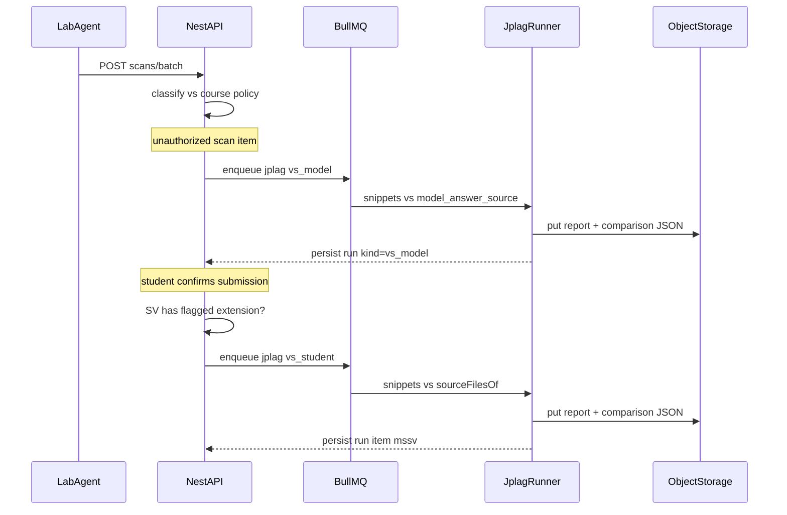

# JPlag trên phiên thi (extension trái phép → vs mẫu → vs bài nộp) — thiết kế

**Ngày:** 2026-11-15 · **Trạng thái:** draft  

**Ứng dụng:** `apps/api` (NestJS + BullMQ) + `apps/web` (teacher / grading / session) + tái dùng viewer demo  
**Builds on:**

- Chuẩn hóa snippet VSIX — [`2026-11-15-ide-extension-snippet-normalize-design.md`](./2026-11-15-ide-extension-snippet-normalize-design.md)
- Lab management / policy / scan — [`2026-10-18-lab-management-ide-extensions-design.md`](./2026-10-18-lab-management-ide-extensions-design.md)
- Demo JPlag (dual text + language, parse `.jplag`, FE highlight) — code tại `apps/api/src/ide-extensions/jplag/`, browse UI

**Implementation plan:** [`docs/superpowers/plans/2026-11-15-ide-extension-jplag-exam-flow.md`](../plans/2026-11-15-ide-extension-jplag-exam-flow.md)

---

## 0. Vì sao có thay đổi này

Admin đã có **demo** so snippet extension với ZIP upload tay. Trên phiên thi thật cần luồng có điều kiện:

1. Phát hiện SV cài **extension không được phép** (scan vs course policy / effective).
2. Với extension bị gắn cờ → so snippet đã chuẩn hóa với **đáp án mẫu** (`grading_reference`).
3. Khi SV **nộp bài** → nếu SV đó có extension cờ → so snippet với **mã nộp**.

Mục tiêu: hỗ trợ giáo viên đánh giá khả năng bài làm / snippet tiện ích trái phép ảnh hưởng đến mã nguồn, không thay sandbox grading.

---

## 1. Phạm vi

### 1.1 Trong phạm vi

| Hạng mục | Ghi chú |
|---|---|
| Gate phát hiện | Dựa scan batch + classify unauthorized / blocked |
| JPlag vs đáp án mẫu | Chỉ extension bị cờ; source từ `model_answer_source_key` |
| JPlag vs bài nộp | Trigger lúc confirm submission; chỉ SV có cờ |
| Core runner | Tách từ demo: stage, dual profile, parse report |
| Persist run | Metadata DB + report `.jplag` + comparison JSON trên Storage |
| UI teacher | Findings + dual similarity + viewer highlight (tái dùng demo) |

### 1.2 Ngoài phạm vi

- Student ↔ student plagiarism thuần (không qua extension).
- So mọi extension allowlist (chỉ nhánh vi phạm policy).
- Đổi contract scan agent / extract VSIX / normalize snippet (đã có).
- Monaco editor; chấm điểm tự động từ similarity.
- RAR submissions (cùng rule grading: không so được).

---

## 2. Quyết định đã chốt

| # | Quyết định | Chi tiết |
|---|---|---|
| 1 | Thứ tự nghiệp vụ | Scan/classify → vs-model → (khi nộp) vs-student |
| 2 | Điều kiện chạy JPlag | Chỉ extension **unauthorized** trên phiên |
| 3 | Bên A | `getNormalizedSources(versionId)` (Snippets-first) |
| 4 | Bên B vs-model | `grading_reference.model_answer_source_key` |
| 5 | Bên B vs-student | `submission.storage_key` → `sourceFilesOf` |
| 6 | Dual profile | `text` + `language` (JS/TS: SWC; cpp/python: native + text) như demo |
| 7 | vs-model dedupe | Một run (pending/done) per `(examSessionId, versionId)` — không nhân theo từng SV |
| 8 | vs-student | Một item per `(session, versionId, mssv, deliverable)` khi confirm nộp |
| 9 | Async | BullMQ cho vs-model và vs-student; demo sync giữ nguyên |
| 10 | Roles | Teacher/admin xem findings; không lộ comparison chi tiết cho SV |

---

## 3. Luồng

---

## 4. Dữ liệu & storage

### 4.1 Entity (gợi ý tên)

**`ide_extension_jplag_run`**

| Cột | Ý nghĩa |
|---|---|
| `id` | uuid |
| `exam_session_id` | FK phiên |
| `extension_id` / `version_id` | Extension bị cờ |
| `kind` | `vs_model` \| `vs_student_batch` (hoặc chỉ dùng item cho student) |
| `status` | `pending` \| `running` \| `completed` \| `failed` |
| `language` | Ưu tiên đề (`exam_problem.language`), thiếu thì fallback `required_deliverable.code_project.language` |
| `trigger` | `scan` \| `submission` \| `manual` |
| `error` | nullable |
| timestamps | |

**`ide_extension_jplag_run_item`** (vs-student; vs-model có thể 1 row “synthetic” hoặc cột trên run)

| Cột | Ý nghĩa |
|---|---|
| `run_id` | FK |
| `student_mssv` | nullable với vs_model |
| `similarity_text` / `similarity_language` | float |
| `cli_language` | string |
| `report_storage_key` | `.jplag` |
| `comparison_storage_key` | JSON parse sẵn cho FE |
| `status` / `error` | |

Unique gợi ý:

- vs_model: `(exam_session_id, version_id, kind=vs_model)` khi status ∈ pending|running|completed
- vs_student: `(exam_session_id, version_id, student_mssv, required_deliverable_id)`

### 4.2 Object keys

Tái dùng prefix ide-extensions / session, ví dụ:

`ide-extensions/{extensionPk}/{versionId}/jplag/{examSessionId}/{runId}/{profile}.jplag`  
`…/comparison-{profile}.json`

---

## 5. API (teacher)

| Method | Path (gợi ý) | Việc |
|---|---|---|
| (internal) | Sau `scans/batch` | Enqueue vs_model nếu unauthorized mới |
| (internal) | Sau submission confirm | Enqueue vs_student nếu SV có cờ |
| `GET` | `/exam-sessions/:id/jplag/runs` | List findings |
| `GET` | `/exam-sessions/:id/jplag/runs/:runId` | Chi tiết + items |
| `GET` | `/…/items/:itemId` | Comparison JSON (hoặc Presigned) cho viewer |
| `POST` | `/…/jplag/vs-model` (manual retry) | Teacher chạy lại vs mẫu |
| `POST` | `/…/jplag/vs-student` (manual) | Retry một MSSV |

Demo `POST …/jplag-demo` giữ cho admin browse; gọi chung `JplagRunner`.

---

## 6. Core runner

Tách từ `jplag-demo.service.ts`:

- Input: `{ language, extensionItems, compareFiles: {path,content}[], profiles }`
- Stage temp `submissions/{extension,compare}`; cwd tương đối (Windows-safe)
- Dual run `text` rồi `swc`/native; parse qua `parseJplagReportBuffer`
- Không phụ thuộc Multer / versionId (caller cung cấp items + files)

---

## 7. UI

- Panel trên exam session / grading: danh sách extension trái phép + trạng thái JPlag vs mẫu.
- Sau nộp: bảng MSSV × extension — % text / % language.
- Click → tái dùng `JplagComparisonViewer` (scroll pane + match sync).
- Link tải `.jplag` tùy chọn (Presigned).

---

## 8. Rủi ro & ràng buộc

| Rủi ro | Xử lý |
|---|---|
| Chưa có `model_answer_source_key` | Run `failed` + message; không silent skip mãi |
| Snippet JS vs đáp án cpp | Language từ deliverable; nếu mismatch snippet language → skip / fail rõ |
| N nộp đồng thời | Queue + unique item; idempotent enqueue |
| Report truncated Windows | Giữ relative cwd như demo |
| Privacy | Comparison chỉ teacher/admin |

---

## 9. Tiêu chí xong (design)

- [x] Spec + plan trong `docs/superpowers/`
- [x] Gate unauthorized → vs_model documented
- [x] Submission confirm → vs_student documented
- [x] Core / entity / API / UI seams cited
- [x] Explicit non-goals (student↔student, allowlist JPlag)
