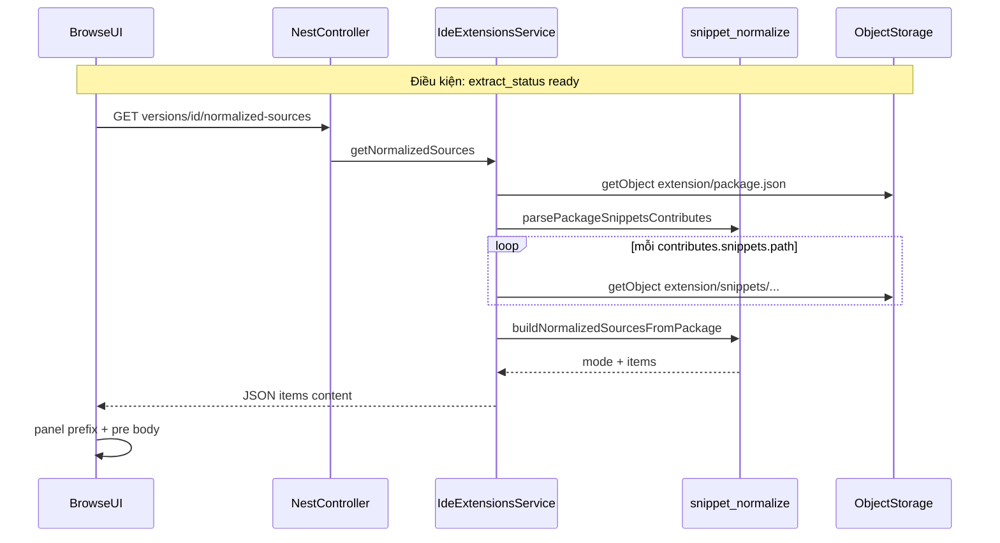

# Chuẩn hóa mã từ VSIX (Snippets-first) — thiết kế

**Ngày:** 2026-11-15 · **Trạng thái:** implemented (`docs/superpowers/plans/2026-11-15-ide-extension-snippet-normalize.md`)  

**Ứng dụng:** `apps/api` (NestJS) + `apps/web` (admin/teacher Code Browser)  
**Builds on:** [`2026-11-02-ide-extension-vsix-code-browser-design.md`](./2026-11-02-ide-extension-vsix-code-browser-design.md) (`extract_status=ready`, `extracted/`, browse UI)  
**Implementation plan:** [`docs/superpowers/plans/2026-11-15-ide-extension-snippet-normalize.md`](../plans/2026-11-15-ide-extension-snippet-normalize.md)  
**Commit tham chiếu:** `b2caf65f` — `feat(ide-extensions): normalize Snippets sources and browse viewer`

---

## 0. Vì sao có thay đổi này

Code Browser đã cho xem cây file trong `.vsix`, nhưng với extension loại **Snippets** (ví dụ PTGDUD / React Bootstrap Kit), mã nguồn thật nằm trong `body` của `.code-snippets`, không phải `src/`. Admin/teacher cần **bung** các body đó thành mã đọc được, lấy đường dẫn từ `package.json` → `contributes.snippets[].path`.

Pha này chỉ chuẩn hóa + xem. So sánh JPlag với đáp án mẫu là pha sau.

---

## 1. Phạm vi

### 1.1 Trong phạm vi (Pha 1 — đã làm)

| Hạng mục | Ghi chú |
|---|---|
| Parse Snippets-first | Đọc `extension/package.json` → `contributes.snippets` → file `.code-snippets` |
| Bung `body` | `string` hoặc `string[]` → `content` (join `\n`) |
| Strip tabstop | Mặc định `${1:Name}` → `Name`; `?raw=1` giữ nguyên |
| API on-demand | `GET …/normalized-sources` khi extract `ready` |
| UI trên browse | Nút «Xem mã đã chuẩn hóa» → panel list + `<pre>` |
| Fixture | `sample extension/hungzazed01.react-bootstrap-kit-0.1.2-sample/` |
| Unit tests | Lib + service |

### 1.2 Ngoài phạm vi (Pha này)

- Lưu body / file synthetic vào Postgres hoặc prefix `normalized/` trên Storage.
- Fallback liệt kê `extension/src/**` khi không có snippets (API trả `mode: 'none'`).
- JPlag / so đáp án mẫu / queue JAR / migration `jplag_run` — xem [`2026-11-15-ide-extension-jplag-exam-flow-design.md`](./2026-11-15-ide-extension-jplag-exam-flow-design.md).
- Monaco / editor diff.
- Đổi luồng extract VSIX hiện có.

---

## 2. Quyết định đã chốt

| # | Quyết định | Chi tiết |
|---|---|---|
| 1 | Nguồn sự thật | Vẫn `extracted/` sau extract; normalize **tính lại** mỗi request |
| 2 | Không persist mã | Không cột DB cho content; không `putObject` synthetic đợt này |
| 3 | Snippets-first | Chỉ đường `contributes.snippets`; không đoán mù thư mục `snippets/` |
| 4 | Path an toàn | Resolve relative dưới `extension/`; reuse sanitize Zip Slip (`..` / absolute → 400) |
| 5 | Trần | ≤ 200 snippet / response; ≤ 100 000 ký tự / item (`truncated: true`); file snippet ≤ 2 MB |
| 6 | Roles | `teacher` \| `admin` (cùng browse) |
| 7 | UI | Ở lại route browse; chế độ `files` \| `normalized` |
| 8 | Bytes | Response JSON có `content` text (đã bung) — khác browse/file (Presigned). Chỉ mã đã parse từ snippet, không stream archive |

---

## 3. Luồng



---

## 4. API

### `GET /ide-extensions/versions/:versionId/normalized-sources`

- Query: `raw=1` \| `true` — không strip tabstop.
- 200:

```json
{
  "mode": "snippets",
  "packageName": "react-bootstrap-kit",
  "items": [
    {
      "id": "ptgdud-footer",
      "prefix": "ptgdud:footer",
      "title": "React Bootstrap Footer (Custom)",
      "language": null,
      "path": "extension/snippets/snippets.code-snippets",
      "content": "const Footer = () => {\n  ...",
      "truncated": false
    }
  ]
}
```

- `mode: "none"` khi không có `contributes.snippets` (items rỗng).
- 400: extract chưa ready / thiếu `package.json` / path xấu / parse lỗi / thiếu file snippet.
- 404: không có version.

---

## 5. Chuẩn hóa (lib)

File: `apps/api/src/ide-extensions/normalize/snippet-normalize.ts`

1. `resolveSnippetContributePath('./snippets/a.code-snippets')` → `extension/snippets/a.code-snippets`.
2. Mỗi entry trong `.code-snippets`: `prefix`, `title` (key), `body` → `content`.
3. `safeIdFromPrefix('ptgdud:footer')` → `ptgdud-footer` (độc nhất trong list).
4. `language` lấy từ `contributes.snippets[].language` nếu có (sample PTGDUD không có → `null`).

Cấu trúc sample:

```text
extension/
  package.json                 # contributes.snippets[].path
  snippets/snippets.code-snippets
```

---

## 6. UI

Trang: `apps/web/.../versions/[versionId]/browse/page.tsx` (title «Xem nội dung VSIX»).

- Khi `browse.status === 'ready'`: hiện «Xem mã đã chuẩn hóa».
- Panel: trái danh sách `prefix` + title; phải `<pre>` content.
- «← Quay lại cây file VSIX» để về chế độ browse file.

Client: `getVersionNormalizedSources` trong `apps/web/src/lib/api/ide-utilities.ts`.

---

## 7. Pha 2+ (spec/plan riêng)

JPlag trên phiên (detect unauthorized → vs mẫu → vs bài nộp):  
[`2026-11-15-ide-extension-jplag-exam-flow-design.md`](./2026-11-15-ide-extension-jplag-exam-flow-design.md).

---

## 8. Tiêu chí xong (Pha 1)

- [x] Lib + unit với fixture sample (prefix `ptgdud:footer`, …).
- [x] `GET normalized-sources` + test service.
- [x] Nút + panel trên browse.
- [x] Không persist content vào DB; không JPlag.
- [x] Fixture `sample extension/` trong repo.
