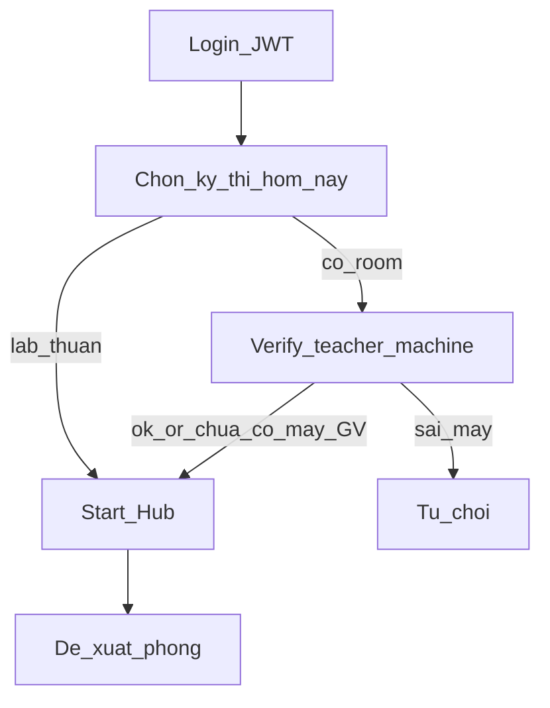

# Agent Quản lý — kỳ thi hôm nay + máy giảng viên — thiết kế

**Ngày:** 2026-11-18 · **Trạng thái:** implemented  

**Ứng dụng:** `apps/agent` (Electron Quản lý) + `apps/api` + `apps/web` (master-data Máy tính)  
**Builds on:** [`2026-10-18-lab-management-ide-extensions-design.md`](./2026-10-18-lab-management-ide-extensions-design.md)  
**Nguồn chốt:** hội thoại 2026-11-18 — list kỳ thi hôm nay sau login GV; máy giảng viên = cờ DB + enforcement (A+C); admin gắn lại được  
**Implementation plan:** [`../plans/2026-11-18-agent-mgmt-today-exams-teacher-machine.md`](../plans/2026-11-18-agent-mgmt-today-exams-teacher-machine.md)

---

## 0. Vì sao

Sau login Quản lý, GV cần chọn **kỳ thi bắt đầu hôm nay** để gắn ngữ cảnh môn/phòng. Mỗi phòng lab có **đúng một máy giảng viên** trong master-data; chỉ máy đó được chạy Teacher Hub / gửi đề xuất khi phòng đã có máy GV.

---

## 1. Phạm vi

**Trong:** list kỳ thi hôm nay (owner); `computer.is_teacher_machine` + `agent_machine_id`; admin set/reassign; accept đề xuất set cờ; agent verify trước Hub (khi có `roomId`) và trước propose gắn phòng đã có máy GV; UI agent chọn phiên.

**Ngoài:** đổi luồng Vào phiên thi; kick Hub realtime khi admin đổi cờ; cho GV tự đổi cờ từ agent.

---

## 2. Quyết định

| # | Quyết định |
|---|---|
| 1 | «Hôm nay» = `start_time` trong ngày `Asia/Ho_Chi_Minh` |
| 2 | Owner = JWT teacher/admin; status ∈ scheduled \| not_ready \| active \| collecting |
| 3 | Chọn phiên → `examSessionId` + `courseId` (từ lớp) + `roomId` trên runtime Hub |
| 4 | Không có kỳ thi hôm nay → vẫn vào Hub lab thuần (cảnh báo) |
| 5 | `is_teacher_machine boolean NOT NULL DEFAULT false`; partial unique `(room_id) WHERE is_teacher_machine` |
| 6 | `agent_machine_id varchar(64) NULL` — map UUID agent; verify ưu tiên field này, fallback hostname+MAC |
| 7 | Admin reassign bất cứ lúc nào (transaction clear cũ → set mới) |
| 8 | Mở Quản lý: resolve máy → thẳng form GV hoặc SV (không chọn role). Login GV: máy GV, hoặc máy thuộc phòng **chưa** có máy GV. Máy không có trong catalog → từ chối. |
| 9 | Accept đề xuất: máy `role=teacher_hub` → `is_teacher_machine=true` + `agent_machine_id=machineId` |

---

## 3. Luồng agent

---

## 4. API

- `GET /exam-sessions/mgmt/today` — teacher\|admin  
- `POST /ide-extensions/lab/teacher-machine/verify` — `{ machineId, hostname?, macAddress?, roomId? }` → `{ ok, reason, teacherMachine? }`  
- `POST /master-data/computers/:id/set-teacher-machine` — admin `{ isTeacherMachine: boolean }`

---

## 5. UI

- Agent: bước chọn kỳ thi sau login; Hub hiện tên phiên / môn; ẩn Course UUID tay khi đã chọn phiên.  
- Web Máy tính: cột «Máy GV» + nút «Đặt làm máy giảng viên».
