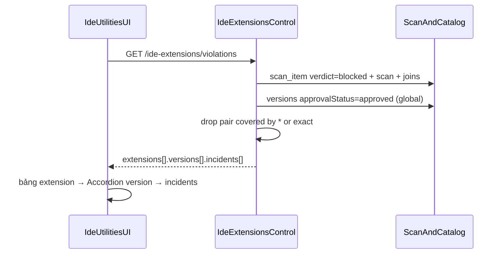

# Quản lý tiện ích IDE — Catalog + Vi phạm (UI 2 tab) — thiết kế

**Ngày:** 2026-11-18 · **Trạng thái:** implemented  

**Ứng dụng:** `apps/api` (NestJS / TypeORM) + `apps/web` (admin/teacher `ide-utilities`)  
**Builds on:** UC13 / [`sequence-uc13-ide-utilities-bce.md`](../../sequence-uc13-ide-utilities-bce.md); allowlist compare agent [`allowlist-compare.ts`](../../../apps/agent/src/lab-mgmt/allowlist-compare.ts); scan sync `POST /ide-extensions/scans/batch`  
**Nguồn chốt:** hội thoại 2026-11-18 — UI **2 tab (1A)**; định nghĩa vi phạm **2B** (blocked trên scan và chưa được duyệt global khớp version)  
**Implementation plan:** [`docs/superpowers/plans/2026-11-18-ide-utilities-violations-ui.md`](../plans/2026-11-18-ide-utilities-violations-ui.md)

---

## 0. Vì sao có thay đổi này

Trang Tiện ích IDE hiện có 3 tab: Catalog / Theo môn / Kết quả quét. Tab quét theo từng máy/MSSV khó trả lời câu hỏi vận hành: **extension nào đang vi phạm, version nào, những sinh viên / kỳ thi nào**. Tab Theo môn ít dùng trên màn hình quản lý catalog.

Cần gom lại thành 2 chế độ xem: quản lý allowlist catalog, và danh sách extension còn vi phạm (chưa duyệt khớp).

---

## 1. Phạm vi

### 1.1 Trong phạm vi

| Hạng mục | Ghi chú |
|---|---|
| UI 2 tab | Catalog · Vi phạm |
| Bỏ tab Theo môn khỏi trang | API course policy vẫn giữ cho Hub / `GET effective` |
| Bỏ tab Kết quả quét theo máy | Thay bằng gom theo extension |
| API gom vi phạm | `GET /ide-extensions/violations` |
| Accordion theo version | Kỳ thi, môn, MSSV, họ tên SV |
| Thêm vào catalog từ tab Vi phạm | Tái dùng `POST catalog/from-scan` |

### 1.2 Ngoài phạm vi

- Xóa / deprecate API course policy hoặc scan list.
- Đổi logic gán `verdict` trên agent (vẫn `compareInventory` + `GET effective`).
- JPlag / Code Browser / extract VSIX.
- Phân quyền mới: vẫn `admin` \| `teacher` (teacher xem; chỉ admin thêm catalog / duyệt version trên Catalog detail).

---

## 2. Quyết định đã chốt

| # | Quyết định | Chi tiết |
|---|---|---|
| 1 | Tab Theo môn | **1A** — bỏ khỏi UI trang Tiện ích IDE |
| 2 | Định nghĩa dòng Vi phạm | **2B** — cặp `(extensionId, version)` từng có `scan_item.verdict = blocked`, **và** hiện **chưa** được allowlist **global** phủ (không tính course policy để gỡ khỏi list) |
| 3 | Khi biến mất khỏi tab Vi phạm | Admin duyệt global version đúng chuỗi **hoặc** duyệt `*` cho mã đó |
| 4 | `blocked` nghĩa là gì | Không khớp rule effective lúc đối chiếu Hub — **không** đồng nghĩa «chưa có trong Catalog» |
| 5 | Surface | Cùng `/admin/ide-utilities` và `/teacher/ide-utilities` (re-export); không route riêng |
| 6 | Accordion | Mở theo **version**; mỗi incident: kỳ thi, môn, MSSV, họ tên |
| 7 | Họ tên SV | Join `student` theo `mssv`; thiếu hồ sơ → `null` / hiển thị `—` |
| 8 | Kỳ thi / môn | Từ `ide_extension_scan.exam_session_id` / `course_id` (+ snapshot `exam_session.name`, `course_name` / `course.name`) |

---

## 3. Quy tắc `blocked` (tham chiếu, không đổi)

Hub: `GET /ide-extensions/effective` → `compareInventory`.

- `allowed` nếu khớp global (`wildcard` / `exact`) hoặc course (`any`).
- `blocked` nếu không khớp rule nào (`matchedScope = null`).
- Verdict lưu trên `ide_extension_scan_item` khi sync batch.

Tab Vi phạm **đọc** các item `blocked` lịch sử rồi **lọc** theo trạng thái duyệt catalog hiện tại (mục 2 #2–3).

---

## 4. Luồng dữ liệu tab Vi phạm



---

## 5. Contract API

### `GET /ide-extensions/violations`

**Roles:** `admin` \| `teacher`

**Response (mảng extension, sort `extensionId` ASC):**

```ts
type ViolationIncident = {
  scanId: string;
  scanItemId: string;
  examSessionId: string | null;
  examSessionName: string | null;
  courseId: string | null;
  courseName: string | null;
  studentMssv: string;
  studentFullName: string | null;
  machineId: string;
  machineName: string | null;
  scannedAt: string; // ISO
};

type ViolationVersion = {
  version: string | null;
  incidentCount: number;
  incidents: ViolationIncident[]; // scannedAt DESC
};

type ViolationExtension = {
  extensionId: string; // publisher.name
  displayName: string | null;
  publisher: string | null;
  inCatalog: boolean;
  catalogExtensionPk: string | null; // UUID catalog nếu có
  versionCount: number;
  incidentCount: number;
  studentCount: number; // distinct mssv
  versions: ViolationVersion[]; // version ASC, null cuối
};
```

**Lọc 2B (server):** sau khi gom mọi `blocked`, bỏ cặp nếu tồn tại version catalog:

- `identifier = extensionId` AND `version = '*'` AND `approvalStatus = 'approved'`, **hoặc**
- `identifier = extensionId` AND `version = <version item>` AND `approvalStatus = 'approved'`  
  (item `version = null`: chỉ bị loại khi có `*` approved).

---

## 6. UI

### Tab Catalog

Giữ form thêm + bảng hiện tại; mô tả page cập nhật (bỏ «theo môn / kết quả quét»). Chi tiết `/[id]` không đổi.

### Tab Vi phạm

- Bảng cột gần Catalog: Extension name, Publisher, Identifier, #version, #lần, #SV.
- Click hàng → mở panel / expand danh sách version.
- Mỗi version: Accordion header `version` + `incidentCount`; body bảng incidents (Kỳ thi, Môn, MSSV, Họ tên; có thể thêm máy / thời điểm phụ).
- Admin: nút «Thêm vào catalog» trên version (gọi `catalogFromScan`). Teacher: chỉ xem (ẩn nút nếu không phải admin — hoặc gọi API và nhận 403; ưu tiên ẩn theo role nếu UI đã biết; nếu chưa có role hook thì hiện và để API chặn).

**Quyết định UI role:** trang đã dùng chung admin/teacher; hiện nút Thêm vào catalog; API `@Roles('admin')` trên `from-scan` giữ nguyên.

Empty state: «Chưa có extension vi phạm chưa được duyệt.»

---

## 7. Kiểm thử

- Unit: helper lọc pair covered by `*` / exact / null version.
- Service/spec: gom 2 scan cùng extension@version → 1 extension, 1 version, 2 incidents; duyệt exact → list rỗng cho pair đó; `*` → mọi version của mã biến mất.
- Không regression catalog list/create.

---

## 8. Ngoài / follow-up

- Deep-link từ incident → phiên thi grading.
- Filter theo `examSessionId` / khoảng ngày trên API.
- Đưa lại course policy UI chỗ khác nếu cần.
