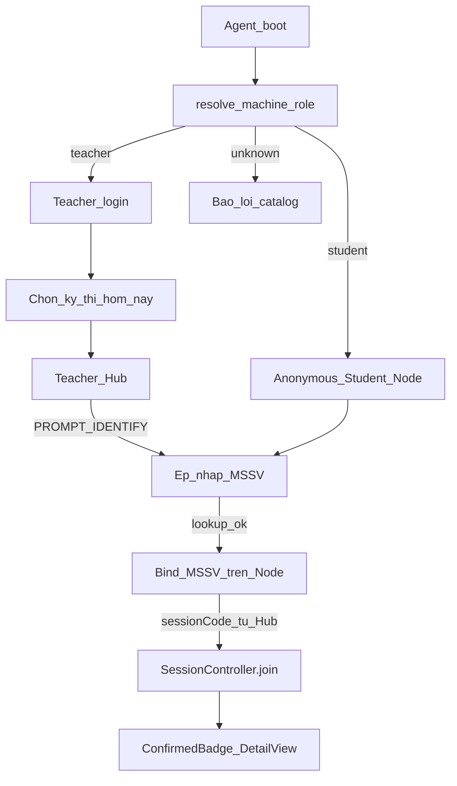

# Hub ép MSSV + auto join phiên thi — thiết kế

**Ngày:** 2026-11-28 · **Trạng thái:** implemented  

**Ứng dụng:** `apps/agent` (Electron)  
**Builds on:** [`2026-10-18-lab-management-ide-extensions-design.md`](./2026-10-18-lab-management-ide-extensions-design.md), [`2026-11-18-agent-mgmt-today-exams-teacher-machine-design.md`](./2026-11-18-agent-mgmt-today-exams-teacher-machine-design.md), [`2026-09-01-student-agent-electron-design.md`](./2026-09-01-student-agent-electron-design.md)  
**Implementation plan:** [`../plans/2026-11-28-hub-prompt-identify-exam-join.md`](../plans/2026-11-28-hub-prompt-identify-exam-join.md)

---

## 0. Vì sao

GV chọn kỳ thi trên Teacher Hub cần **chủ động** bắt máy SV nhập MSSV rồi vào đúng phiên đó, không phụ thuộc SV tự chọn landing / gõ mã 6 ký tự.

---

## 1. Quyết định đã chốt

| # | Quyết định |
|---|---|
| 1B | Sau MSSV hợp lệ → agent tự `SessionController.join` với `sessionCode` GV đã chọn (không gõ mã) |
| 2C | Máy catalog: bỏ landing 2 nút - SV thẳng chờ Hub; GV thẳng login / Hub |
| 3 | Contract server `agent:join` **giữ nguyên** (MSSV + code qua `/exam-live`) |
| 4 | Mở phiên (`active`) vẫn trên web exam-live; join lỗi `SESSION_NOT_ACTIVE` nếu chưa mở |
| 5 | Hub lab thuần (không gắn kỳ) **không** gửi prompt join |
| 6 | Rate limit / roster / access-request không bypass |

---

## 2. Luồng

---

## 3. LAN

Lệnh mới trên `LabCommandName`:

- `PROMPT_IDENTIFY` - payload `{ sessionCode: string; examLabel?: string }`
- `CANCEL_IDENTIFY` - hủy overlay (payload rỗng)

Node ack `ok: true` rồi emit sự kiện UI; không join trong handler TCP (join sau khi SV submit MSSV).

---

## 4. UI

- **Teacher Hub:** nút «Yêu cầu SV nhập MSSV và vào phiên» - disabled khi thiếu `examSessionCode`.
- **Máy SV:** màn chờ Hub; overlay nhập MSSV khi nhận `PROMPT_IDENTIFY`.
- Khi `joinPhase === 'joined'`, UI exam vẫn thắng như hiện tại.

---

## 5. Ngoài phạm vi

- Lobby / mở / finalize phiên trên agent
- Deep-link web exam-live
- Unlock rate-limit từ Hub
